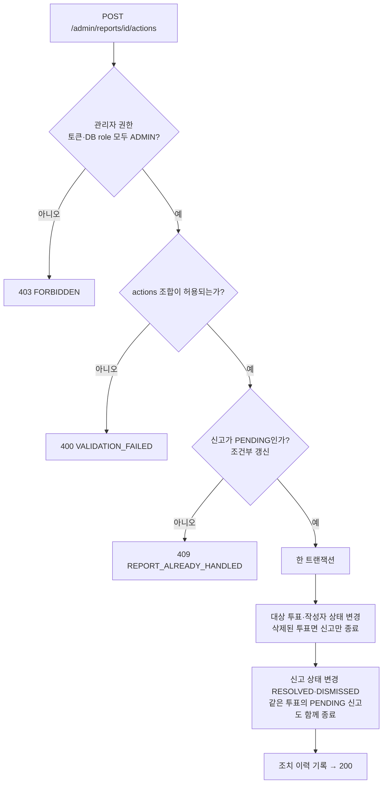

# AuDDum API 명세서

| 항목 | 내용 |
| --- | --- |
| 버전 | v1 |
| 작성일 | 2026-10-12 |
| 작성자 | 태풍 |
| 관련 문서 | [AuDDum 예외·정책 명세서](예외-정책.md), [AuDDum ERD 설계](ERD.md), [AuDDum 인증·중복 참여 설계서](인증-중복-참여.md) |

## 요약

어떰의 REST API 17개를 정리했다. 인증·회원 6개, 투표 4개, 참여 1개, 신고 1개, 관리자 5개다. 핵심 규칙은 네 가지다.

- 참여 API는 하나이며 인증 쿠키 유무로 회원·비회원을 구분한다. 같은 선택의 재전송은 200, 다른 선택은 409다.
- 마감 전 결과는 참여한 사람에게만, 마감 후에는 모두에게 공개한다. 서버는 득표 수만 내려준다.
- 투표는 외부에 12자 `publicId`로만 노출하고 선택지는 `position`으로 가리킨다.
- 모든 오류는 ProblemDetail이고 오류 코드는 확장 필드 `code`로 내려간다.

## 목차

1. [공통 규칙](#1-공통-규칙)
2. [인증·회원 API](#2-인증회원-api)
3. [투표 API](#3-투표-api)
4. [참여·결과 API](#4-참여결과-api)
5. [신고 API](#5-신고-api)
6. [관리자 API](#6-관리자-api)
7. [오류 코드 목록](#7-오류-코드-목록)
8. [미정 항목](#8-미정-항목)

## 1. 공통 규칙

모든 엔드포인트에 적용되는 규칙이다. 개별 API는 이 규칙과 다른 점만 적는다.

| 항목 | 규칙 |
| --- | --- |
| 기본 경로 | `/api/v1`, JSON(UTF-8) |
| 시각 | ISO-8601, KST 오프셋 포함 (예: `2026-10-12T13:00:00+09:00`) |
| 인증 | 액세스·리프레시 토큰은 HttpOnly 쿠키로만 주고받는다. 비회원은 익명 식별 쿠키를 쓰며 첫 참여나 첫 신고 때 서버가 발급한다. |
| 권한 표기 | 이 문서에서는 `비회원 가능`, `회원(ACTIVE)`, `관리자`로 적는다. 회원 상태는 쓰기 요청마다 DB에서 확인한다. |
| 투표 식별자 | 외부에는 12자 `publicId`만 쓰며 응답 필드 이름은 `id`다. 내부 BIGINT id는 노출하지 않는다. |
| 선택지 식별자 | 투표 안의 순번 `position`(1~5)으로 가리킨다. |
| 관리자 API 식별자 | 신고·회원은 내부 숫자 id를 쓴다. 관리자 전용이라 허용한다. |
| 페이징 | 커서 방식이다. 요청은 `cursor`, `size`(기본 20, 최대 50), 응답은 `items`와 `nextCursor`(마지막이면 null). 커서는 외부에서 해석할 수 없는 문자열이다. |
| 득표율 | 서버는 득표 수(`count`)와 전체 참여 수(`total`)만 내려주고, 비율 표기와 반올림은 클라이언트가 한다. |
| 알 수 없는 요청 필드 | 거부하지 않고 무시한다. MVP 범위 밖인 이미지·링크 필드가 와도 저장하지 않는다. |
| 멱등성 | 별도 요청 키는 없다. 유니크 제약으로 중복을 막고, 같은 선택의 재시도는 200으로 응답한다. |

각 엔드포인트의 JSON 예시는 필드 구성을 보여주는 용도이며 값은 임의다. 투표 결과(`result`)는 `total`과 선택지별 `position`·`count`로 구성한다.

**오류 응답 형식**

모든 오류는 ProblemDetail(RFC 7807)이며 확장 필드로 오류 코드를 담는다. 응답의 `Content-Type`은 `application/problem+json`이다.

| 필드 | 설명 |
| --- | --- |
| `type` | 기본값 `about:blank`. 기본값이면 응답에서 생략한다(RFC 7807에서 생략은 `about:blank`와 같다). |
| `title` | 상태 코드의 짧은 설명 |
| `status` | HTTP 상태 코드 |
| `detail` | 사람이 읽는 설명. 내부 오류의 상세는 담지 않는다. |
| `instance` | 요청 경로 |
| `code` | 오류 코드(7절의 목록). 클라이언트는 이 값으로 분기한다. |
| `errors` | 입력 검증 실패 때만 담는다. `{field, reason}` 목록 |

오류 응답 예시(입력 검증 실패, 400)

```json
{
  "title": "Bad Request",
  "status": 400,
  "detail": "요청 값이 올바르지 않습니다.",
  "instance": "/api/v1/polls",
  "code": "VALIDATION_FAILED",
  "errors": [
    { "field": "options", "reason": "선택지는 2~5개여야 합니다." }
  ]
}
```

**인증·인가 실패의 구분**

- 로그인이 필요한 API를 인증 없이 호출하면 401이다.
- 로그인했지만 상태나 권한 때문에 막히면 403이다. 정지 회원은 `MEMBER_SUSPENDED`, 권한 없음은 `FORBIDDEN`이다.
- 관리자 API도 권한이 없으면 404가 아니라 403이다.

## 2. 인증·회원 API

로그인 시작과 콜백은 Spring Security OAuth2 Client(`oauth2Login`)가 제공하는 경로를 그대로 쓴다. 컨트롤러를 만들지 않고, 응답은 JSON이 아니라 리다이렉트다. 순서는 아키텍처 설계서의 카카오 로그인 다이어그램과 같다.

| 메서드와 경로 | 권한 | 성공 응답 | 설명 |
| --- | --- | --- | --- |
| `GET /oauth2/authorization/kakao` | 비회원 가능 | 302 | 로그인 시작(프레임워크 제공). 카카오 동의 화면으로 이동시킨다. |
| `GET /login/oauth2/code/kakao` | 비회원 가능 | 302 | 콜백(프레임워크 제공). 카카오가 호출하며 로그인 처리 후 원래 페이지로 이동시킨다. |
| `POST /auth/refresh` | 리프레시 쿠키 | 204 | 토큰 재발급 |
| `POST /auth/logout` | 로그인 회원 | 204 | 로그아웃 |
| `GET /members/me` | 로그인 회원 | 200 | 내 정보 조회 |
| `DELETE /members/me` | 회원(정지 포함) | 204 | 탈퇴 |

로그인 시작·콜백 경로는 스프링 기본값이다. 카카오 개발자 콘솔의 리다이렉트 URI에 콜백 주소를 등록해야 한다. 이 두 경로는 `/api/v1` 아래가 아니다.

**로그인 시작: GET /oauth2/authorization/kakao**

- 프레임워크가 state를 만들어 보관하고 카카오 인가 페이지로 302한다. 프런트는 이 주소로 이동만 한다.
- 로그인 뒤 돌아갈 서비스 내부 경로는 `redirect` 파라미터로 받아 보관한다. 보관 방식은 구현 때 정한다.
- state는 기본이 세션 저장이다. 로그인 상태는 JWT로 유지하므로 로그인 과정에서만 세션 또는 쿠키 기반 저장소를 쓰는 것으로 한다.

**콜백: GET /login/oauth2/code/kakao**

- 요청 파라미터 `code`, `state`. 카카오 화면에서 취소하면 `error`가 오고 가입 없이 이전 화면으로 보낸다.
- state 검증, 토큰 교환, 카카오 유저 정보 조회는 필터가 처리한다. 직접 구현하는 것은 세 가지다.
- `OAuth2UserService`: 카카오 식별자로 회원을 조회하고 없으면 ACTIVE 회원으로 가입시킨다. 탈퇴한 계정은 새 회원으로 가입하고, 정지 회원도 로그인은 허용한다.
- `SuccessHandler`: 액세스·리프레시 토큰 쿠키를 설정하고, 돌아갈 경로가 허용 목록에 있는지 검증한 뒤 302한다. 목록에 없으면 기본 경로(홈)로 보낸다.
- `FailureHandler`: state 불일치·누락 → 400 `INVALID_STATE`, 인가 코드 만료·재사용 → 401 `KAKAO_AUTH_FAILED`, 카카오 장애·타임아웃 → 502 `KAKAO_UNAVAILABLE`(회원 미생성, 재시도 안내). 브라우저 이동 중의 실패를 ProblemDetail로 보여줄지, 프런트 오류 화면으로 보낼지는 구현 때 정한다.

**POST /auth/refresh**

- 리프레시 토큰 쿠키를 검증하고 새 액세스·리프레시 토큰 쿠키를 발급한다. 이전 리프레시 토큰은 폐기한다.
- 토큰이 없거나 만료·폐기됐거나 탈퇴한 회원이면 401 `UNAUTHENTICATED`.

**POST /auth/logout**

- 현재 기기의 리프레시 토큰을 폐기하고 쿠키를 지운다. 동시 로그인이 허용되므로 다른 기기의 로그인은 유지된다.

**GET /members/me**

- 응답 `{ status, role, createdAt }`. 닉네임이나 프로필은 저장하지 않아 내려주지 않는다.
- `status`는 `ACTIVE`, `SUSPENDED`이다. 프런트엔드는 이 값으로 화면을 다르게 보여주되, 최종 검증은 서버가 한다.

`GET /members/me` 응답 예시

```json
{
  "status": "ACTIVE",
  "role": "MEMBER",
  "createdAt": "2026-10-12T13:00:00+09:00"
}
```

**DELETE /members/me**

- 작성한 투표는 익명화해 유지하고 투표 기록은 보존한다. 카카오 연동 정보와 리프레시 토큰을 삭제하고 쿠키를 지운다. 정지 중에도 탈퇴할 수 있다.
- 되돌릴 수 없다. 같은 카카오 계정으로 다시 가입하면 새 회원이다.
- 삭제할 개인정보의 정확한 범위는 개인정보 처리방침 작성 때 정한다.

## 3. 투표 API

| 메서드와 경로 | 권한 | 성공 응답 | 설명 |
| --- | --- | --- | --- |
| `POST /polls` | 회원(ACTIVE) | 201 | 투표 생성 |
| `GET /polls` | 비회원 가능 | 200 | 투표 목록 |
| `GET /polls/{pollId}` | 비회원 가능 | 200 | 투표 상세 |
| `DELETE /polls/{pollId}` | 작성자 | 204 | 투표 삭제(논리 삭제) |

투표 수정 API는 없다. 생성 후 질문과 선택지는 바꿀 수 없다.

**POST /polls**

- 요청: `{ question, category, options, closesAt }`
- `question`은 1~500자이고 줄바꿈이 없다(줄바꿈의 범위는 도메인 모델 §4). `options`는 문자열 2~5개이고 각 1~50자이며 서로 달라야 한다. 글자 수는 유니코드 문자 단위이고, 질문과 선택지는 앞뒤 공백을 제거한 뒤 길이를 판단하며 제거한 값을 저장한다.
- `category`는 `SOME`, `BLIND_DATE`, `CONTACT`, `IN_RELATIONSHIP`, `BREAKUP`, `LOVE_VALUES`, `ETC` 중 하나다.
- `closesAt`은 선택이다. 있으면 요청 시점보다 미래여야 하고 상한은 없다. 없으면 마감 없는 투표다.
- 성공 시 `201`, `Location: /api/v1/polls/{id}`, 본문은 상세 조회와 같은 형태다.
- 실패: 입력 위반 400 `VALIDATION_FAILED`(위반 필드를 `errors`에 담는다), 미로그인 401, 정지 회원 403 `MEMBER_SUSPENDED`, 연속 생성 간격 위반 429 `POLL_RATE_LIMITED`, 직전과 같은 질문 409 `DUPLICATE_POLL`.
- 투표와 선택지는 한 트랜잭션으로 저장한다. 중간에 실패하면 전부 롤백된다.

`POST /polls` 요청 예시

```json
{
  "question": "읽씹 3시간 뒤 답장, 이거 관심 없는 걸까요?",
  "category": "SOME",
  "options": ["관심 없음", "그냥 바쁜 것", "더 지켜봐야 함"],
  "closesAt": "2026-10-19T23:59:00+09:00"
}
```

**GET /polls**

- 요청 파라미터 `cursor`, `size`. 공개(PUBLIC) 투표만 최신순으로 내려준다. 마감된 투표도 마감 표시와 함께 포함한다. 카테고리 필터는 MVP에서 제외한다.
- 응답: `{ items: [{ id, question, category, participantCount, closed, closesAt, createdAt }], nextCursor }`
- `cursor`나 `size` 형식 오류는 400 `MALFORMED_REQUEST`이다. `size`가 상한을 넘으면 상한으로 보정한다.
- 투표가 없으면 빈 `items`로 200이다.

`GET /polls` 응답 예시

```json
{
  "items": [
    {
      "id": "aB3dE5fG7hJk",
      "question": "읽씹 3시간 뒤 답장, 이거 관심 없는 걸까요?",
      "category": "SOME",
      "participantCount": 42,
      "closed": false,
      "closesAt": "2026-10-19T23:59:00+09:00",
      "createdAt": "2026-10-12T13:00:00+09:00"
    }
  ],
  "nextCursor": "eyJpZCI6MTIzfQ"
}
```

**GET /polls/{pollId}**

- 응답: `{ id, question, category, options: [{ position, content }], closesAt, closed, participantCount, myChoice, result }`
- `myChoice`는 내가 이미 참여했을 때만 선택지 `position`이고 아니면 null이다. 참여 여부는 회원 식별자 또는 익명 쿠키로 판단한다.
- `result`는 4절의 공개 규칙에 따라 내려준다. 공개하지 않는 경우 null이고 선택지와 전체 참여 수만 내려준다.
- 마감된 투표는 조회되며 `closed`가 true다.
- 숨김(HIDDEN)·삭제(DELETED) 투표는 일반 사용자에게 404 `POLL_NOT_FOUND`이고 작성자와 관리자에게는 200이다. 이때 응답에 `status`를 담아 직접 확인할 수 있게 한다.
- ID 형식 오류 400 `MALFORMED_REQUEST`, 없는 ID 404.

`GET /polls/{pollId}` 응답 예시: 참여 전(결과 비공개)

```json
{
  "id": "aB3dE5fG7hJk",
  "question": "읽씹 3시간 뒤 답장, 이거 관심 없는 걸까요?",
  "category": "SOME",
  "options": [
    { "position": 1, "content": "관심 없음" },
    { "position": 2, "content": "그냥 바쁜 것" },
    { "position": 3, "content": "더 지켜봐야 함" }
  ],
  "closesAt": "2026-10-19T23:59:00+09:00",
  "closed": false,
  "participantCount": 42,
  "myChoice": null,
  "result": null
}
```

`GET /polls/{pollId}` 응답 예시: 참여 후(결과 공개)

```json
{
  "id": "aB3dE5fG7hJk",
  "question": "읽씹 3시간 뒤 답장, 이거 관심 없는 걸까요?",
  "category": "SOME",
  "options": [
    { "position": 1, "content": "관심 없음" },
    { "position": 2, "content": "그냥 바쁜 것" },
    { "position": 3, "content": "더 지켜봐야 함" }
  ],
  "closesAt": "2026-10-19T23:59:00+09:00",
  "closed": false,
  "participantCount": 42,
  "myChoice": 2,
  "result": {
    "total": 42,
    "options": [
      { "position": 1, "count": 10 },
      { "position": 2, "count": 25 },
      { "position": 3, "count": 7 }
    ]
  }
}
```

**DELETE /polls/{pollId}**

- 작성자 본인만 삭제할 수 있다. 작성자가 아니면 공개 투표는 403 `FORBIDDEN`이고, 숨김·삭제된 투표는 존재를 숨기려고 404 `POLL_NOT_FOUND`다. 관리자가 숨긴 투표는 작성자도 삭제할 수 없고 403 `POLL_NOT_DELETABLE`이다.
- 이미 삭제된 투표는 404다. 삭제는 되돌릴 수 없고, 투표 기록은 보존한다.
- 정지 회원은 삭제도 할 수 없고 403 `MEMBER_SUSPENDED`다.

## 4. 참여·결과 API

| 메서드와 경로 | 권한 | 성공 응답 | 설명 |
| --- | --- | --- | --- |
| `POST /polls/{pollId}/votes` | 비회원 가능, 회원(ACTIVE) | 201 또는 200 | 투표 참여 |

참여 API는 하나다. 인증 쿠키가 있으면 회원, 없으면 비회원으로 처리한다. 선택을 바꾸는 API는 없다.

**POST /polls/{pollId}/votes**

- 요청: `{ position }` (선택지 순번 1~5)
- 신규 참여는 `201`, 이미 참여한 신원이 같은 선택을 다시 보낸 경우는 `200`이다. 두 경우 모두 본문은 결과다: `{ myChoice, result }`.
- 비회원의 익명 식별 쿠키가 없으면 이 요청에서 발급해 `Set-Cookie`로 내려준다(영속 1년). 위조·변조된 쿠키는 무효로 보고 새로 발급하며 시도를 기록한다.
- 검증 순서는 다음과 같다. 앞 단계에서 거절되면 뒤는 보지 않는다.

| 순서 | 검증 | 실패 시 |
| --- | --- | --- |
| 1 | 투표가 존재하고 공개 상태인가 | 404 `POLL_NOT_FOUND` (ID 형식 오류는 400) |
| 2 | 회원이면 상태가 ACTIVE인가 | 403 `MEMBER_SUSPENDED` |
| 3 | 이미 참여했는가 | 같은 선택이면 200, 다른 선택이면 409 `ALREADY_VOTED` |
| 4 | 마감되었는가 | 409 `POLL_CLOSED` |
| 5 | `position`이 이 투표의 선택지인가 | 400 `INVALID_OPTION` |
| 6 | 저장 | 유니크 제약 위반이면 재조회해 같은 선택은 200, 다른 선택은 409 `ALREADY_VOTED`, DB 오류는 500과 전체 롤백 |

- 이미 참여한 사람은 마감 후에도 3단계가 먼저 적용되어 기존 결과를 받는다. 마감 여부는 요청을 받은 시점의 서버 시각으로 한 번만 판단하며 서버 시각 ≥ 마감 시각이면 마감이다.
- 같은 신원의 동시 요청은 한 건만 201이다. 진 쪽은 재조회해 같은 선택이면 200, 다른 선택이면 409다. 6단계의 유니크 제약이 최종 방어선이다.
- 비회원 참여 기록과 회원 ID는 연결하지 않는다. 비회원으로 참여한 뒤 로그인해 다시 참여하는 것은 막을 수 없는 한계다.

`POST /polls/{pollId}/votes` 요청·응답 예시(201 또는 200)

```jsonc
// 요청
{ "position": 2 }

// 응답
{
  "myChoice": 2,
  "result": {
    "total": 42,
    "options": [
      { "position": 1, "count": 10 },
      { "position": 2, "count": 25 },
      { "position": 3, "count": 7 }
    ]
  }
}
```

**결과 공개 규칙**

| 투표 상태 | 참여 여부 | 결과 |
| --- | --- | --- |
| 마감 전 | 참여함 | 공개 |
| 마감 전 | 참여하지 않음 | 비공개. 상세의 `result`는 null이고 선택지와 전체 참여 수만 내려준다. |
| 마감 후 | 상관없음 | 공개 (참여하지 않은 사용자도) |

공개 여부는 정책이므로 controller가 아니라 애플리케이션(Query 서비스)가 판단하고, 참여 응답과 상세 조회가 같은 판단을 쓴다. 결과 조회 전용 API는 두지 않는다. 숨김 투표의 결과는 일반 사용자에게 노출하지 않는다.

## 5. 신고 API

| 메서드와 경로 | 권한 | 성공 응답 | 설명 |
| --- | --- | --- | --- |
| `POST /polls/{pollId}/reports` | 비회원 가능, 회원(ACTIVE) | 201 | 투표 신고 |

**POST /polls/{pollId}/reports**

- 요청: `{ reason, detail }`
- `reason`은 `ABUSE_HATE`, `SEXUAL_HARASSMENT`, `PERSONAL_INFO`, `SPAM`, `ETC` 중 하나다. `ETC`일 때만 `detail`을 받고 필수다. 글자 수 상한은 구현 때 확정한다(임시 200자). 다른 사유에 담긴 `detail`은 무시한다.
- 신고자는 회원 ID 또는 익명 식별 쿠키로 식별한다. 비회원이 쿠키가 없으면 이 요청에서 발급한다.
- 성공 시 `201`이고 본문은 없다. 신고자에게 처리 결과를 알리는 API는 없다.
- 신고는 투표당 신고자당 1회다. 중복 신고는 409 `REPORT_ALREADY_SUBMITTED`이고 한 건만 인정한다.
- 숨김·삭제된 투표에는 신고할 수 없고 404 `POLL_NOT_FOUND`다.
- 정지 회원은 403 `MEMBER_SUSPENDED`이고, 허용되지 않는 `reason`이나 `ETC`인데 `detail`이 없는 경우는 400 `VALIDATION_FAILED`다.
- 신고는 접수 상태(PENDING)로만 저장하고 투표의 노출 상태는 바꾸지 않는다. 건수만으로 자동 처리하지 않는다.

`POST /polls/{pollId}/reports` 요청 예시

```json
{ "reason": "ETC", "detail": "특정인을 지목하는 내용입니다." }
```

## 6. 관리자 API

모두 관리자 권한이 필요하다. 권한은 매 요청마다 서버가 확인하고, 권한이 없으면 403 `FORBIDDEN`이며 시도를 기록한다. 관리자 역할(`role`)은 API로 바꾸지 않는다.

| 메서드와 경로 | 성공 응답 | 설명 |
| --- | --- | --- |
| `GET /admin/reports` | 200 | 신고 목록 |
| `GET /admin/reports/{reportId}` | 200 | 신고 상세 |
| `POST /admin/reports/{reportId}/actions` | 200 | 신고 처리(기각·숨김·삭제·작성자 정지) |
| `POST /admin/polls/{pollId}/restore` | 204 | 숨김 투표 복구 |
| `POST /admin/members/{memberId}/unsuspend` | 204 | 회원 정지 해제 |

**GET /admin/reports**

- 요청 파라미터 `status`(`PENDING`, `RESOLVED`, `DISMISSED`, 기본 `PENDING`), `cursor`, `size`.
- 항목: `{ id, poll: { id, question, status }, reason, status, createdAt, pollReportCount }`. `pollReportCount`는 같은 투표에 쌓인 신고 수다. 정렬 기준은 구현 때 정한다(기본은 접수 순).

`GET /admin/reports` 응답 예시

```json
{
  "items": [
    {
      "id": 17,
      "poll": { "id": "aB3dE5fG7hJk", "question": "읽씹 3시간 뒤 답장...", "status": "PUBLIC" },
      "reason": "SPAM",
      "status": "PENDING",
      "createdAt": "2026-10-12T14:20:00+09:00",
      "pollReportCount": 3
    }
  ],
  "nextCursor": null
}
```

**GET /admin/reports/{reportId}**

- 신고 내용과 대상 투표(숨김·삭제 상태여도 조회), 같은 투표의 다른 신고, 지금까지의 조치 이력을 담는다. 없는 ID는 404 `REPORT_NOT_FOUND`.

**POST /admin/reports/{reportId}/actions**

- 요청: `{ actions, reason }`. `actions`는 `DISMISS`, `HIDE_POLL`, `DELETE_POLL`, `SUSPEND_AUTHOR` 중 하나 이상이고 `reason`은 필수다(회원에게 노출하지 않는다).
- 허용하는 조합: `DISMISS`는 단독, `HIDE_POLL`과 `DELETE_POLL`은 함께 쓸 수 없고, 둘 중 하나에 `SUSPEND_AUTHOR`를 덧붙일 수 있다. 위반하면 400 `VALIDATION_FAILED`.
- 대상 상태 변경, 신고 상태 변경(`DISMISS`면 DISMISSED, 그 외 RESOLVED), 조치 이력(처리자·시각·조치·사유) 기록을 한 트랜잭션으로 처리한다. 실패하면 전부 롤백한다.
- 신고 상태가 PENDING일 때만 변경하는 조건부 갱신이다. 이미 처리된 신고에 다시 조치하거나 두 관리자가 동시에 처리하면 한쪽만 성공하고 나머지는 409 `REPORT_ALREADY_HANDLED`다.
- 같은 투표의 다른 PENDING 신고는 같은 결과로 함께 종료한다. 한 투표에 신고가 여러 건이어도 조치는 한 번만 하면 된다.
- 대상 투표가 이미 삭제된 신고는 투표 조치 없이 신고만 종료(RESOLVED)한다.
- 작성자를 정지해도 그 회원의 기존 투표는 그대로 유지한다.

`POST /admin/reports/{reportId}/actions` 요청 예시

```json
{
  "actions": ["HIDE_POLL", "SUSPEND_AUTHOR"],
  "reason": "특정인 비방 내용 확인"
}
```

조치 요청의 처리 순서는 아래와 같다.



**POST /admin/polls/{pollId}/restore**

- 숨김(HIDDEN) 투표를 공개(PUBLIC)로 되돌린다. 요청 `{ reason }`. 숨김 상태가 아니면 409 `POLL_NOT_HIDDEN`이다. 삭제된 투표는 복구할 수 없다. 이력을 남긴다.

**POST /admin/members/{memberId}/unsuspend**

- 정지(SUSPENDED) 회원을 ACTIVE로 되돌린다. 요청 `{ reason }`. 정지 상태가 아니면 409 `MEMBER_NOT_SUSPENDED`이다. 이력을 남긴다.
- 정지는 기간 없이 수동으로 해제할 때까지 유지된다. 신고 조치 없이 회원을 직접 정지하는 API는 MVP에 두지 않는다.

## 7. 오류 코드 목록

시나리오·예외 명세의 초안 코드를 확정하고 이 명세에서 새로 필요한 코드를 더했다. 상태 코드는 이 표가 기준이다.

| 코드 | 상태 | 의미 |
| --- | --- | --- |
| `MALFORMED_REQUEST` | 400 | ID·커서·본문 형식 오류 |
| `VALIDATION_FAILED` | 400 | 입력 값 검증 실패(`errors`에 필드별 사유) |
| `INVALID_OPTION` | 400 | 존재하지 않거나 이 투표에 속하지 않는 선택지 |
| `INVALID_STATE` | 400 | 카카오 로그인의 state 불일치·누락 |
| `UNAUTHENTICATED` | 401 | 로그인이 필요하거나 토큰이 무효하다 |
| `KAKAO_AUTH_FAILED` | 401 | 인가 코드 만료·재사용 등 카카오 인증 실패 |
| `FORBIDDEN` | 403 | 권한 없음(작성자가 아님, 관리자 아님) |
| `MEMBER_SUSPENDED` | 403 | 정지 회원의 쓰기 요청(로그아웃·탈퇴 제외) |
| `POLL_NOT_DELETABLE` | 403 | 관리자가 숨긴 투표는 작성자가 삭제할 수 없다 |
| `POLL_NOT_FOUND` | 404 | 없는 투표, 또는 일반 사용자에게 숨김·삭제된 투표 |
| `REPORT_NOT_FOUND` | 404 | 없는 신고 |
| `MEMBER_NOT_FOUND` | 404 | 없는 회원 |
| `ALREADY_VOTED` | 409 | 이미 참여했고 다른 선택을 보냈다, 또는 동시 요청에서 진 쪽 |
| `POLL_CLOSED` | 409 | 마감된 투표에 참여(기록이 없는 경우만) |
| `DUPLICATE_POLL` | 409 | 직전과 같은 질문으로 연속 생성 |
| `REPORT_ALREADY_SUBMITTED` | 409 | 같은 투표를 이미 신고했다 |
| `REPORT_ALREADY_HANDLED` | 409 | 이미 처리된 신고에 조치했거나 동시 처리에서 졌다 |
| `POLL_NOT_HIDDEN` | 409 | 숨김 상태가 아닌 투표를 복구하려 했다 |
| `MEMBER_NOT_SUSPENDED` | 409 | 정지 상태가 아닌 회원의 정지를 해제하려 했다 |
| `POLL_RATE_LIMITED` | 429 | 연속 생성 간격 위반 |
| `INTERNAL_ERROR` | 500 | 서버 내부 오류(상세는 노출하지 않는다) |
| `KAKAO_UNAVAILABLE` | 502 | 카카오 장애·타임아웃 |

## 8. 미정 항목

**구현 중 확정할 값**

이 명세를 쓰면서 제안으로 정한 값이다. 운영이나 구현 중 바꿀 수 있다.

- 페이지 크기(기본 20, 최대 50), `ETC` 신고 사유의 글자 수 상한(임시 200자), 연속 생성 간격 수치
- 관리자 신고 목록의 정렬 기준(기본은 접수 순)
- 로그인 중 state 저장 방식과 로그인 실패 응답 방식

**다른 문서에서 정할 것**

- 약관·개인정보 동의의 저장 여부와 탈퇴 시 삭제 범위: 개인정보 처리방침 작성
