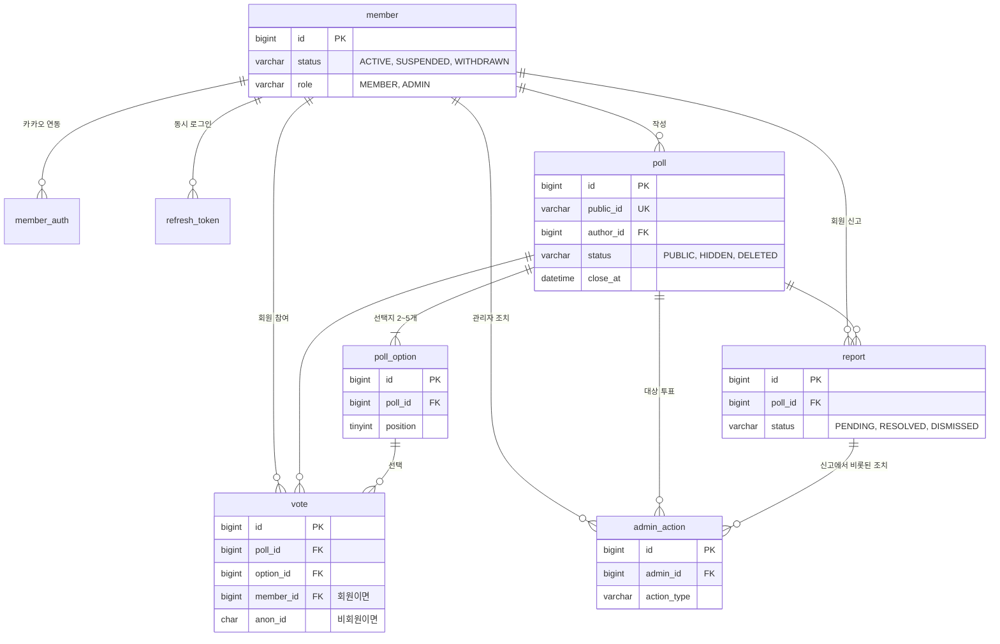

# AuDDum ERD 설계

| 항목 | 내용 |
| --- | --- |
| 버전 | v2 |
| 작성일 | 2026-10-11 |
| 작성자 | 태풍 |
| 관련 문서 | [AuDDum 예외·정책 명세서](예외-정책.md), [AuDDum 도메인 모델](도메인-모델.md), [AuDDum API 명세서](API-명세.md) |

## 요약

AuDDum(어떰)의 확정 정책과 [도메인 모델](도메인-모델.md)을 MySQL 8.4 기준 ERD로 옮겼다. 테이블은 8개이고, 핵심 설계는 다섯 가지다.

- 중복 참여는 vote의 유니크 제약 (투표, 회원)과 (투표, 익명 식별자)로 막는다. 회원 ID와 익명 식별자 중 하나만 채우는 CHECK 제약을 함께 쓴다.
- 선택지가 투표에 속하는지는 복합 FK로 보장한다.
- 투표는 외부에 12자 public_id만 노출하고, 내부 BIGINT id는 PK·FK·커서에 쓴다.
- 결과는 투표 기록 건수로 집계한다. 카운터 컬럼은 성능 문제가 측정된 뒤 검토한다.
- 투표·회원은 물리 삭제하지 않고 상태값으로 관리한다. 동시성 시나리오는 「AuDDum 예외·정책 명세서 v2」에 있다.

## 목차

1. [정책 → 모델 반영](#1-정책--모델-반영)
2. [애그리거트와 설계 결정](#2-애그리거트와-설계-결정)
3. [ERD](#3-erd)
4. [테이블 정의](#4-테이블-정의)
5. [제약조건과 인덱스](#5-제약조건과-인덱스)
6. [핵심 쿼리 패턴](#6-핵심-쿼리-패턴)

## 1. 정책 → 모델 반영

확정된 정책 중 데이터 모델에 직접 영향을 주는 것만 모았다. 응답 코드나 화면 규칙은 API 설계 단계에서 다룬다. 이 문서의 컬럼 타입, 제약조건, 인덱스는 모두 **[기술 초안]**이며 MySQL을 기준으로 한다.

| 확정 정책 | 모델 반영 | 관련 테이블 |
| --- | --- | --- |
| 인증 정보와 회원 정보를 분리, 카카오 고유 식별자로 회원 식별 | 회원 테이블과 카카오 연동 테이블을 나누고 (제공자, 제공자 사용자 ID)에 유니크 제약 | member, member_auth |
| P-14 탈퇴 후 새 회원으로 재가입, 이전 데이터와 연결하지 않음 | 탈퇴 시 member_auth 행을 삭제해 같은 카카오 계정이 새 member로 가입되게 한다. | member_auth |
| P-04 탈퇴 시 작성 투표 익명화 유지, 투표 기록 보존 | member 행은 WITHDRAWN으로 남기고 식별 정보(member_auth)만 지운다. poll, vote는 그대로 둔다. | member, poll, vote |
| P-20·27 JWT 사용, 동시 로그인 허용, 마지막 로그인 시각 저장 | 리프레시 토큰을 서버에 저장하고(회원당 여러 건), member.last_login_at을 둔다. | refresh_token, member |
| P-01·02 숨김·삭제는 상태값, 숨김만 관리자가 복구(삭제는 복구 불가), 수정 불가·삭제만 허용 | poll.status(PUBLIC, HIDDEN, DELETED). 수정 이력 테이블은 필요 없다. | poll |
| P-16 질문 500자, 선택지 50자, 선택지 간 중복 불허 | question VARCHAR(500), content VARCHAR(50), (poll_id, content) 유니크 | poll, poll_option |
| 선택지는 2~5개 | 개수는 애플리케이션에서 검증하고, DB에는 position 범위(1~5)만 제약한다. | poll_option |
| P-15 마감 시간은 선택, 상한 없음 | poll.close_at NULL 허용. 마감 여부는 저장하지 않고 서버 시각과 비교해 계산한다. | poll |
| P-08·09·10 회원·비회원 중복 참여 방지, 쿠키 첫 참여 시 발급 | vote에 member_id, anon_id를 두고 각각 (poll_id, …) 유니크 | vote |
| 선택지는 해당 투표 소속이어야 함 | vote (poll_id, option_id)가 poll_option (poll_id, id)를 가리키는 복합 외래키 | vote, poll_option |
| P-03·25 결과는 마감 전 참여자만, 마감 후 전체 공개 | 모델 영향은 없고 "이 신원이 참여했는가" 조회가 필요하다. | vote 인덱스 |
| P-07 커서 기반 목록, 참여 수 노출 | 목록용 인덱스와, 참여 수는 vote 집계로 계산한다. | poll, vote |
| P-18 신고는 투표당 1회(회원·비회원), '기타'는 짧은 텍스트 | reporter_member_id, reporter_anon_id 각각 (poll_id, …) 유니크, detail 컬럼 | report |
| UC-15 관리자 조치 이력 | 처리자, 시각, 조치, 사유를 남기는 이력 테이블 | admin_action |
| P-13 정지는 기간 없이 수동 해제 | 정지 기간 컬럼 없이 member.status와 정지 시각만 둔다. | member |
| P-26 정지 회원의 기존 투표 유지 | 정지 시 poll은 변경하지 않는다. | poll |
| P-22 정지·탈퇴 상태는 쓰기마다 DB 확인 | member.status를 PK 조회로 읽는다. 별도 인덱스는 필요 없다. | member |

## 2. 애그리거트와 설계 결정

애그리거트는 Member, Poll, Vote, Report, AdminAction 다섯 개로 나눈다. PRD의 영역(Member, Authentication, Poll, PollOption, Vote, Report, Admin) 중 Authentication은 Member에, PollOption은 Poll에 포함시켰다.

| 애그리거트 | 구성 | 테이블 |
| --- | --- | --- |
| Member | Member, MemberAuth, RefreshToken | member, member_auth, refresh_token |
| Poll | Poll, PollOption | poll, poll_option |
| Vote | Vote | vote |
| Report | Report | report |
| AdminAction | AdminAction | admin_action |

용어집, 값 객체(VO), 클래스 다이어그램, 애그리거트별 속성·행위·규칙, 상태 전이는 [AuDDum 도메인 모델](도메인-모델.md)에 있다. 이 문서는 그 모델을 테이블로 옮긴 결과와 설계 이유를 다룬다.

### 설계 결정

- **Vote를 Poll 안에 넣지 않는다.** 참여가 쌓일수록 Poll을 불러오고 잠그는 범위가 커지고, 중복 참여 방지는 DB 유니크 제약이 맡기 때문이다. Vote는 poll_id와 option_id 값으로만 Poll을 가리킨다.
- **애그리거트 사이는 ID 값으로만 참조한다.** 예: Vote는 Poll 객체가 아니라 pollId를 가진다. JPA 연관관계를 최소화해 불필요한 로딩을 줄인다. **[기술 초안]**
- **마감은 저장하지 않고 계산한다.** Poll이 `isClosed(now)`를 제공하고, 참여 가능 여부(공개 상태이면서 마감 전)도 Poll이 판단한다. now는 한 곳에서 주입하는 시각 하나만 쓴다.
- **결과 공개 여부는 응용 서비스가 판단한다.** "마감 후이거나 이 신원이 참여했는가"는 Poll과 Vote를 함께 봐야 하므로 도메인 객체 하나에 넣지 않는다.
- **중복 참여는 DB 유니크 제약이 최종 방어선이다.** 애플리케이션의 사전 조회는 빠른 응답을 위한 것이고, 제약 위반 예외를 "이미 참여" 응답으로 변환한다.

## 3. ERD



vote는 poll이 아니라 poll_option을 통해 poll에 연결된다. (poll_id, option_id)가 poll_option (poll_id, id)를 가리키는 복합 외래키라서, 다른 투표의 선택지를 고른 기록은 DB가 거부한다.

## 4. 테이블 정의

테이블이 8개다. 시각 컬럼은 모두 한국 시간(KST) 기준으로 저장하는 DATETIME(6)이고, PK는 BIGINT AUTO_INCREMENT다. 모든 테이블이 `created_at`·`updated_at`을 가지며 엔티티의 부모 `BaseEntity`가 자동으로 채운다. 상태값과 카테고리는 DB ENUM이 아니라 VARCHAR에 코드 문자열로 저장하고 애플리케이션 enum으로 검증한다. **[기술 초안]**

### member

| 컬럼 | 타입 | NULL | 설명 |
| --- | --- | --- | --- |
| id | BIGINT | N | PK |
| status | VARCHAR(20) | N | ACTIVE, SUSPENDED, WITHDRAWN |
| role | VARCHAR(20) | N | MEMBER(기본값), ADMIN. API로 변경할 수 없다. |
| last_login_at | DATETIME(6) | Y | 마지막 로그인 시각 (P-27) |
| suspended_at | DATETIME(6) | Y | 정지된 시각 |
| withdrawn_at | DATETIME(6) | Y | 탈퇴한 시각 |
| created_at, updated_at | DATETIME(6) | N | 생성·수정 시각 |

### member_auth

| 컬럼 | 타입 | NULL | 설명 |
| --- | --- | --- | --- |
| id | BIGINT | N | PK |
| member_id | BIGINT | N | FK → member |
| provider | VARCHAR(20) | N | KAKAO |
| provider_user_id | VARCHAR(64) | N | 카카오 고유 식별자 |
| created_at, updated_at | DATETIME(6) | N | 생성·수정 시각 |

### refresh_token

| 컬럼 | 타입 | NULL | 설명 |
| --- | --- | --- | --- |
| id | BIGINT | N | PK |
| member_id | BIGINT | N | FK → member. 동시 로그인 허용이므로 회원당 여러 건 |
| token_hash | CHAR(64) | N | 토큰 원문이 아니라 해시값만 저장한다. |
| expires_at | DATETIME(6) | N | 만료 시각 (발급 시점 + 14일) |
| revoked_at | DATETIME(6) | Y | 폐기 시각 |
| created_at, updated_at | DATETIME(6) | N | 생성·수정 시각 |

### poll

| 컬럼 | 타입 | NULL | 설명 |
| --- | --- | --- | --- |
| id | BIGINT | N | PK |
| author_id | BIGINT | N | FK → member. 탈퇴해도 행은 남으므로 NOT NULL 유지 |
| question | VARCHAR(500) | N | 질문 (유니코드 문자 단위 500자) |
| category | VARCHAR(20) | N | SOME, BLIND_DATE, CONTACT, IN_RELATIONSHIP, BREAKUP, LOVE_VALUES, ETC (썸, 소개팅, 연락, 연애 중, 이별, 연애 가치관, 기타) |
| status | VARCHAR(20) | N | PUBLIC(기본값), HIDDEN, DELETED |
| close_at | DATETIME(6) | Y | 마감 시각. NULL이면 마감 없음 |
| created_at, updated_at | DATETIME(6) | N | 생성·수정 시각 |
| public_id | VARCHAR(36) | N | 외부에 노출하는 투표 식별자. URL과 API에는 id 대신 이 값을 쓴다. 형식은 12자 영숫자 |

### poll_option

| 컬럼 | 타입 | NULL | 설명 |
| --- | --- | --- | --- |
| id | BIGINT | N | PK |
| poll_id | BIGINT | N | FK → poll |
| position | TINYINT | N | 표시 순서 1~5 |
| content | VARCHAR(50) | N | 선택지 텍스트 (줄바꿈 불가) |
| created_at, updated_at | DATETIME(6) | N | 생성·수정 시각 |

### vote

| 컬럼 | 타입 | NULL | 설명 |
| --- | --- | --- | --- |
| id | BIGINT | N | PK |
| poll_id | BIGINT | N | 투표 ID |
| option_id | BIGINT | N | 선택지 ID |
| member_id | BIGINT | Y | FK → member. 회원이 참여한 경우 |
| anon_id | CHAR(36) | Y | 비회원 익명 식별자(UUID). 비회원이 참여한 경우 |
| created_at, updated_at | DATETIME(6) | N | 참여·수정 시각. 참여 기록은 수정·삭제하지 않으므로 둘이 같다. |

### report

| 컬럼 | 타입 | NULL | 설명 |
| --- | --- | --- | --- |
| id | BIGINT | N | PK |
| poll_id | BIGINT | N | FK → poll |
| reporter_member_id | BIGINT | Y | FK → member. 회원이 신고한 경우 |
| reporter_anon_id | CHAR(36) | Y | 비회원 신고자의 익명 식별자 |
| reason | VARCHAR(30) | N | ABUSE_HATE, SEXUAL_HARASSMENT, PERSONAL_INFO, SPAM, ETC |
| detail | VARCHAR(200) | Y | '기타' 사유의 짧은 텍스트. 글자 수 상한은 구현 때 확정(임시 200) |
| status | VARCHAR(20) | N | PENDING(기본값), RESOLVED, DISMISSED (API 명세에서 확정) |
| created_at, updated_at | DATETIME(6) | N | 접수·수정 시각 |
| handled_at | DATETIME(6) | Y | 처리 시각 |
| handled_by | BIGINT | Y | FK → member. 처리한 관리자 |

### admin_action

| 컬럼 | 타입 | NULL | 설명 |
| --- | --- | --- | --- |
| id | BIGINT | N | PK |
| admin_id | BIGINT | N | FK → member. 조치한 관리자 |
| action_type | VARCHAR(30) | N | HIDE_POLL, DELETE_POLL, RESTORE_POLL, SUSPEND_MEMBER, UNSUSPEND_MEMBER, DISMISS_REPORT |
| target_poll_id | BIGINT | Y | FK → poll |
| target_member_id | BIGINT | Y | FK → member |
| report_id | BIGINT | Y | FK → report. 신고에서 비롯된 조치일 때 |
| reason | VARCHAR(200) | Y | 관리자가 남기는 사유 (회원에게 노출하지 않는다) |
| created_at, updated_at | DATETIME(6) | N | 조치·수정 시각 |

## 5. 제약조건과 인덱스

V1에는 제약(UNIQUE, CHECK, FK)과 그것이 쓰는 인덱스만 둔다. 이것들이 빠지면 규칙이 사라진다. 조회 속도만 바꾸는 인덱스는 아래 "조회 최적화 인덱스"로 미룬다.

중복 참여, 선택지 소속, 신원 구분은 애플리케이션 검증과 별개로 DB가 최종 방어선이 되게 한다. 삭제는 모두 상태값 변경(논리 삭제)이므로 외래키는 ON DELETE RESTRICT로 둔다.

| 테이블 | 제약·인덱스 | 목적 |
| --- | --- | --- |
| member_auth | UNIQUE (provider, provider_user_id) | 카카오 계정당 회원 하나. 같은 계정의 동시 최초 로그인에서 회원이 둘 생기는 것을 막는다. |
| member_auth | UNIQUE (member_id, provider) | 회원당 제공자 하나 |
| refresh_token | UNIQUE (token_hash), INDEX (member_id) | 토큰 조회, 회원 탈퇴·정지 시 일괄 폐기 |
| poll_option | UNIQUE (poll_id, position), UNIQUE (poll_id, content) | 순서와 선택지 내용의 중복 방지 |
| poll_option | UNIQUE (poll_id, id), CHECK (position BETWEEN 1 AND 5) | vote 복합 외래키의 대상, 선택지 5개 상한 |
| vote | FOREIGN KEY (poll_id, option_id) → poll_option (poll_id, id) | 선택지가 해당 투표 소속임을 DB가 보장 |
| vote | UNIQUE (poll_id, member_id), UNIQUE (poll_id, anon_id) | 회원·비회원 각각 투표당 1회 참여 |
| vote | CHECK (member_id와 anon_id 중 정확히 하나만 NOT NULL) | 신원 구분 |
| vote | INDEX (poll_id, option_id) | 선택지별 득표 집계. 복합 외래키 인덱스를 겸한다. |
| report | UNIQUE (poll_id, reporter_member_id), UNIQUE (poll_id, reporter_anon_id) | 신고자당 투표당 1회 (P-18) |
| report | CHECK (신고자 신원 정확히 하나) | 신원 구분 |
| admin_action | INDEX (target_poll_id), INDEX (target_member_id) | 외래키 인덱스를 겸한다. 대상별 이력 조회 |
| poll | UNIQUE (public_id) | 외부 식별자 중복 방지, public_id로 단건 조회 |

### 조회 최적화 인덱스 (V1에 넣지 않는다)

없어도 결과는 같고 느려질 뿐인 인덱스다. 대량 시드 데이터에서 `EXPLAIN`으로 쿼리 플랜을 확인한 뒤, 필요한 것만 새 마이그레이션으로 추가한다(로드맵 M4). 측정 전후 수치를 함께 남긴다.

| 후보 인덱스 | 받치려는 쿼리 | 확인할 것 |
| --- | --- | --- |
| poll (status, id) | 공개 투표 목록의 커서 조회 | 숨김·삭제 비율이 높을 때 풀 스캔·filesort가 생기는가 |
| poll (author_id, id) | 작성자 본인의 투표 조회(숨김·삭제 포함) | author_id 외래키 인덱스만으로 충분한가 |
| report (status, created_at) | 관리자 신고 대기 목록 | 대기 건수가 많을 때 정렬 비용 |
| admin_action (admin_id, created_at) | 관리자별 이력 조회 | admin_id 외래키 인덱스만으로 충분한가 |

### vote 테이블 DDL 초안

```sql
CREATE TABLE vote (
  id         BIGINT AUTO_INCREMENT PRIMARY KEY,
  poll_id    BIGINT   NOT NULL,
  option_id  BIGINT   NOT NULL,
  member_id  BIGINT   NULL,
  anon_id    CHAR(36) NULL,
  created_at DATETIME(6) NOT NULL,
  updated_at DATETIME(6) NOT NULL,
  CONSTRAINT uq_vote_member UNIQUE (poll_id, member_id),
  CONSTRAINT uq_vote_anon   UNIQUE (poll_id, anon_id),
  CONSTRAINT fk_vote_option FOREIGN KEY (poll_id, option_id)
    REFERENCES poll_option (poll_id, id),
  CONSTRAINT fk_vote_member FOREIGN KEY (member_id) REFERENCES member (id),
  CONSTRAINT ck_vote_voter  CHECK ((member_id IS NULL) <> (anon_id IS NULL)),
  INDEX ix_vote_result (poll_id, option_id)
);
```

### 알아둘 점

- MySQL의 UNIQUE 인덱스는 NULL을 서로 다른 값으로 취급한다. 그래서 (poll_id, member_id) 제약은 member_id가 NULL인 비회원 행에 영향을 주지 않고, 회원과 비회원에 각각 독립적으로 적용된다. 회원·비회원 신원을 한 테이블에 섞을 때의 NULL 처리 우려는 이 구조로 해소된다.
- CHECK 제약은 MySQL 8.0.16 이상에서만 실제로 강제된다. 사용할 MySQL 8.4는 이에 해당한다. (확정)
- 선택지 내용은 대소문자와 악센트를 구분하지 않고 중복 여부를 판단한다. (확정) MySQL 8의 기본 콜레이션 utf8mb4_0900_ai_ci가 이 방식이므로 poll_option.content에 그대로 쓰고, 저장 전에 앞뒤 공백을 제거한다.
- 위 제약이 모든 위반을 막는 것은 아니다. 선택지 2~5개 하한, 마감 시각, 질문 500자 같은 규칙은 애플리케이션이 검증한다.

## 6. 핵심 쿼리 패턴

구현 전에 인덱스와 제약이 이 쿼리들을 받쳐 주는지 확인하기 위한 초안이다. 성능 수치는 측정하기 전에는 주장하지 않는다.

### 목록 (커서 기반)

```sql
SELECT id, public_id, question, category, close_at, created_at
FROM poll
WHERE status = 'PUBLIC' AND id < :cursor
ORDER BY id DESC
LIMIT :size;
```

정렬과 커서는 내부 id 기준이다. 응답에는 내부 id를 담지 않고 public_id만 내려주며, 다음 페이지 커서는 마지막 항목의 id를 불투명한 문자열로 인코딩해 담는다. 상세 조회, 참여, 신고처럼 투표를 가리키는 요청은 `WHERE public_id = :publicId`로 투표를 찾은 뒤 내부 id로 이어서 처리한다.

참여 수는 위 결과의 poll ID 묶음으로 한 번에 집계한다. 투표마다 따로 세는 N+1을 피한다.

```sql
SELECT poll_id, COUNT(*) AS participants
FROM vote
WHERE poll_id IN (:pollIds)
GROUP BY poll_id;
```

### 결과 집계

```sql
SELECT o.id, o.content, COUNT(v.id) AS votes
FROM poll_option o
LEFT JOIN vote v ON v.poll_id = o.poll_id AND v.option_id = o.id
WHERE o.poll_id = :pollId
GROUP BY o.id, o.content, o.position
ORDER BY o.position;
```

득표율은 애플리케이션에서 계산한다. 전체 참여가 0건이면 0으로 반환한다. 결과는 항상 투표 기록(vote)에서 계산하므로 집계와 기록이 어긋날 수 없다.

### 참여 여부 (결과 공개 판단)

```sql
-- 회원
SELECT option_id FROM vote WHERE poll_id = :pollId AND member_id = :memberId;
-- 비회원
SELECT option_id FROM vote WHERE poll_id = :pollId AND anon_id = :anonId;
```

두 쿼리 모두 중복 방지용 유니크 인덱스를 그대로 사용한다. 결과를 공개할지는 "마감 후이거나 이 조회에 행이 있는가"로 판단한다.

### 참여 저장

```sql
-- 1) 트랜잭션 안에서 투표 상태 확인
SELECT status, close_at FROM poll WHERE id = :pollId;
-- 2) 저장 (유니크·복합 외래키 위반이면 예외)
INSERT INTO vote (poll_id, option_id, member_id, anon_id, created_at, updated_at)
VALUES (:pollId, :optionId, :memberId, :anonId, :now, :now);
```

유니크 위반은 "이미 참여"로 변환한다. 같은 선택지의 재전송이면 기존 기록을 읽어 200으로 돌려주고, 다른 선택지이면 409를 반환한다. 요청은 선택지 id가 아니라 표시 순서(position)로 선택지를 가리키고, 서버가 (투표, position)으로 선택지 id를 찾는다. 해당 순서의 선택지가 없으면 400으로 응답한다. 복합 외래키는 그래도 DB 단의 마지막 방어선으로 둔다. 마감 판단은 요청을 받은 시점에 한 번만 한다. (P-11)

### 관리자 신고 대기 목록

```sql
SELECT id, poll_id, reason, created_at
FROM report
WHERE status = 'PENDING'
ORDER BY created_at, id
LIMIT :size;
```
