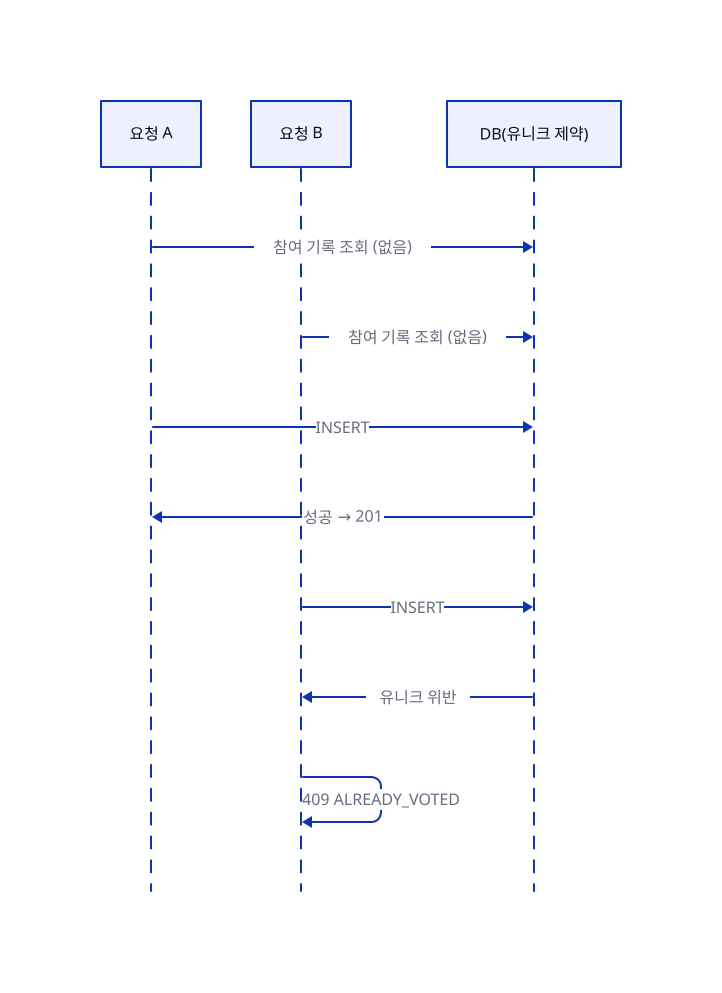

# 동시성·중복 참여 방지

| --- | --- |

## 요약

한 사람이 같은 투표에 두 번 참여하지 못하게 막는 방법을 정한다. 거의 동시에 두 요청이 와도 한 건만 남도록 두 겹으로 막고, 진 쪽을 어떻게 처리하는지도 정한다. 핵심 결정은 두 가지다.

- 서비스의 사전 검사는 빠르고 친절한 응답을 위한 것이고, 마지막 방어선은 DB 유니크 제약이다.
- 동시 요청에서 진 쪽은 유니크 위반을 받아 409로 바꾸고, 재조회하지 않는다.

## 목차

1. [중복 참여 방지](#1-중복-참여-방지)
2. [검증 테스트 관점](#2-검증-테스트-관점)

## 1. 중복 참여 방지

중복 참여를 막는 일은 두 겹으로 나눈다. 서비스의 사전 검사는 빠르고 친절한 응답을 위한 것이고, 마지막 방어선은 DB 유니크 제약이다.

**신원 모델**

- 투표 기록(`vote`)의 신원은 회원 ID와 익명 식별자 중 **정확히 하나**다. 둘 다 있거나 둘 다 없으면 저장되지 않는다.
- 회원은 `(poll_id, member_id)`, 비회원은 `(poll_id, anon_id)`에 각각 유니크 제약을 건다. 비어 있는 쪽은 NULL이라 MySQL의 유니크 비교에서 빠지므로 CHECK 제약으로 "정확히 하나"를 보장한다.
- 투표 기록은 생성 후 수정·삭제하지 않는다. 선택을 바꾸는 API도 없다.
- 같은 요청이 다시 와도 안전해야 하지만(멱등성) 요청을 구분하는 키는 만들지 않는다. 유니크 제약만으로 충분하고, 요청 식별 정보는 저장하지 않는다.

**처리 순서**

참여 유스케이스 서비스가 처리한다. 판정 순서와 실패 응답은 [03-참여하기](../features/03-참여하기.md)의 흐름이 기준이다(앞 단계에서 거절되면 뒤는 보지 않는다).

- 신원 결정(회원 ID 또는 익명 UUID)은 투표 조회 다음에 한다. 쿠키가 위조되었으면 무효로 보고 새로 발급한다.
- 마감 확인과 선택지 소속 확인은 `Poll` 도메인이 하고, 나머지는 서비스가 한다. 회원 상태 확인은 `getActiveMember`로 한다.
- 마감과 선택지 소속 같은 규칙은 서비스가 값을 꺼내 판단하지 않고 `Poll`에게 묻는다. 서버 시각은 서비스가 요청 시점에 한 번 정해 넘긴다.
- 이미 참여한 사람은 마감 후에도 기존 참여 확인이 마감 확인보다 먼저라 `POLL_CLOSED`가 아니라 `ALREADY_VOTED`(409)를 받는다(P-12).
- 투표 기록 저장에서 유니크 위반은 409 `ALREADY_VOTED`다(아래 "동시 요청").

**동시 요청**

그림의 원본: [동시성-중복-방지-동시-요청.d2](../diagrams/동시성-중복-방지-동시-요청.d2)

- 두 요청이 모두 "기록 없음"을 보고 들어와도 유니크 제약이 한 건만 통과시킨다. 진 쪽은 유니크 위반 예외를 받고 이를 409 `ALREADY_VOTED`로 바꾼다. 진 쪽이 같은 선택을 보냈어도 마찬가지다(재조회하지 않는다).
- 겹치는 구간은 두 요청이 같은 순간에 사전 조회를 통과한 경우뿐이다. 이미 끝난 요청의 재전송(응답 유실 후 재시도, 이긴 쪽이 끝난 뒤 도착한 더블 클릭)도 사전 조회에서 기록을 찾아 선택과 관계없이 409로 응답한다. 클라이언트는 `ALREADY_VOTED`를 받으면 상세 조회의 `myChoice`로 화면을 맞춘다.
- 유니크 위반이 아닌 제약 위반(외래키, CHECK)은 409로 바꾸지 않고 500으로 둔다. 진짜 버그를 409로 가리지 않기 위해서다.

**트랜잭션 경계**

- 서비스 진입 메서드 하나가 하나의 트랜잭션이다. 위반이 저장 시점에 바로 드러나도록 INSERT를 즉시 반영하고(flush), 유니크 위반이면 `ALREADY_VOTED`로 바꿔 던지므로 트랜잭션은 롤백된다. 재조회가 없으므로 트랜잭션을 나누지 않는다.
- 저장 중 다른 DB 오류는 500이고 전체 롤백한다. 부분 저장은 없다.

## 2. 검증 테스트 관점

세부 전략은 [테스트 전략](테스트-전략.md)에 있다. 여기서는 참여 밖의 요청에서 이 설계가 지켜야 할 결과만 적는다. 참여의 동시 요청·경계 검증은 [03-참여하기](../features/03-참여하기.md)에 있다. 동시 요청은 실제 MySQL을 쓰는 통합 테스트로 확인한다.

| 확인할 것 | 기대 결과 |
| --- | --- |
| 같은 신고자가 같은 투표를 동시에 신고 | 신고 기록이 정확히 1건, 진 쪽은 409 `REPORT_ALREADY_SUBMITTED` |
| 정지 회원이 API를 직접 호출 | 참여·신고·생성 모두 403 |
| 탈퇴 회원의 액세스 토큰으로 쓰기 요청 | 401 |
| 이미 사용한 리프레시 토큰의 재사용 | 401, 재발급 실패 |
