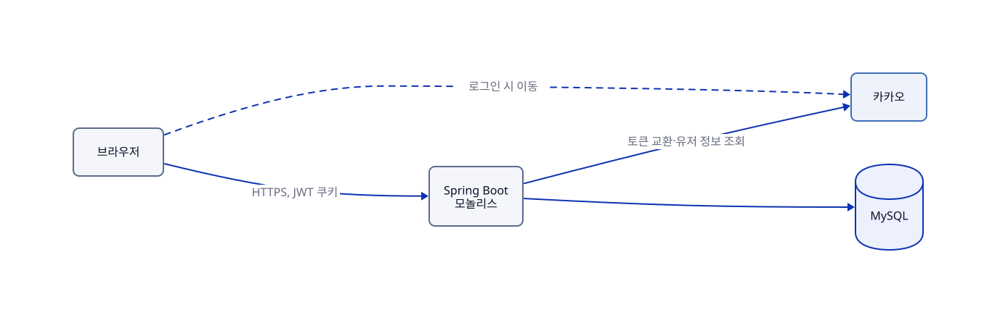
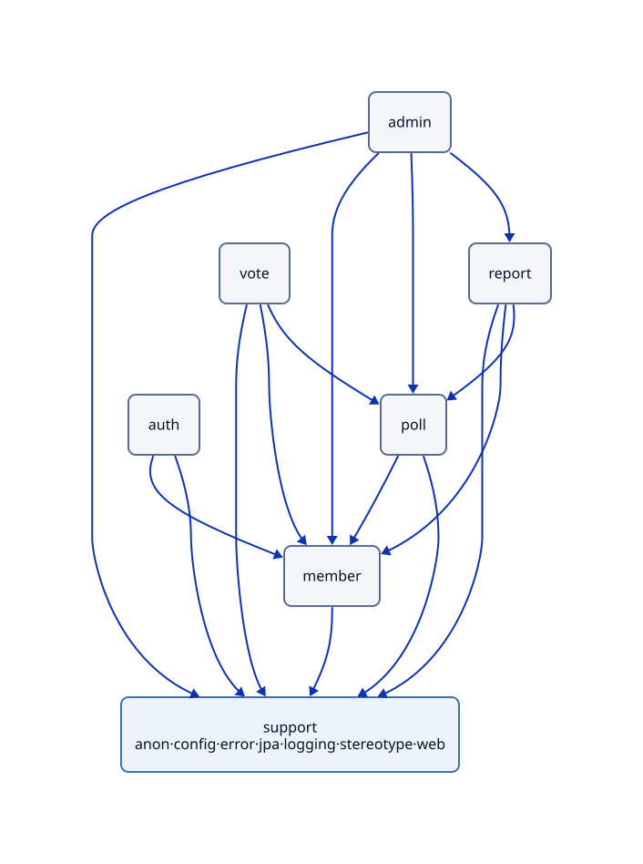
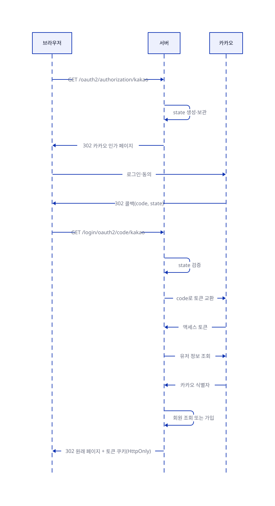

# AuDDum 아키텍처 설계서

| 항목 | 내용 |
| --- | --- |
| 버전 | v1 |
| 작성일 | 2026-10-12 |
| 작성자 | 태풍 |
| 관련 문서 | [AuDDum ERD 설계](../ERD.md), [AuDDum API 명세서](../API-명세.md), [AuDDum 인증 설계서](인증.md), [AuDDum 동시성·중복 방지 설계서](동시성-중복-방지.md) |

## 요약

어떰은 모놀리식 Spring Boot 애플리케이션 하나와 MySQL로 시작한다. 설계는 DDD 실용형이다.
도메인별 패키지와 애그리거트로 경계를 나누고, 규칙은 도메인 객체에 두며, 쓰기와 읽기 서비스를 분리한다.
서비스는 애그리거트를 반환하고 응답 구성은 controller가 맡는다. 로그인은 서버 주도 카카오 인증과 JWT 쿠키다.
보류한 항목은 마지막 절에 모았다.

## 목차

1. [시스템 구성](#1-시스템-구성)
2. [애플리케이션 구조](#2-애플리케이션-구조)
3. [인증·인가 설계](#3-인증인가-설계)
4. [데이터·횡단 관심사](#4-데이터횡단-관심사)
5. [기술 결정 요약](#5-기술-결정-요약)

## 1. 시스템 구성

배포 단위는 하나다. Spring Boot 모놀리스 하나가 API를 제공하고 MySQL에 모든 데이터를 저장한다. Redis, 메시지 큐, 검색 엔진은 처음부터 두지 않고 실제 문제가 측정되면 추가한다.

그림의 원본: [아키텍처-시스템-구성.d2](../diagrams/아키텍처-시스템-구성.d2)

로그인은 서버가 카카오와 직접 통신하고 브라우저는 카카오 토큰을 다루지 않는다. 브라우저와는 HTTPS로 통신하고 로그인 상태는 JWT 쿠키로 유지한다. 배포 환경은 [배포](../howto/배포.md)에 있다(EC2 한 대, RDS, Vercel).

## 2. 애플리케이션 구조

패키지는 도메인별로 나눈다. 도메인 6개는 PRD의 영역과 같다(선택지는 poll에 포함). 설계 방식은 DDD 실용형이다.

**핵심**

- 도메인마다 `api`, `application`, `domain`, `infrastructure` 네 패키지를 둔다.
- 의존은 `api → application → infrastructure` 한 방향이고, `domain`은 가장 안쪽이라 모두가 참조한다.
- 서비스는 처리 순서만 잇는다. 세부 로직은 구현 계층 클래스가, 규칙은 도메인 객체가 맡는다.
- 서비스는 repository도 다른 서비스도 쓰지 않는다. 다른 도메인은 그 도메인의 구현 계층 클래스로 부른다.
- 서비스는 애그리거트를 반환하고 응답 구성은 controller가 한다.

**패키지와 레이어**

| 패키지 | 두는 것 | 레이어 이름 |
| --- | --- | --- |
| `api` | controller(`@WebApi`), 요청·응답 DTO | Presentation |
| `application` | 서비스(`@CommandService`·`@QueryService`) | Business |
| `application` | 구현 계층 클래스(`@Component`) | Implement |
| `domain` | 엔티티, 값 객체, enum | (가장 안쪽) |
| `infrastructure` | `*JpaRepository` | Data Access |

*참조 규칙*

- 위에서 아래로만 참조한다. 아래에서 위로 거슬러 참조하지 않는다.
- 하위 레이어를 건너뛰지 않는다(서비스가 repository를 바로 쓰지 않는다).
- 같은 레이어끼리 참조하지 않는다. 구현 계층 클래스끼리는 예외다.
- `domain`은 가장 안쪽 레이어라 `api`, `application`, `infrastructure` 모두가 직접 참조할 수 있다(건너뛰지 않는다는 규칙의 예외). `domain`은 다른 레이어를 참조하지 않는다.
- `application`에서 repository를 쓰는 것은 구현 계층 클래스뿐이다.
- 이 규칙은 ArchUnit(`ArchitectureTest`)이 검사한다.

*서비스와 구현 계층 클래스*

- 서비스 본문에는 비즈니스 흐름만 남기고 세부 로직은 구현 계층 클래스에 시킨다.
- 구현 계층 클래스는 자체 트랜잭션 경계를 두지 않고 부른 서비스의 트랜잭션에 참여한다.
- 이름은 정해진 목록이 아니라 책임에 맞게 짓는다: `Reader` 조회, `Validator` 검증, `Resolver` 식별 해석, `Participator` 참여 처리 등.
- 그래서 ArchUnit은 이름이 아니라 "서비스(`@ApplicationService`가 붙은 클래스)는 `*JpaRepository`와 다른 서비스에 의존하지 않는다"로 검사한다.

*구현 계층 클래스를 서브패키지로 나누지 않는 이유*

- **결정.** `application` 안에 `implement` 같은 서브패키지를 만들지 않는다.
- **이유.** 나누면 서비스가 다른 패키지에서 부르게 되어, 같은 도메인 안에서만 쓰는 구현 클래스를 모두 public으로 열어야 한다.
- **바꿀 때.** 한 도메인의 구현 클래스가 8개를 넘으면 다시 검토한다(지금 가장 많은 vote가 6개).

**도메인 사이 의존**

그림의 원본: [아키텍처-패키지-의존.d2](../diagrams/아키텍처-패키지-의존.d2)

- 의존은 화살표 방향 한 방향이고 순환 의존은 만들지 않는다.
- admin은 report·poll·member를 모두 쓴다. poll·vote·report는 쓰기 전에 회원 상태를 확인하려고 member를 쓴다.

*도메인 사이 호출*

- **결정.** 상대 도메인의 구현 계층 클래스(`MemberReader`, `PollReader`)로 부른다. 서비스끼리 부르거나 다른 도메인의 repository를 직접 쓰지 않는다.
- **협력 방식.** 직접 호출로 시작하고, 필요해지면 도메인 이벤트를 도입한다.
- **도입한 곳.** 회원 탈퇴다. member가 auth를 참조하면 순환이라 `MemberWithdrawnEvent`를 발행하고, auth가 동기 `@EventListener`로 같은 트랜잭션에서 리프레시 토큰을 지운다.

*조회 조합*

한 화면이 여러 도메인의 값을 붙여 보여줄 때는 값이 어느 도메인의 사용 사례에 속하는지로 방식을 정한다.

| 경우 | 방식 | 지금 쓰는 곳 |
| --- | --- | --- |
| 값이 소유 도메인(목록·상세의 주체)의 사용 사례에 속하고 의존 방향(`vote → poll`)을 거스른다 | 소유 도메인이 인터페이스(포트)를 선언하고 반대쪽의 구현 계층 클래스가 구현한다. 순환 없이 잇는다. | 투표 목록의 참여 수: poll이 `ParticipationReader`를 선언하고 vote의 `VoteParticipationReader`가 구현한다(#62). 투표 상세의 내 선택·득표도 같은 포트다(#63). |
| 여러 도메인이 필요하고 독립된 흐름이다 | 소유 도메인과 별개로 조합 전용 서비스(facade, 예: admin)를 둔다. 각 도메인의 구현 계층 클래스를 조합하고 서비스끼리는 부르지 않는다. | admin |

- 어느 쪽이든 조회는 소유 도메인의 책임이다. 화면에 보여주는 필드가 늘거나 줄어도 조회의 위치는 바뀌지 않는다.
- 레포지토리를 포트·어댑터로 나누지 않는다는 방침과는 별개다.
- **바꿀 때.** 지금은 포트로 풀지만 필요해지면 조합 서비스(facade)로 바꿀 수 있다. 바꾸려면 조합 서비스를 둘 새 패키지와 ArchUnit의 허용 의존 맵 변경이 필요하다.

**support 패키지**

도메인이 아닌 기술 기반만 둔다. 도메인 규칙은 넣지 않고, 여러 도메인이 쓰는 규칙이 생기면 해당 도메인에 둔다. `common` 패키지는 만들지 않는다.

| 하위 패키지 | 두는 것 |
| --- | --- |
| `stereotype` | 역할 어노테이션 |
| `web` | 컨트롤러 인자 처리. `@CurrentMemberId`는 액세스 토큰 쿠키로 확인된 신원(SecurityContext)에서 회원 ID를 꺼내고, 로그인하지 않았으면 401이다. 토큰은 `auth.api`의 필터가 확인한다. |
| `anon` | 비회원 식별용 익명 쿠키의 발급·검증(`AnonCookieProvider`)과 쿠키 값 해석(`AnonIdentityResolver`: 유효하면 그 UUID, 없거나 위조면 발급). 도메인 값 객체를 모르고 UUID만 다룬다. 쿠키를 쓰는 `AnonCookies`와 이름 `AnonCookieName`은 `web`에 있다. |
| `jpa` | 엔티티 공통 부모 `BaseEntity`(PK, 생성·수정 시각, 프록시를 고려한 동등성). 생성·수정 시각은 JPA Auditing이 서버 `Clock`(KST) 기준으로 채운다. |
| `config`, `error`, `logging` | 설정, 오류 처리, 로깅 |

- 규칙을 적용하는 마감 판단처럼 도메인 규칙에 쓰는 시각은 서비스가 요청 시점에 정해 넘기는 now를 쓴다.
- 멀티모듈은 보류했다. 이 패키지 경계를 지키면 나중에 모듈로 나눌 때 비용이 작다.

**설계 원칙**

핵심:

- 규칙은 도메인 객체에 두고 서비스는 흐름과 트랜잭션만 맡는다.
- 도메인 모델이 곧 JPA 엔티티이고, 레포지토리는 포트로 나누지 않는다.
- 클래스는 기본 package-private이고, 다른 도메인에는 서비스 진입점과 구현 계층 클래스만 연다.

*객체 설계*

| 원칙 | 내용 | 예 |
| --- | --- | --- |
| 책임·협력 중심 | 객체의 책임·역할·협력을 중심으로 설계하고, 결합도는 낮추며 응집도는 높인다. | |
| Tell, Don't Ask | 값을 꺼내 서비스가 판단하지 않고 객체에게 시킨다. | 마감 판단, 참여 가능 여부 검증 |
| 규칙의 위치 | 도메인 규칙은 엔티티와 도메인 객체에 둔다. 서비스는 흐름과 트랜잭션만 맡는다. | 마감 판단, 상태 전이, 선택지 소속 검증 |
| 도메인 서비스 | 한 객체가 갖기 어려운 규칙(여러 애그리거트가 필요한 판단)만 둔다. 상태를 갖지 않는다. | |

*도메인 모델과 레포지토리*

- **결정.** JPA 엔티티를 도메인 모델로 겸용한다. 도메인 모델과 영속 모델을 따로 만들지 않는다. 레포지토리는 `infrastructure`의 `{도메인}JpaRepository`(Spring Data JPA)로 두고 `application`의 구현 계층 클래스가 쓴다. 포트·어댑터로 나누지 않는다.
- **이유.** 도메인이 이미 JPA에서 분리돼 있지 않고, 구현이 하나뿐이며, 서비스 테스트를 H2 통합으로 하므로 인터페이스를 나눠도 얻는 것이 작다.
- **바꿀 때.** 구현이 둘이 되거나 도메인을 JPA에서 분리해야 할 때 나눈다.

*가시성: 기본은 package-private*

| 대상 | 접근 |
| --- | --- |
| 서비스 진입점, 다른 도메인이 부르는 구현 계층 클래스(`MemberReader`, `PollReader`) | public (다른 도메인에 여는 것은 이 둘뿐) |
| 하위 패키지(`api`, `application`, `domain`, `infrastructure`) 사이에서 쓰는 엔티티·값 객체·enum | public |
| 애그리거트 안에서만 쓰는 행위(예: 선택지 생성) | package-private |

의존 방향은 ArchUnit 테스트가 검증한다.

*애그리거트*

- Poll(선택지 포함), Vote, Member, Report를 애그리거트로 둔다. 서로는 객체가 아니라 ID로만 참조한다.
- Vote는 Poll 안에 넣지 않고 따로 둔다. 양이 많고 중복 참여를 유니크 제약으로 막기 때문이다.

*서비스 구성*

- 쓰기는 도메인별 Command 서비스가 기본이다. 검증 단계가 많거나, 여러 애그리거트에 걸치거나, 시나리오에서 독립된 흐름인 것만 유스케이스 서비스로 분리한다. 예: 투표 참여는 별도 서비스로 두고, 신고는 상태값·조치 이력이 확정된 뒤 판단한다.
- 읽기는 도메인별 Query 서비스가 맡고 읽기 전용 트랜잭션을 쓴다.

**역할 어노테이션**

패키지는 클래스가 어디 있는지를, 어노테이션은 어떤 역할인지를 나타낸다.

| 어노테이션 | 붙이는 곳 | 포함하는 것 |
| --- | --- | --- |
| `@WebApi` | `api`의 controller | `@RestController` |
| `@CommandService` | `application`의 쓰기 서비스 | `@Transactional` |
| `@QueryService` | `application`의 읽기 서비스 | `@Transactional(readOnly = true)` |
| `@ApplicationService` | (위 둘이 메타 어노테이션으로 가진다) | `@Service` |

- **이유.**
  - 클래스 선언만 봐도 역할을 알 수 있어 가독성이 높다.
  - ArchUnit이 역할 기준으로 의존 규칙을 검사할 수 있다. 패키지를 옮기거나 이름을 바꿔도 규칙의 의도가 유지된다.
  - 쓰기와 읽기의 트랜잭션 설정을 역할에 묶어 두어 설정 실수와 `@Service`·`@Transactional` 반복을 줄인다.
- **한계.** 어노테이션 종류가 늘어난다. 그래서 역할 4개로 시작하고, 패키지와 어노테이션이 어긋나지 않도록 ArchUnit으로 함께 검사한다.
- **규칙 예.** `@WebApi` 클래스는 `infrastructure`에 의존하지 않는다. 응답은 controller가 만들므로 `domain`의 엔티티·값 객체·enum은 쓸 수 있다.

**응답 반환 규칙**

핵심: 서비스는 애그리거트를 반환하고, 응답 구성은 controller가 한다.

- **기본.** 서비스는 애그리거트를 반환한다. 응답에 어떤 필드를 담을지는 controller가 정한다. 프레젠테이션 관심사가 애플리케이션 계층으로 들어오지 않게 하려는 것이다.
- **예외.** 목록, 결과 집계, 조합 조회처럼 엔티티 단위로 표현할 수 없을 때만 조회 전용 DTO를 반환한다.

*마감 시각과 판단의 위치*

| 경우 | 누가 판단하나 |
| --- | --- |
| 목록 응답의 `closed`(표시용) | controller가 응답으로 변환할 때 서버 시각(KST)을 한 번 정해 `Poll.isClosed(now)`에 물어 채운다. |
| 참여 정보가 붙는 상세(`poll`의 조회 서비스, 참여 정보는 포트로 받는다) | 서비스가 요청 시각을 하나로 정해 `closed`와 결과 공개를 함께 판단한다. |
| 참여·생성처럼 규칙을 적용하는 판단 | 서비스가 now를 정한다. 마감 규칙은 도메인에 있다. |

- 정책 판단은 controller로 올리지 않는다. 예: 투표 결과 공개 여부는 도메인(`Poll.isResultOpen`)과 조회 서비스가 판단하고, controller는 그 결과를 변환만 한다.

*그 밖의 규칙*

- OSIV는 끈다. 응답에 필요한 연관은 서비스에서 미리 로딩해 반환한다.
- 엔티티에 setter는 두지 않는다. 조회용 getter는 응답 변환을 위해 허용한다.

## 3. 인증·인가 설계

로그인은 지금 카카오 하나만 지원하고(구조는 제공자를 늘려도 같다), 모든 과정을 서버가 맡는다. 프런트엔드는 인가 코드나 토큰을 직접 다루지 않는다.

그림의 원본: [아키텍처-카카오-로그인.d2](../diagrams/아키텍처-카카오-로그인.d2)

**로그인과 토큰**

- state 값은 서버가 만들어 보관하고, 콜백에서 대조해 맞지 않으면 로그인을 거절한다.
- 로그인 뒤 이동할 주소는 서비스 내부 경로(`/`로 시작하는 상대 경로)만 받는다. 외부 주소, `//`, `\`, 스킴, 제어문자가 들어 있으면 홈으로 보낸다.
- 액세스 토큰과 리프레시 토큰은 JWT이며 HttpOnly 쿠키로만 전달한다. 스크립트에서는 읽을 수 없다.
- 리프레시 토큰은 refresh_token 테이블에 저장하고, 재발급할 때 교체하며 로그아웃·탈퇴 때 폐기한다.
- 만료 시간은 액세스 30분, 리프레시 14일이다([인증](인증.md)).

**인가**

- 토큰에 든 정보는 신원 확인에만 쓴다. 정지·탈퇴 여부는 쓰기 요청마다 DB에서 확인해 즉시 반영하며, 이 확인은 쓰기 서비스가 `MemberReader.getActiveMember()`로 한다. 컨트롤러에는 두지 않는다.
- 비회원은 익명 쿠키로 구분한다. 첫 참여 때 발급하고 유효기간은 1년이며, 중복 참여 판별에만 쓴다.
- 인증 실패는 401, 상태에 따른 거절은 403으로 응답한다. 상태 코드는 API 명세에서 확정했다.
- 쿠키 방식이므로 CSRF는 SameSite=Lax와 Origin 검증으로 막는다.

## 4. 데이터·횡단 관심사

**데이터와 트랜잭션**

- 트랜잭션 경계는 service 메서드다. 투표와 선택지, 신고 처리와 이력은 한 트랜잭션으로 묶는다.
- 중복 참여 같은 규칙의 마지막 방어선은 DB 유니크 제약이다. 서비스의 사전 검사는 응답을 친절하게 하려는 용도다.
- 유니크 제약 위반 예외는 구현 클래스(`VoteWriter`)가 잡아 확정된 정책대로(선택과 관계없이 409) 바꾼다.
- 시각은 모두 KST로 저장한다. 마감 여부는 service가 요청을 받은 시점의 서버 시각을 한 번 정해 도메인에 넘겨 판단한다.
- 바깥에는 poll.public_id(12자)만 노출하고 내부 BIGINT id는 드러내지 않는다. 목록 커서는 외부에서 해석할 수 없는 값으로 만든다.
- 투표 결과는 투표 기록에서 집계한다. 개수를 저장하는 컬럼은 두지 않는다.
- 삭제는 논리 삭제다. 조회 쿼리는 삭제·숨김 상태를 일관되게 걸러야 한다.

**횡단 관심사**

| 관심사 | 규칙 |
| --- | --- |
| 오류 응답 | 모든 오류는 ProblemDetail(RFC 7807)로 내려간다. 오류 코드는 확장 필드로 담고, 코드 목록은 API 명세에서 확정했다. |
| 로깅 | 요청 단위로 추적할 수 있게 하고, 토큰·쿠키 값은 남기지 않는다. 모니터링은 Prometheus·Grafana다([배포](../howto/배포.md)). |
| 설정 | 비밀 값(카카오 키, JWT 서명 키)은 코드에 넣지 않고 환경별 설정으로 분리한다. |
| 테스트 | 정책은 서비스 단위 테스트로, 중복 참여·마감 경계는 실제 DB를 쓰는 통합 테스트로 확인한다. 세부 전략은 [테스트 전략](테스트-전략.md)에 있다. |

*오류 코드와 예외*

- 코드는 `support/error`의 `ErrorCode` 인터페이스로 다룬다.
  - 공통 코드는 `DefaultErrorCode`에 두고(상태·메시지·로그 레벨을 가진다), 도메인 코드는 support가 도메인을 모르도록 각 도메인에 `ErrorCode`를 구현한 enum으로 둔다.
- 서비스와 도메인은 `AuddumException(ErrorCode[, cause])`를 던지고, 전역 핸들러가 ProblemDetail로 바꾼다.
- 입력 검증 실패는 `AuddumException.validation(field, reason)`로 `errors`를 담는다.

## 5. 기술 결정 요약

| 구분 | 항목 | 내용 |
| --- | --- | --- |
| 확정 | 언어·프레임워크 | Java 25, Spring Boot(구현 시점의 최신 안정 버전) |
| 확정 | 구조 | 모놀리식, 도메인별 패키지, DDD 실용형 |
| 확정 | 역할 어노테이션 | `@WebApi`, `@ApplicationService`, `@CommandService`, `@QueryService`로 역할을 표시하고 ArchUnit이 역할 기준으로 검사(애플리케이션 구조) |
| 확정 | 서비스 구성 | 도메인별 Command 서비스(큰 유스케이스만 분리), Query 서비스 분리 |
| 확정 | 응답 반환 | 애그리거트 반환이 기본, 엔티티로 표현 못 하는 조회만 DTO, OSIV 끔 |
| 확정 | 오류 응답 | ProblemDetail(RFC 7807) |
| 확정 | 보안·영속성 | Spring Security, JPA, MySQL 8.4 |
| 확정 | 인증 | 카카오 로그인(서버 주도), JWT를 HttpOnly 쿠키로 전달 |
| 보류 | 멀티모듈 | 후보로 두고 보류 |
| 보류 | Redis·메시지 큐·검색 엔진 | 도입하지 않고 시작 |
| 부분 도입 | 도메인 이벤트 | 직접 호출로 시작. 순환이 생기는 탈퇴(member → auth)에만 동기 이벤트를 쓴다 |
| 확정 | 배포 환경 | EC2 한 대, RDS, Vercel, Caddy, GHCR([배포](../howto/배포.md)) |
| 확정 | 토큰 만료, CSRF 대응 | 액세스 30분·리프레시 14일, SameSite=Lax + Origin 검증 |
| 확정 | 모니터링 | Prometheus·Grafana, 별도 소형 EC2 |
