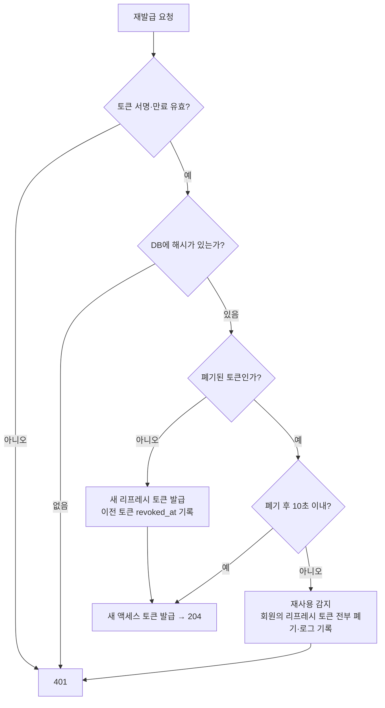
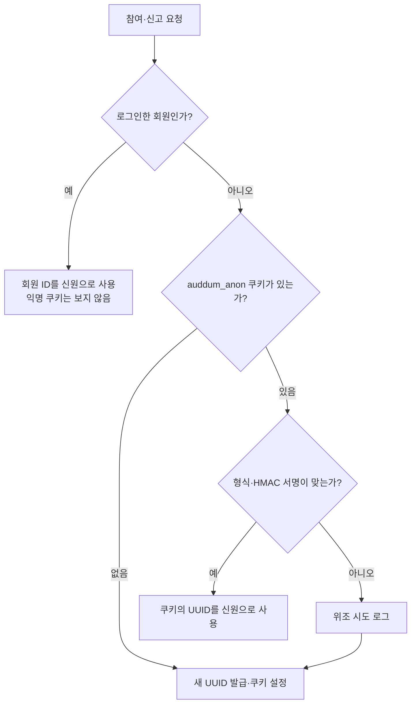

# AuDDum 인증 설계서

| 항목 | 내용 |
| --- | --- |
| 버전 | v1 |
| 작성일 | 2026-10-12 |
| 작성자 | 태풍 |
| 관련 문서 | [아키텍처](아키텍처.md), [동시성·중복 방지](동시성-중복-방지.md), [API 명세](../API-명세.md), [테스트 전략](테스트-전략.md) |

## 요약

로그인 이후의 신원 확인과 비회원 식별을 정한다. 핵심 결정은 세 가지다.

- 액세스·리프레시 JWT를 HttpOnly 쿠키로 전달하고, 리프레시 토큰은 해시로 저장해 교체·폐기한다.
- 회원 상태(정지·탈퇴)는 토큰이 아니라 쓰기 요청마다 DB에서 확인한다.
- 비회원은 서명된 익명 쿠키의 UUID로 구분하며, 이는 보조 수단이다.

## 목차

1. [토큰 인증](#1-토큰-인증)
2. [익명 식별 쿠키](#2-익명-식별-쿠키)

## 1. 토큰 인증

로그인 이후의 신원 확인은 JWT 두 종류로 한다. 카카오 로그인이 끝난 뒤에 서버가 발급하고 프런트는 토큰을 만지지 않는다. 만료 시간과 동시 재발급 유예는 확정했다.

| 항목 | 액세스 토큰 | 리프레시 토큰 |
| --- | --- | --- |
| 역할 | API 요청의 신원 확인 | 액세스 토큰 재발급 |
| 형식 | JWT, 서명 검증만으로 판단 | JWT, DB(`refresh_token`)에 해시로 대조 |
| 담는 값 | `sub`(회원 ID), `category`(`access`), `role`, `iat`, `exp` | `sub`, `category`(`refresh`), `jti`, `iat`, `exp` |
| 담지 않는 값 | 회원 상태(정지·탈퇴)·카카오 정보 | 회원 상태·역할 |
| 만료 | 30분 | 14일 |
| 쿠키 경로 | `/` | `/api/v1/auth`(재발급·로그아웃에만 전송) |
| 공통 속성 | HttpOnly, Secure, SameSite=Lax | 같음. Secure는 `auddum.auth.cookie-secure`로 정하며 http인 로컬 환경에서만 끈다. |

- `category` 클레임으로 두 토큰을 구분하고, 다른 종류의 토큰은 거절한다(리프레시 토큰을 액세스 쿠키로 보내도 인증되지 않는다).
- 서명 키(`JWT_SECRET`, HS256, 32바이트 이상)는 환경 설정으로 분리하고 코드에 넣지 않는다. 운영에는 기본값이 없다.
- `token_hash`는 리프레시 토큰 원문의 SHA-256 소문자 16진수(64자)다. 폐기 후 "10초 이내"는 정확히 10초를 포함한다.
- 로그아웃은 액세스 토큰이 만료돼 있어도 되도록 리프레시 쿠키만으로 처리한다. 모르는 토큰이거나 쿠키가 없어도 204이고 쿠키를 지운다.
- 액세스 토큰의 `role`은 권한 판단에 쓰지 않는다. 상태와 권한(관리자 여부)은 모두 아래 "회원 상태 확인"처럼 DB에서 확인한다. 권한이 바뀌어도 재로그인 없이 바로 반영된다.

**리프레시 토큰 교체와 폐기**

- 재발급할 때마다 새 리프레시 토큰을 만들고 이전 토큰의 `revoked_at`을 채운다. 저장은 원문이 아니라 해시값(`token_hash`)만 한다.
- 이미 폐기된 토큰이 다시 오면 재사용으로 보고 요청을 401로 거절한다. 이때 그 회원의 리프레시 토큰을 **모두 폐기**하고(모든 기기 로그아웃) 로그로 남긴다. (확정)
- 로그아웃은 현재 기기의 토큰만 폐기한다. 동시 로그인을 허용하므로 회원당 토큰이 여러 건이다.
- 탈퇴하면 그 회원의 리프레시 토큰을 모두 삭제한다. 이미 발급된 액세스 토큰은 원래 만료까지 쓸 수 있지만, 쓰기 요청은 아래 "회원 상태 확인"에서 막히고 재발급은 토큰이 없어 실패한다.
- 탭 두 개가 같은 리프레시 토큰으로 거의 동시에 재발급하면 한쪽이 재사용으로 보여 모든 기기가 로그아웃될 수 있다. 같은 리프레시 토큰이 동시에 오면 직전 토큰을 10초간 허용하는 유예를 둔다(확정).

리프레시 토큰으로 재발급을 요청했을 때의 판단 순서는 아래와 같다.

**회원 상태 확인**

정지·탈퇴는 로그인이 유지되는 동안에도 일어나므로 상태는 토큰이 아니라 DB에서 확인한다. 확인은 쓰기를 처리하는 서비스가 `MemberReader.getActiveMember()`로 한다(상태 규칙은 R-MEMBER-11).

| 대상 요청 | 확인 내용 | 실패 시 |
| --- | --- | --- |
| 로그인한 회원의 쓰기 요청(POST·DELETE 등) | 회원 PK로 상태 조회 | 탈퇴·없음 401, 정지 403 `MEMBER_SUSPENDED`(로그아웃·탈퇴는 확인하지 않는다) |
| 조회(GET) | 확인 없음(토큰 서명만 확인) | 토큰 무효 시 비회원으로 취급 |
| `GET /members/me` | 회원 PK로 조회(자기 정보를 읽는 요청이라 DB를 본다) | 탈퇴·없음 401, 정지는 조회할 수 있다 |
| 관리자 API | DB의 `role`이 ADMIN이고 정상(ACTIVE)인 회원. 정지·탈퇴한 관리자는 권한이 없다(`MemberReader.isAdmin`이 판정하고 `AdminAccessValidator`가 매 요청 확인한다) | 403 `FORBIDDEN` (정지 관리자도 `MEMBER_SUSPENDED`가 아니다) |

정지·탈퇴 회원이 할 수 있는 일은 요청마다 다르다.

| 요청 | 정지 회원 | 탈퇴 회원 |
| --- | --- | --- |
| 참여·신고·생성 등 일반 쓰기 | 403 `MEMBER_SUSPENDED` (서비스가 `getActiveMember()`로 확인) | 401 |
| 로그아웃 | 통과. 리프레시 쿠키로만 신원을 보고 회원을 조회하지 않아 쿠키를 정리할 수 있다. | 통과 |
| 탈퇴 | 통과(`getActiveMember()`를 부르지 않는다) | 401 (이미 탈퇴한 회원) |
| 재발급 | 통과 | 401 |
| 조회 | 가능 | 비회원 취급 |

- 일반 쓰기 서비스는 모두 `getActiveMember()`를 부른다. 새 쓰기를 만들 때 빠뜨리지 않는 것이 리뷰 확인 항목이다.
- 상태 조회는 PK 조회 한 번이다. 성능 문제가 측정되기 전에는 캐시를 두지 않는다.
- 정지와 동시에 들어온 요청은 정지 직전에 검증된 것이면 그대로 처리한다(정책 P-29).

**CSRF 대응**

쿠키로 인증하므로 다른 사이트가 사용자 브라우저로 쓰기 요청을 보내는 공격을 막아야 한다.

- 상태를 바꾸는 요청은 POST·DELETE만 쓰고 GET은 상태를 바꾸지 않는다.
- 쿠키는 SameSite=Lax로 두고, 쓰기 요청(GET·HEAD·OPTIONS 외)은 `Origin` 헤더가 허용 목록(`FRONTEND_BASE_URL` + `CORS_ALLOWED_ORIGINS`, CORS 설정과 같은 목록)에 있을 때만 받고, 없거나 다르면 403 `FORBIDDEN`이다. 별도 CSRF 토큰은 도입하지 않는다.
- 프런트와 API는 같은 사이트의 서브도메인으로 둔다([배포](../howto/배포.md)). 다른 사이트가 되면 SameSite와 CORS 설정을 다시 본다.

## 2. 익명 식별 쿠키

비회원의 중복 참여를 줄이는 보조 수단이다. 신원 확인 수단이 아니고, 쿠키를 지우거나 다른 기기를 쓰면 새 사용자로 보인다는 한계를 정책으로 받아들였다.

| 항목 | 내용 |
| --- | --- |
| 이름 | `auddum_anon` |
| 값 | `v1.<UUID>.<서명>`. 서명은 서버 비밀 키로 `v1.<UUID>`에 대해 만든 HMAC-SHA256(Base64url)이다. UUID는 소문자 표준 형식(8-4-4-4-12)만 인정한다. |
| 속성 | HttpOnly, SameSite=Lax, 경로 `/`, 만료 1년(365일). Secure는 토큰 쿠키와 같이 설정 `auddum.auth.cookie-secure`를 따른다(운영 true, http인 로컬 false). |
| 저장 | UUID만 `vote.anon_id`와 `report.reporter_anon_id`(CHAR(36))에 저장한다. 서명은 저장하지 않는다. |

**발급과 읽기**

| 상황 | 동작 |
| --- | --- |
| 쿠키가 필요한 쓰기 요청(첫 참여, 첫 신고) | 처리 중에 발급한다. 조회만 하는 방문자에게는 발급하지 않는다. |
| 참여 여부 판단(상세·결과 조회) | 쿠키를 읽기만 하고 새로 발급하지 않는다. 쿠키가 없거나 위조·형식 오류이면 미참여로 본다. 조회는 호출이 많아 위조 로그도 남기지 않는다. |
| 쿠키가 유효하다 | 그 UUID를 신원으로 쓴다. 만료 시각은 요청마다 갱신하지 않는다. |
| 요청이 오류로 끝났다(`INVALID_OPTION`, `POLL_CLOSED` 등) | 새로 발급한 쿠키도 내리지 않는다. 다음 요청에서 다시 발급한다. |
| 쿠키 값이 빈 문자열이다 | 쿠키가 없는 것으로 본다. 위조로 보지 않아 로그를 남기지 않고 새로 발급한다. |
| 회원이 로그인한 상태다 | 회원 ID를 우선 쓰고 익명 쿠키는 중복 판단에 쓰지 않는다. |

익명 쿠키로 신원을 정하는 순서는 아래와 같다.

**위조·변조 처리**

- 서명이 맞지 않거나 형식이 틀리면 무효로 보고 새 UUID를 발급해 덮어쓴다. 오류로 응답하지 않는다.
- 이때 시도를 WARN 로그로 남긴다(`[AnonIdentityResolver] 위조 의심 익명 쿠키…`). 사유(형식 오류, 서명 불일치)만 적고 쿠키 값 원문은 남기지 않는다. 외부 입력이 로그에 섞이는 것을 막기 위해서다. 위조된 값으로는 다른 사람의 신원을 흉내 낼 수 없다.
- 회원이 로그인한 상태에서는 쿠키를 보지 않으므로 위조 쿠키가 와도 로그를 남기지 않는다.

**서명 키**

- 환경 변수 `ANON_COOKIE_SECRET`(`auddum.anon-cookie.secret`)으로 주입하고, UTF-8 바이트 기준 32바이트 이상이어야 한다.
- 운영(prod)에는 기본값이 없어 값이 없거나 짧으면 기동하지 못한다. 로컬은 `application-local.yaml`의 기본값을 쓴다.

**한계**

- 쿠키 삭제, 다른 기기·브라우저, 시크릿 모드로는 같은 사람이 다시 참여할 수 있다.
- 저장은 성공했는데 응답이 유실되어 쿠키가 남지 않으면 다음 요청이 새 익명 ID로 처리되어 재참여가 가능하다.
- 비회원으로 참여한 뒤 로그인해 다시 참여하는 것도 막지 않는다. 비회원 기록과 회원 ID는 연결하지 않는다.
- 서명 키를 교체하면 기존 쿠키가 모두 무효가 되어 중복 참여가 가능해진다. MVP는 키 하나로 운영하고 노출되면 교체하며 전원이 재로그인한다. 이전 키를 함께 검증하는 무중단 교체는 이후에 본다.
