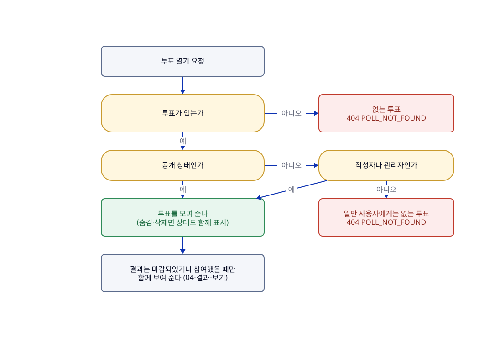

# 둘러보기

## 한눈에

누구나(회원도 비회원도) 공개된 투표 목록을 보고, 투표 하나를 열어 볼 수 있다.

- 목록에는 공개 상태인 투표만 최신순으로 나온다. 마감된 투표도 마감 표시와 함께 나온다.
- 목록은 한 번에 최대 50개씩 가져오고, 이어서 볼 때는 커서(마지막으로 본 위치)를 넘긴다.
- 목록의 한 줄에는 질문, 카테고리, 참여 수, 마감 여부, 마감 시각, 생성 시각이 있다.
- 투표를 열면 질문, 선택지 2~5개, 마감 여부, 참여 수가 나오고, 이미 참여했다면 내가 고른 선택지도 나온다.
- 숨김·삭제된 투표는 일반 사용자에게는 없는 것처럼 보이고(404), 작성자와 관리자만 볼 수 있다.
- 투표 결과(득표 수)는 마감되었거나 내가 참여했을 때만 함께 나온다. 자세한 것은 [04-결과-보기](04-결과-보기.md)에 있다.

**한계**(아직 없는 것)

- 카테고리로 거르는 기능은 없다. 카테고리는 표시만 한다.

## 흐름

그림의 원본은 [01-둘러보기.d2](../diagrams/01-둘러보기.d2)이고, 응답의 기준은 [API 목록](../generated/API-목록.md)과 [openapi.json](../generated/openapi.json)이다.

## 이럴 때는

UC는 사용자 시나리오 번호다. 응답 코드는 위 흐름도와 아래 규칙 표에 있다.

| UC | 상황 | 결과 |
|---|---|---|
| UC-01 | **누구든 투표 목록을 연다.** 사전 조건은 없다 | 공개 투표만 최신순으로 나온다. 투표가 없으면 빈 목록이다. 정렬과 커서는 투표가 만들어진 순서를 따르고, 한 번에 줄 수 있는 개수에는 서버 상한(50)이 있다 |
| UC-02 | **누구든 목록에서 투표 하나를 연다.** 대상 투표가 있어야 한다 | 질문, 선택지, 마감 여부, 참여 수가 나온다. 마감된 투표도 열리지만 참여할 수 없다고 내려간다. 이미 참여했으면 내 선택과 결과도 나오고, 마감 전에 참여하지 않았으면 선택지와 전체 참여 수만 나온다. 마감 여부는 서버 시각으로 계산한다 |

## 규칙

| 규칙 | 어긋나면 | 근거·테스트 |
|---|---|---|
| 공개 투표는 모두에게 보이고, 숨김·삭제된 투표는 작성자와 관리자에게만 보인다(R-POLL-18). 목록에는 공개 투표만 나온다 | 거절(404 `POLL_NOT_FOUND`) | P-01 · `HiddenPollViewChainTest`, `PollQueryServiceTest` |
| 마감은 저장하지 않고, 요청을 받은 시각으로 그때그때 계산한다(R-POLL-07) | — | P-11 · `PollListWebApiTest`, `ClosesAtTest` |
| 투표는 12자 영숫자의 공개 ID로 가리키고, 내부 번호는 밖에 보이지 않는다(R-POLL-21) | 형식이 틀리면 거절(400 `MALFORMED_REQUEST`) | `PublicIdTest`, `PollListWebApiTest` |
| 선택지도 내부 번호 대신 순번(1~5)으로 가리킨다(R-POLL-22) | — | `PositionTest` |

규칙(R)은 코드가 항상 지키는 조건이고, 정책(P)은 그렇게 정한 제품 결정이다. 규칙의 정의는 [도메인-모델](../domain/도메인-모델.md)에 있고 위 요약이 다르면 정의를 따른다. 정책의 정의는 바로 아래에 있다.

## 정책 정의

| ID | 확정 내용 | 관련 UC |
| --- | --- | --- |
| P-07 | 목록은 커서 기반 페이징으로 제공하고 질문·카테고리·참여 수·마감 여부·생성 시각을 노출한다. | UC-01 |
| P-23 | 카테고리 필터는 MVP에서 제외하고 목록에 표시만 한다. | UC-01 |

이 기능과 이어진 다른 정책은 다른 페이지에 있다. P-01(숨김·삭제 투표는 404)은 [06-관리자-조치](06-관리자-조치.md), P-03·P-25(결과 공개)는 [04-결과-보기](04-결과-보기.md)에 있다.

## 사용하는 API

| API | 하는 일 |
|---|---|
| `GET /polls` | 공개 투표 목록을 최신순으로 준다([API 목록](../generated/API-목록.md)) |
| `GET /polls/{pollId}` | 투표 하나를 열어 준다. 내 선택과 결과도 조건에 따라 함께 준다 |

## 이력

| 이슈 | 변경 | sketch |
|---|---|---|
| #109 | 목록·상세 시나리오와 목록 정책 정의를 이 페이지로 옮김. 기능 단위로 한 페이지에서 읽게 하려고 | [109-feature-pages-1](../records/sketches/109-feature-pages-1.md) |
