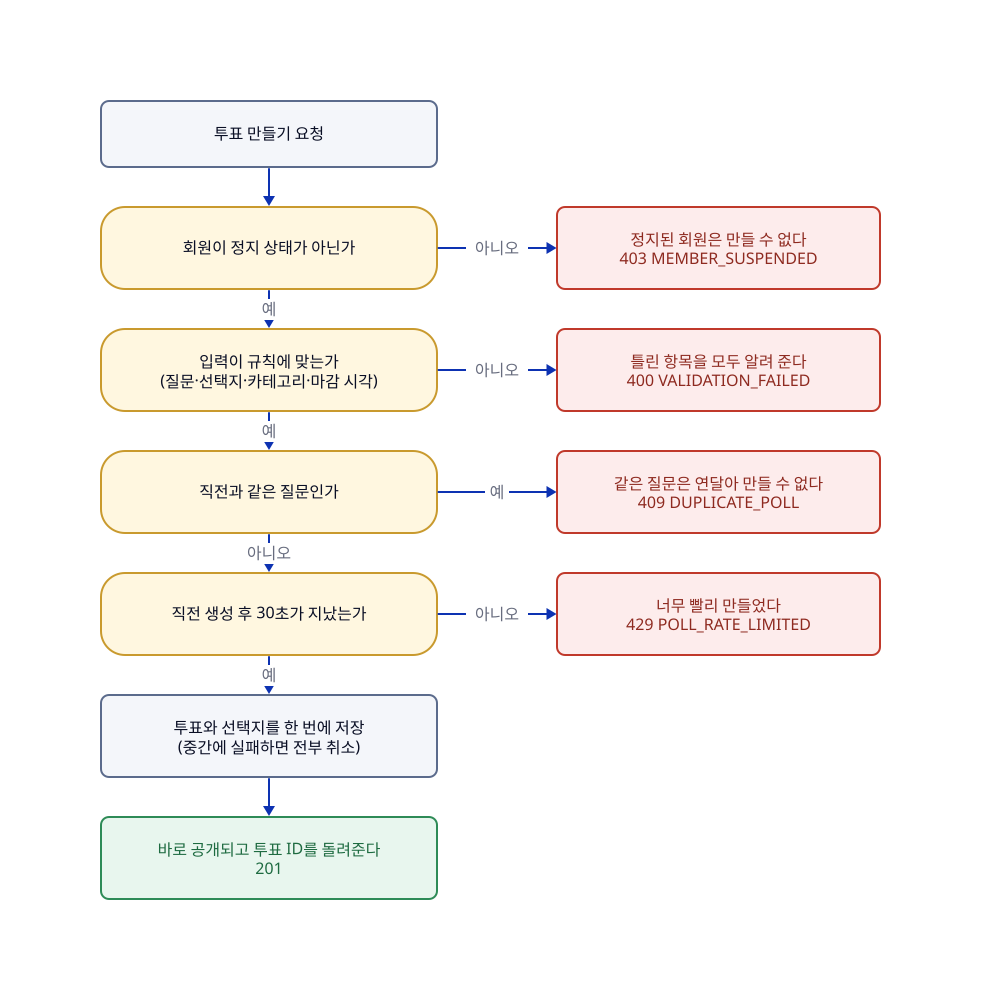

# 투표 만들기

## 한눈에

로그인한 회원(정상 상태)이 질문과 선택지, 카테고리를 적어 투표를 만들 수 있다. 만들면 관리자 승인 없이 바로 공개된다.

- 질문은 1~500자(줄바꿈 불가), 선택지는 2~5개(각 1~50자, 줄바꿈 불가, 같은 것 불가), 카테고리는 7가지 중 하나다. 마감 시각은 선택이고, 적으면 지금보다 뒤여야 한다.
- 만든 뒤에는 수정할 수 없다. 작성자는 삭제만 할 수 있고, 삭제해도 참여 기록은 남는다.
- 연달아 만드는 것을 막는다. 직전과 같은 질문은 안 되고, 직전에 만든 뒤 30초가 지나야 한다.
- 정지된 회원은 만들 수도 지울 수도 없다.
- 텍스트만 받는다. 이미지나 링크 첨부는 받지 않고, 출력할 때 스크립트가 실행되지 않도록 이스케이프 정책을 둔다.

> [!NOTE]
> **한계**
>
> - 탈퇴한 회원은 그 회원으로 다시 로그인할 수 없으므로, 탈퇴 전에 만든 투표를 작성자로서 삭제할 수 없다. 관리자만 삭제할 수 있다.

## 흐름

그림의 원본은 [02-투표-만들기.d2](../diagrams/02-투표-만들기.d2)이고, 응답의 기준은 [API 목록](../generated/API-목록.md)과 [openapi.json](../generated/openapi.json)이다. 빠진 항목과 개수는 회원 상태보다 먼저 검사하므로 정지 회원도 이 경우에는 400을 받는다. 같은 질문과 30초 제한이 동시에 걸리면 같은 질문(409)이 먼저다.

## 이럴 때는

| UC | 상황 | 결과 |
|---|---|---|
| UC-07 | **회원이 투표를 만든다.** 질문, 선택지 2~5개, 카테고리를 적고 마감 시각은 원하면 적는다 | 투표와 선택지가 한꺼번에 저장되어 바로 공개된다. 참여 수는 0이다. 중간에 실패하면 아무것도 남지 않는다 |
| UC-08 | **규칙에 맞지 않는 입력을 보낸다.** 화면이 먼저 걸러도 서버가 다시 검사한다(API 직접 호출 포함) | 아무것도 저장하지 않고 틀린 항목과 이유를 알려 준다. 빠진 항목·선택지 개수·지난 마감 시각은 한 번에 모두 알려 주고, 글자 수·줄바꿈·중복은 처음 틀린 항목 하나를 알려 준다. 틀린 입력은 질문 없음·500자 초과·줄바꿈, 선택지 1개 이하·6개 이상·빈 값·50자 초과·줄바꿈·중복, 카테고리 없음·허용되지 않는 값, 과거 마감 시각, 범위 밖 필드(이미지·링크)다 |
| UC-09 | **정지된 회원이 투표를 만들려 한다.** 정지 전에 이미 로그인했어도, 서버는 요청 때마다 DB의 상태를 다시 확인한다 | 거절하고 아무것도 저장하지 않는다. 정지 처리 직전에 도착한 요청은 그대로 처리한다(P-29) |
| UC-17 | **작성자가 자기 투표를 삭제한다.** 작성자인지는 로그인 정보로 판단하고, 요청에 적힌 회원 ID는 믿지 않는다 | 투표가 삭제 상태가 되어 일반 사용자에게는 바로 안 보이고, 투표 기록은 남는다. 되돌릴 수 없고 작성자와 관리자는 조회할 수 있다. 삭제한 주체와 시각을 기록한다. 삭제 직전에 도착한 참여는 그대로 처리한다. 삭제된 투표에 접수된 신고는 관리자 조치에서 종료한다 |

## 규칙

| 규칙 | 어긋나면 | 근거·테스트 |
|---|---|---|
| 질문은 앞뒤 공백을 뺀 뒤 1~500자(유니코드 문자 단위)이고 줄바꿈이 없다. 카테고리는 필수다(R-POLL-01) | 거절(400 `VALIDATION_FAILED`) | P-16 · `PollQuestionTest`, `PollTest` |
| 선택지는 2~5개이고 각각 앞뒤 공백을 뺀 뒤 1~50자이며 줄바꿈이 없다. 대소문자와 악센트를 구분하지 않고 같은 것이 둘 있으면 안 된다. 선택지의 순번과 내용은 한 투표 안에서 겹치지 않는다(R-POLL-02, R-POLL-23) | 거절(400 `VALIDATION_FAILED`) | P-16 · `OptionContentTest`, `PollTest` |
| 같은 작성자는 직전 투표와 같은 질문을 만들 수 없고, 직전 생성 후 30초가 지나야 다시 만들 수 있다. 일일 총량 제한은 없다. 30초는 배포로 바꿀 수 있다(R-POLL-03, R-POLL-04) | 거절(409 `DUPLICATE_POLL`, 30초 미만은 429 `POLL_RATE_LIMITED`). 둘 다 어기면 같은 질문(409)이 먼저다 | P-06, P-17 · `PollCommandServiceTest` |
| 마감 시각은 선택이다. 적으면 만드는 시점보다 뒤여야 하고(같은 시각도 안 된다) 상한은 없다(R-POLL-05) | 거절(400 `VALIDATION_FAILED`) | P-15 · `ClosesAtTest` |
| 만든 뒤에는 질문·선택지·마감 시각을 수정할 수 없고, 작성자는 삭제만 할 수 있다(R-POLL-06) | — | P-02 · `PollTest` |
| 값 규칙을 어기면 어느 항목이 왜 틀렸는지 함께 알려 준다. 요청 검증이 먼저 걸러도 도메인이 한 번 더 지킨다(R-POLL-08) | 거절(400 `VALIDATION_FAILED`) | `DomainValidationReasonTest`, `PollWebApiTest` |
| 작성자가 아닌 사람의 삭제는 공개 투표면 거절하고, 숨김·삭제된 투표면 존재를 숨기려고 없는 투표로 답한다(R-POLL-17) | 거절(403 `FORBIDDEN`, 숨김·삭제 투표는 404 `POLL_NOT_FOUND`) | P-01 · `PollTest` |
| 관리자가 숨긴 투표는 작성자가 삭제할 수 없다(R-POLL-09) | 거절(403 `POLL_NOT_DELETABLE`) | P-30 · `PollTest` |
| 작성자의 삭제로 공개 투표가 삭제 상태가 된다. 삭제는 되돌릴 수 없다(R-POLL-13, R-POLL-16) | 이미 삭제된 투표는 404 | P-02 · `PollTest` |

## 정책 정의

| ID | 확정 내용 | 관련 UC |
| --- | --- | --- |
| P-02 | 투표 수정은 불가하고 작성자의 삭제만 허용한다(논리 삭제). | UC-17 |
| P-06 | 연속 생성 간격만 제한하고 일일 총량 제한은 두지 않는다. 간격은 30초이고 필요하면 상수를 바꿔 배포한다. | UC-07 |
| P-15 | 마감 시간은 현재보다 미래이기만 하면 허용하고 상한을 두지 않는다. | UC-07, 08 |
| P-16 | 글자 수는 유니코드 문자 단위다. 질문 500자, 선택지 50자, 줄바꿈 불가, 선택지 중복 불허. | UC-07, 08 |
| P-17 | 같은 회원의 직전 동일 질문 연속 생성을 서버에서 차단한다. | UC-07 |

이 기능과 이어진 다른 정책은 다른 페이지에 있다. P-01(숨김·삭제 투표는 404)과 P-29·P-30(조치 직전 요청, 권한)은 [06-관리자-조치](06-관리자-조치.md), P-05(정지 회원은 쓰기 불가)는 [07-로그인과-회원](07-로그인과-회원.md)에 있다.

## 사용하는 API

| API | 하는 일 |
|---|---|
| `POST /polls` | 투표를 만든다([API 목록](../generated/API-목록.md)) |
| `DELETE /polls/{pollId}` | 작성자가 자기 투표를 삭제한다(구현 전, #76. 삭제 규칙은 도메인에 있다) |

## 이력

| 이슈 | 변경 | sketch |
|---|---|---|
| [#9](https://github.com/kwakseobang/AuDDum/issues/9) | 투표·선택지와 입력 규칙(질문·선택지·마감 시각·공개 ID)을 만듦 | — |
| [#10](https://github.com/kwakseobang/AuDDum/issues/10) | 투표 생성 API와 연속 생성 제한(같은 질문 409, 30초 429)을 만듦 | — |
