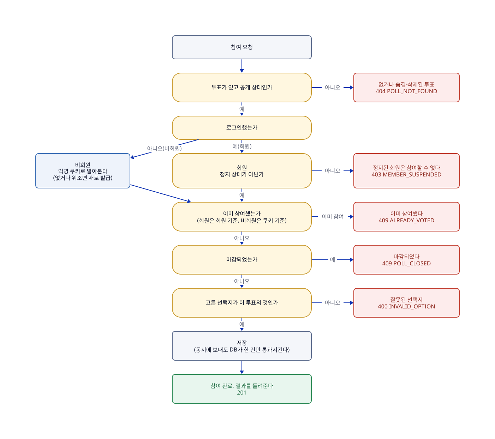

# 참여하기

## 한눈에

비회원도 회원도 투표에서 선택지 하나를 골라 참여할 수 있다.

- 한 사람은 한 투표에 **한 번만** 참여하고, 선택은 바꿀 수 없다.
- 이미 참여한 사람이 다시 보내면 거절한다(409). 마감이 지난 뒤에도 같다.
- 없거나 숨김·삭제된 투표, 마감된 투표, 정지된 회원은 참여할 수 없다.
- 로그인했으면 회원, 아니면 비회원이다. 비회원은 서버가 브라우저에 심어 둔 익명 쿠키로 같은 사람인지 알아본다.

**한계**(막을 수 없는 것)

- 비회원이 쿠키를 지우거나 다른 기기를 쓰면 새 사람으로 보인다. 저장 뒤 응답이 사라져 쿠키를 못 받았을 때도 같다.
- 비회원으로 참여한 뒤 로그인해 다시 참여하거나, 로그아웃한 뒤 비회원으로 다시 참여할 수 있다.

숫자(409 등)는 서버가 돌려주는 응답 코드다. 4로 시작하면 요청이 잘못되었거나 지금은 받을 수 없다는 뜻이다.

## 흐름

앞 단계에서 거절되면 뒤는 보지 않는다. 그림의 원본은 [03-참여하기.d2](../diagrams/03-참여하기.d2)이고, 순서의 기준은 이 그림이고, 응답의 기준은 [API 목록](../generated/API-목록.md)과 [openapi.json](../generated/openapi.json)이다.

## 이럴 때는

UC는 사용자 시나리오 번호다. 응답 코드는 위 흐름도와 아래 규칙 표에 있다.

| UC | 상황 | 결과 |
|---|---|---|
| UC-03 | **비회원이 처음 참여한다.** 익명 쿠키로 알아보고, 없으면 이 요청에서 새로 준다 | 참여가 기록된다. 저장 중 오류가 나면 아무것도 남기지 않는다 |
| UC-04 | **비회원이 같은 쿠키로 다시 보낸다.** 새로고침, 재시도, 동시에 두 번 | 거절한다. 동시에 보내면 한 건만 남는다. 시도는 로그에 남겨 어뷰징 분석에 쓴다 |
| UC-10 | **회원이 처음 참여한다.** 로그인 정보로 알아본다(요청에 적힌 회원 정보는 쓰지 않는다). 로그인하지 않았으면 UC-03으로 처리한다 | 참여가 기록된다. 정지된 회원은 거절한다 |
| UC-11 | **회원이 다시 보낸다.** 다른 기기·브라우저도 포함 | 거절한다. 동시에 보내면 한 건만 남는다 |
| UC-12 | **마감이 지난 뒤 보낸다.** 서버 시각이 마감 시각 이상이면 마감이고, 요청을 받은 순간 한 번만 판단한다. 서버가 여러 대여도 동기화된 서버 시각을 쓰고, 화면의 남은 시간이나 버튼 비활성화는 믿지 않는다 | 기록이 없으면 "마감" 거절. 이미 참여했으면 "이미 참여" 거절이 먼저다. 마감 시각이 없는 투표는 계속 참여할 수 있다 |

## 규칙

| 규칙 | 어긋나면 | 근거·테스트 |
|---|---|---|
| 참여 기록은 만든 뒤 바꾸거나 지우지 않는다(R-VOTE-01) | — | `VoteTest` |
| 한 사람은 한 투표에 한 번만 참여한다. 동시에 보내도 마지막에 DB가 한 건만 통과시킨다(R-VOTE-02, 유니크 제약) | 거절(409 `ALREADY_VOTED`) | P-08 · `VoteConcurrencyTest`, `VoteWriterConflictTest` |
| 참여자는 회원이거나 비회원, 둘 중 한 쪽이다. 둘 다이거나 둘 다 아니면 저장되지 않는다(R-VOTE-03) | 저장 실패(DB가 막는다, CHECK 제약) | `VoterTest`, `VoteMappingTest` |
| 선택지는 같은 투표의 것이어야 한다. DB도 이중으로 막는다(R-VOTE-04, 외래키) | 거절(400 `INVALID_OPTION`) | `VoteTest` |
| 다시 보내면 선택이 같든 다르든 거절한다. 마감 뒤에도 같다(R-VOTE-05) | 거절(409 `ALREADY_VOTED`) | P-08, P-12 · `VoteParticipatorTest`, `VoteCommandServiceTest` |
| 정지된 회원은 참여할 수 없다(R-VOTE-06) | 거절(403 `MEMBER_SUSPENDED`) | P-05 · `VoteCommandServiceTest` |
| 탈퇴한 회원의 참여 기록은 남기고 집계에도 센다(R-VOTE-07) | — | 테스트 아직 없음 |
| 비회원의 참여 기록과 회원 ID는 연결하지 않는다(R-VOTE-08) | — | P-10 · `VoteCommandServiceTest` |

규칙(R)은 코드가 항상 지키는 조건이고, 정책(P)은 그렇게 정한 제품 결정이다. 규칙의 정의는 [도메인-모델](../domain/도메인-모델.md)에 있고 위 요약이 다르면 정의를 따른다. 정책의 정의는 바로 아래에 있다.

**동시 요청과 경계에서 확인할 것**(실제 MySQL을 쓰는 통합 테스트로 확인한다)

| 확인할 것 | 기대 결과 |
| --- | --- |
| 같은 회원이 같은 투표에 여러 번 동시에 보낸다 | 참여 기록이 정확히 1건 |
| 같은 익명 쿠키로 동시에 보낸다 | 1건만 저장되고, 진 쪽은 선택이 같아도 거절(409) |
| 서로 다른 사람이 동시에 참여한다 | 선택지별 득표 합계가 전체 참여 수와 같다 |
| 마감 시각 직전과 직후에 보낸다 | 마감이면 거절(409), 아니면 참여 완료(201). 판정은 P-11 |
| 저장 중에 오류를 일으킨다 | 부분 저장 없이 전체 취소 |
| 위조된 익명 쿠키를 보낸다 | 오류 없이 새 UUID를 발급하고 시도를 로그에 남김 |
| 참여 기록에 회원 ID와 익명 식별자를 둘 다 넣거나 둘 다 비운다 | CHECK 제약으로 저장 실패 |

## 정책 정의

| ID | 확정 내용 | 관련 UC |
| --- | --- | --- |
| P-08 | 이미 참여한 신원이 다시 참여하면 선택지와 관계없이 409로 응답한다. 재전송 200은 두지 않는다. | UC-04, 11 |
| P-09 | 익명 식별 쿠키는 첫 참여 시 발급하고 영속 쿠키(1년)로 둔다. 위조·변조된 쿠키는 새로 발급하며 시도를 기록한다. | UC-03 |
| P-10 | 비회원 참여 기록과 회원 ID를 연결하지 않는다. 비회원으로 참여한 뒤 로그인해 다시 참여할 수 있는 한계를 명시한다. | UC-10, 11 |
| P-11 | 서버 시각이 마감 시각 이상이면 마감이며, 요청을 받은 시점에 한 번 판단한다. | UC-12 |
| P-12 | 마감된 투표에서 중복 참여가 감지되면 마감(POLL_CLOSED)보다 중복 참여(ALREADY_VOTED) 409를 우선한다. | UC-12 |
| P-24 | 참여 API는 하나로 두고 인증 정보 유무로 회원·비회원을 구분한다. | UC-03, 10 |

이 기능과 이어진 다른 정책은 다른 페이지에 있다. P-03·P-25(결과 공개)는 [04-결과-보기](04-결과-보기.md), P-05(정지 회원은 쓰기 불가)는 [07-로그인과-회원](07-로그인과-회원.md), P-01(숨김·삭제 투표는 404)은 [06-관리자-조치](06-관리자-조치.md)에 있다.

## 사용하는 API

| API | 하는 일 |
|---|---|
| `POST /polls/{pollId}/votes` | 투표에 참여한다([API 목록](../generated/API-목록.md)) |
| `GET /polls/{pollId}` | 이미 참여했다는 응답을 받은 화면이 여기서 내 선택(`myChoice`)과 결과를 받아 화면을 맞춘다 |

## 이력

| 이슈 | 변경 | sketch |
|---|---|---|
| #106 | 참여 시나리오·정책 정의를 이 페이지로 옮기고 흐름을 D2로 그림. 기능 하나를 한 페이지에서 읽게 하려고 | [106-participation-page](../records/sketches/106-participation-page.md) |
| #109 | 동시 요청·경계 검증 표를 인증과 중복 참여를 함께 다루던 옛 문서에서 이 페이지로 옮김. 참여 규칙의 검증을 한곳에서 보려고 | [109-docs-restructure](../records/sketches/109-docs-restructure.md) |
