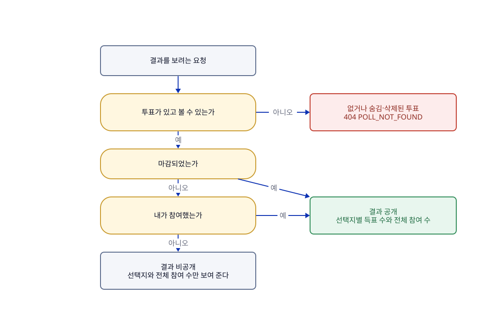

# 결과 보기

## 한눈에

투표가 마감되었거나 내가 참여했다면, 선택지별 득표 수와 전체 참여 수를 볼 수 있다.

- 마감 전에 참여하지 않은 사람에게는 결과를 감춘다. 이때는 선택지와 전체 참여 수만 보인다.
- 마감된 투표의 결과는 참여하지 않은 사람도 볼 수 있다.
- 결과를 따로 부르는 API는 없다. 참여한 직후의 응답과 투표 상세에 함께 담긴다.
- 서버는 득표 수만 주고, 비율은 화면이 계산한다.
- 숨김·삭제된 투표의 결과는 일반 사용자에게 보이지 않는다.

## 흐름

그림의 원본은 [04-결과-보기.d2](04-결과-보기.d2)이고, 공개 규칙의 기준은 [API-명세](../API-명세.md)의 참여·결과 API다.

## 이럴 때는

UC는 사용자 시나리오 번호다.

| UC | 상황 | 결과 |
|---|---|---|
| UC-13 | **참여한 직후나 투표 상세에서 결과를 본다.** 투표가 있고 볼 수 있는 상태여야 한다 | 선택지별 득표 수와 전체 참여 수가 입력한 순서대로 나온다. 득표가 없는 선택지도 0으로 나오고, 참여가 하나도 없으면 모두 0이다. 마감 전에는 참여한 사람에게만, 마감 뒤에는 참여하지 않은 사람에게도 보인다. 집계와 기록이 다르면 기록을 기준으로 하고 오류를 남긴다 |

## 규칙

| 규칙 | 어긋나면 | 근거·테스트 |
|---|---|---|
| 마감되었거나 내가 참여했으면 결과를 공개한다(R-POLL-19). 참여했는지는 회원 ID나 익명 쿠키로 판단한다 | 결과는 비공개(`result`가 비고, 선택지와 전체 참여 수만 준다) | P-03, P-25 · `PollQueryServiceParticipationTest`, `PollDetailChainTest` |
| 결과의 원천은 저장된 참여 기록이고, 전체 참여 수는 선택지별 득표 수의 합과 같다 | — | `VoteReaderTest`, `PollQueryServiceParticipationTest` |

규칙(R)은 코드가 항상 지키는 조건이고, 정책(P)은 그렇게 정한 제품 결정이다. 규칙의 정의는 [도메인-모델](../domain/도메인-모델.md)에 있고 위 요약이 다르면 정의를 따른다. 정책의 정의는 바로 아래에 있다.

## 정책 정의

| ID | 확정 내용 | 관련 UC |
| --- | --- | --- |
| P-03 | 마감 전에는 참여한 뒤에만 결과를 공개한다. 참여 여부는 회원 ID 또는 익명 쿠키로 판단한다. | UC-02, 13 |
| P-25 | 마감된 투표의 결과는 참여하지 않은 사용자도 조회할 수 있다. | UC-02, 12, 13 |

## 사용하는 API

| API | 하는 일 |
|---|---|
| `POST /polls/{pollId}/votes` | 참여한 직후의 응답에 내 선택과 결과를 담아 준다([03-참여하기](03-참여하기.md)) |
| `GET /polls/{pollId}` | 투표 상세에 결과를 조건에 따라 담아 준다([01-둘러보기](01-둘러보기.md)) |

## 이력

| 이슈 | 변경 | sketch |
|---|---|---|
| #109 | 결과 조회 시나리오와 결과 공개 정책 정의를 이 페이지로 옮김. 결과 공개 규칙이 참여·상세 두 곳에 흩어져 있어서 | [109-feature-pages-1](../records/sketches/109-feature-pages-1.md) |
