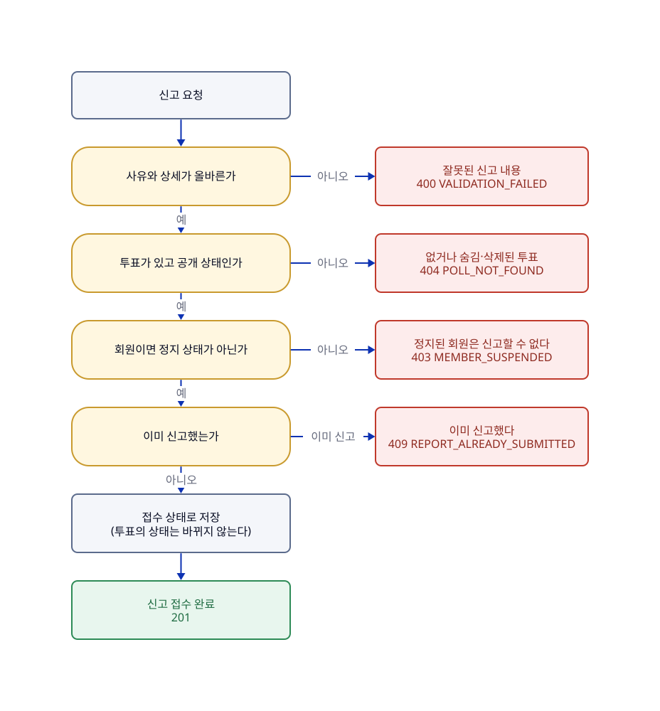

# 신고하기

## 한눈에

회원도 비회원도 공개된 투표를 신고할 수 있다.

- 신고 사유는 다섯 가지 중 하나다: 욕설·혐오 표현, 성희롱, 개인정보 노출, 광고·도배, 기타. '기타'를 고르면 상세 내용을 꼭 적어야 한다.
- 한 사람은 한 투표를 **한 번만** 신고할 수 있다. 다시 신고하면 거절한다(409).
- 신고가 들어와도 투표는 자동으로 숨겨지거나 삭제되지 않는다. 관리자가 검토해서 조치한다([06-관리자-조치](06-관리자-조치.md)).
- 이미 숨김·삭제된 투표와 정지된 회원은 신고할 수 없다. 마감된 투표는 신고할 수 있다.
- 신고한 사람에게 처리 결과를 알려 주지 않는다.

**한계**

- 비회원은 서버가 브라우저에 심어 둔 익명 쿠키로 구분하므로, 쿠키를 지우면 같은 사람이 다시 신고할 수 있다.
- 신고를 도배하는 것을 막는 방법은 아직 정하지 않았다(P-28).

## 흐름

그림의 원본은 [05-신고하기.d2](05-신고하기.d2)이고, 응답의 기준은 [API-명세](../API-명세.md)의 신고 API다.

## 이럴 때는

UC는 사용자 시나리오 번호다. 응답 코드는 위 흐름도와 아래 규칙 표에 있다.

| UC | 상황 | 결과 |
|---|---|---|
| UC-14 | **회원이나 비회원이 투표 상세에서 신고를 고르고 사유를 제출한다.** 비회원은 익명 쿠키로 구분하고, 쿠키가 없으면 이 요청에서 새로 준다 | 신고가 접수 상태로 저장되어 관리자 검토 대상이 된다. 투표의 노출 상태는 바뀌지 않는다. 같은 투표를 다시 신고하면 거절하고, 동시에 보내도 한 건만 남는다 |

## 규칙

| 규칙 | 어긋나면 | 근거·테스트 |
|---|---|---|
| 신고는 접수 상태로 저장하고 관리자 검토 대상에 올린다(R-REPORT-01) | — | `ReportTest`, `ReportSubmitChainTest` |
| 한 사람은 한 투표를 한 번만 신고할 수 있다. 동시에 보내도 한 건만 인정한다(R-REPORT-02) | 거절(409 `REPORT_ALREADY_SUBMITTED`) | P-18 · `ReportSubmitChainTest`, `ReportConcurrencyTest` |
| 사유는 허용된 다섯 가지뿐이고, '기타'면 상세가 필수다(공백뿐이면 없는 것). 다른 사유의 상세도 버리지 않고 저장하며, 상세는 200자(임시)까지다(R-REPORT-03) | 거절(400 `VALIDATION_FAILED`, 허용되지 않는 사유 값은 400 `MALFORMED_REQUEST`) | P-18 · `ReportReasonTest` |
| 숨김·삭제된 투표는 신고할 수 없고, 정지된 회원도 신고할 수 없다(R-REPORT-04) | 거절(404 `POLL_NOT_FOUND`, 정지 회원은 403 `MEMBER_SUSPENDED`) | P-05 · `ReportSubmitChainTest`, `ReporterResolverTest` |
| 신고가 쌓여도 처리 전까지는 투표가 공개 상태로 남는다. 건수만으로 자동 처리하지 않는다(R-POLL-10) | — | `ReportSubmitChainTest` |

규칙(R)은 코드가 항상 지키는 조건이고, 정책(P)은 그렇게 정한 제품 결정이다. 규칙의 정의는 [도메인-모델](../domain/도메인-모델.md)에 있고 위 요약이 다르면 정의를 따른다. 정책의 정의는 바로 아래에 있다.

## 정책 정의

| ID | 확정 내용 | 관련 UC |
| --- | --- | --- |
| P-18 | 신고는 회원·비회원 모두 투표당 1회만 가능하다. '기타' 사유는 상세 텍스트가 필수이고(다른 사유의 상세도 저장), 신고자에게 처리 결과를 알리지 않는다. | UC-14 |

이 기능과 이어진 다른 정책은 다른 곳에 있다. P-05(정지 회원은 쓰기 불가)는 [07-로그인과-회원](07-로그인과-회원.md)에 있고, P-28(신고 도배 방어 등 운영 세부 값은 구현 단계에서 정한다)은 [예외-응답](../engineering/예외-응답.md)의 남은 결정에 있다.

## 사용하는 API

| API | 하는 일 |
|---|---|
| `POST /polls/{pollId}/reports` | 투표를 신고한다([API-명세](../API-명세.md)의 신고 API) |

## 이력

| 이슈 | 변경 | sketch |
|---|---|---|
| #109 | 신고 시나리오와 신고 정책 정의를 이 페이지로 옮김. 신고 접수가 규칙·정책·시나리오에 흩어져 있어서 | [109-feature-pages-1](../records/sketches/109-feature-pages-1.md) |
