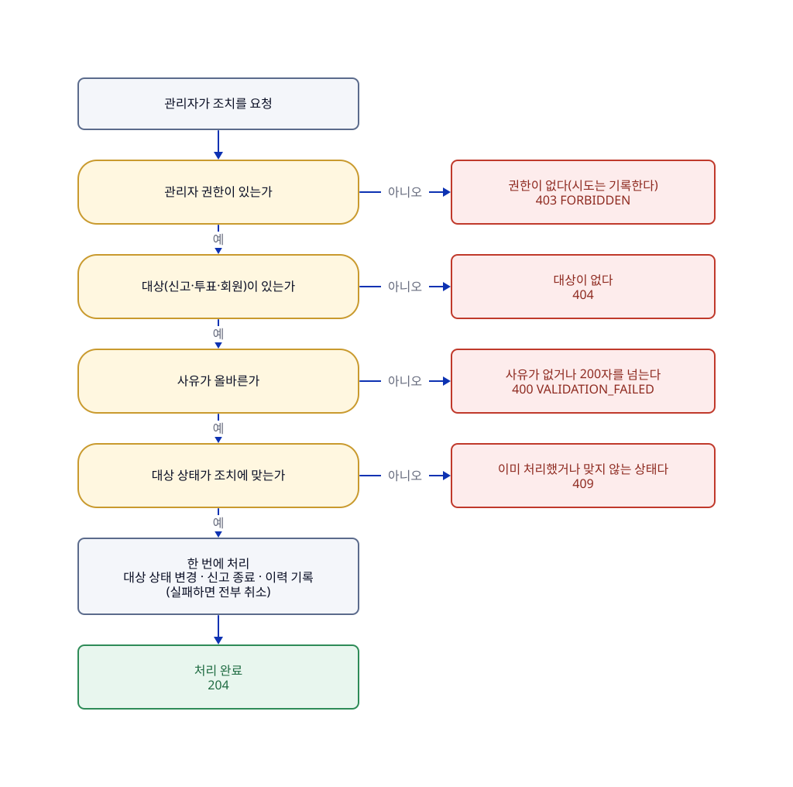

# 관리자 조치

## 한눈에

관리자는 접수된 신고를 보고 조치한다. 신고는 건수와 관계없이 자동으로 처리되지 않고, 항상 관리자가 검토한다.

- 조치는 네 가지다: 신고 기각, 투표 숨김, 투표 삭제, 작성자 이용 정지. 각각 별도 요청이다.
- 숨김은 되돌릴 수 있지만 삭제는 되돌릴 수 없다. 정지는 기간 없이 관리자가 풀 때까지 이어진다. 정지 규칙은 [07-로그인과-회원](07-로그인과-회원.md)에 있다.
- 한 투표에 신고가 여러 건이어도 한 번의 조치로 함께 종료한다.
- 모든 조치는 대상 상태 변경, 신고 종료, 이력 기록을 한 번에 처리하고, 처리자·시각·내용·사유를 이력으로 남긴다. 중간에 실패하면 전부 취소한다.
- 관리자 권한은 DB의 role이 ADMIN이고 정상 상태인 회원만 가진다. 매 요청마다 서버가 확인하고, 권한이 없으면 시도를 기록한다.
- 정지된 회원이 만든 기존 투표는 그대로 둔다.

**한계**

- 투표 복구와 정지 해제는 설계만 있고 아직 구현하지 않았다(#20).
- 관리자 계정을 만들고 권한을 주는 방식은 정하지 않았다(별도 보안 정책으로 정한다). 지금은 DB에서 직접 부여하고, role은 API로 바꿀 수 없다.

## 흐름

그림의 원본은 [06-관리자-조치.d2](../diagrams/06-관리자-조치.d2)이고, 응답의 기준은 [API-명세](../API-명세.md)의 관리자 API다. 권한 확인이 가장 먼저이고, 대상이 없으면(404) 사유 오류(400)보다 먼저, 사유 오류는 대상 상태 오류(409)보다 먼저 나간다.

## 이럴 때는

UC는 사용자 시나리오 번호다.

| UC | 상황 | 결과 |
|---|---|---|
| UC-15 | **관리자가 신고 목록을 보고 상세와 대상 투표를 확인한 뒤 조치를 고른다.** 기각·숨김·삭제는 각각 별도 요청이고, 필요하면 작성자 정지를 이어서 한다 | 대상 상태 변경, 신고 종료, 이력 기록이 한꺼번에 처리되어 일반 사용자에게 바로 반영된다. 기각은 투표를 그대로 두고 신고만 종료한다. 이미 처리된 신고를 다시 기각하거나 같은 신고에 동시에 기각하면 한쪽만 성공하고 나머지는 거절한다(409). 이미 숨긴 투표를 또 숨기거나 이미 정지·탈퇴한 회원을 정지해도 거절한다(409) |

## 운영 시나리오

신고 건수만으로 자동 삭제하지 않고 관리자가 검토한다. 모든 조치는 대상 상태 변경과 이력 기록을 한 트랜잭션으로 처리한다.

| ID | 시나리오 | 관리자 동작 | 시스템 동작 | 비고 |
| --- | --- | --- | --- | --- |
| OP-01 | 신규 신고가 접수됨 | 신고 목록에서 검토 대기 건 확인 | 신고를 접수 상태로 저장하고 검토 대상에 올림 | 접수 순(id 오름차순)으로 정렬한다(API 명세의 관리자 API) |
| OP-02 | 신고가 부당함 | 기각 | 신고를 기각 처리하고 투표는 그대로 유지, 이력 기록 |  |
| OP-03 | 규칙 위반이지만 삭제까지는 불필요 | 투표 숨김 | 일반 사용자에게 비공개로 전환, 이력 기록 | 관리자만 복구 |
| OP-04 | 개인정보 노출 등 심각한 위반 | 투표 삭제 | 논리 삭제, 일반 사용자에게 비공개, 이력 기록 | 복구 불가, 투표 기록은 보존 |
| OP-05 | 같은 회원의 문제 투표가 반복됨 | 작성자 이용 정지 | 회원 상태를 SUSPENDED로 변경, 이력 기록 | 기간 없이 수동 해제, 기존 투표는 유지 |
| OP-06 | 한 투표에 신고가 여러 건 쌓임 | 대표 건 검토 | 같은 투표의 신고를 묶어 보여줄지 | 확정: 같은 투표의 신고는 한 번의 조치로 함께 종료한다(API 명세) |
| OP-07 | 같은 신고에 조치가 동시에 들어옴(더블클릭·재전송) | 먼저 처리한 조치가 적용 | 나중 요청은 409로 거절 | 동시성 설계는 [예외-응답](../engineering/예외-응답.md)의 동시성·정합성 |
| OP-08 | 이미 숨겨진 투표에 신고가 또 접수됨 | 해당 없음(조치 때 시스템이 종료) | 숨김·삭제된 투표에는 신고를 받지 않고 404 반환 | 숨김·삭제 조치와 같은 트랜잭션에서 그 투표의 접수(PENDING) 상태 신고를 모두 종료 처리한다 |
| OP-09 | 잘못된 조치를 되돌려야 함 | 숨김 해제, 정지 해제 | 상태 복원과 이력 기록 | 숨김·정지만 복구, 삭제는 복구 불가 |
| OP-10 | 관리자 권한 없는 사용자가 관리자 기능 호출 | 해당 없음 | 403으로 거절하고 시도를 기록 | 일반 회원 로그인과 권한 분리 |

## 규칙

| 규칙 | 어긋나면 | 근거·테스트 |
|---|---|---|
| 관리자 권한은 DB의 role이 ADMIN이고 정상 상태여야 한다. 정지·탈퇴한 관리자는 없다. role은 API로 바꿀 수 없고 DB에서 직접 부여한다(R-MEMBER-09, R-MEMBER-10) | 거절(403 `FORBIDDEN`, 시도를 기록) | P-30 · `AdminAccessValidatorTest`, `MemberTest` |
| 조치 이력은 추가만 하고 고치거나 지우지 않는다(R-ACTION-01) | — | `AdminActionTest` |
| 모든 조치에 처리자, 처리 시각, 조치 내용, 사유(필수, 1~200자)를 남긴다(R-ACTION-02) | 거절(400 `VALIDATION_FAILED`) | `AdminActionTest`, `AdminReportActionChainTest` |
| 대상 상태 변경, 신고 상태 변경, 이력 기록은 한 번에 처리하고 실패하면 전부 되돌린다(R-ACTION-03) | 전부 취소(500) | `AdminReportActionRollbackTest` |
| 신고 이력(기각)에만 신고 ID를 채우고, 숨김·삭제·정지 이력은 신고 ID가 비어 있다(R-ACTION-04) | — | `AdminActionTest`, `AdminReportActionChainTest` |
| 공개 투표만 숨길 수 있고, 이미 숨겨졌으면 거절한다. 숨김만 복구할 수 있다(R-POLL-12, R-POLL-14) | 거절(409 `POLL_NOT_PUBLIC`, 복구는 `POLL_NOT_HIDDEN`) | P-01 · `PollTest`, `AdminReportActionChainTest` |
| 공개·숨김 투표를 삭제할 수 있고 삭제는 되돌릴 수 없다. 관리자가 숨긴 투표는 작성자가 삭제할 수 없다(R-POLL-13, R-POLL-15, R-POLL-16) | 삭제됐거나 없는 투표는 404 | P-01, P-30 · `PollTest`, `PollTakedownTest` |
| 정지한 회원의 기존 투표는 그대로 둔다(R-POLL-11) | — | P-26 · `AdminReportActionChainTest` |
| 종료된 신고는 다시 처리할 수 없다(R-REPORT-05). 같은 신고에 조치가 동시에 들어오면 한쪽만 반영한다(R-REPORT-08, 낙관적 락) | 거절(409 `REPORT_ALREADY_HANDLED`) | `ReportHandleTest`, `AdminReportActionConcurrencyTest` |
| 투표를 숨기거나 삭제하면 그 투표의 대기 신고를 모두 종료한다. 회원 정지는 신고 상태를 바꾸지 않는다(R-REPORT-06) | — | `AdminReportActionChainTest`, `AdminReportChainTest` |
| 기각은 처리 일시와 처리자를 기록한다(R-REPORT-07) | — | `ReportHandleTest` |

규칙(R)은 코드가 항상 지키는 조건이고, 정책(P)은 그렇게 정한 제품 결정이다. 규칙의 정의는 [도메인-모델](../domain/도메인-모델.md)에 있고 위 요약이 다르면 정의를 따른다. 정책의 정의는 바로 아래에 있다.

## 정책 정의

| ID | 확정 내용 | 관련 UC |
| --- | --- | --- |
| P-01 | 숨김·삭제는 상태값으로 관리한다. 일반 사용자는 접근할 수 없고(404) 작성자와 관리자만 조회할 수 있다. 숨김은 관리자만 복구할 수 있고 삭제된 투표는 복구할 수 없다. | UC-02, 13, 15 |
| P-26 | 이용 정지된 회원이 만든 기존 투표는 그대로 유지한다. | UC-15 |
| P-29 | 숨김·삭제나 정지·탈퇴 처리 직전에 도착한 요청은 그대로 처리하고 이후 요청부터 제한한다. | UC-09, 17 |
| P-30 | 권한 없는 접근은 관리자 API 포함 403이다. 관리자가 숨긴 투표는 작성자가 삭제할 수 없다. | UC-15, 17 |

## 사용하는 API

| API | 하는 일 |
|---|---|
| `GET /admin/reports` | 신고 목록을 접수 순으로 본다 |
| `GET /admin/reports/{reportId}` | 신고 상세, 같은 투표의 다른 신고, 조치 이력을 본다 |
| `POST /admin/reports/{reportId}/dismiss` | 신고를 기각한다 |
| `PATCH /admin/polls/{pollId}/status` | 투표를 숨기거나 삭제한다 |
| `POST /admin/members/{memberId}/suspend` | 회원을 정지한다 |
| `POST /admin/polls/{pollId}/restore` | 숨긴 투표를 복구한다(구현 전) |
| `POST /admin/members/{memberId}/unsuspend` | 정지를 해제한다(구현 전) |

([API-명세](../API-명세.md)의 관리자 API)

## 이력

| 이슈 | 변경 | sketch |
|---|---|---|
| #109 | 신고 검토·조치 시나리오, 운영 시나리오(OP-01~10), 조치 관련 정책 정의를 이 페이지로 옮김. 조치 규칙이 시나리오·정책·도메인에 흩어져 있어서 | [109-feature-pages-2](../records/sketches/109-feature-pages-2.md) |
