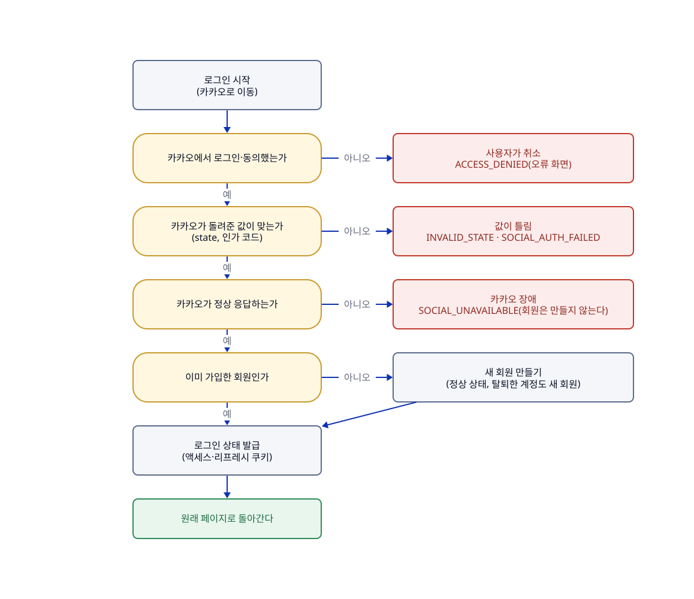

# 로그인과 회원

## 한눈에

카카오 계정으로 로그인하고, 처음이면 자동으로 가입된다. 로그인 상태는 쿠키로 유지된다(액세스 30분, 리프레시 14일).

- 로그인은 서버가 카카오 인증의 전 과정을 처리하는 서버 주도 방식이다. 프런트는 인가 코드나 카카오 토큰을 다루지 않는다.
- 가입할 때 카카오 식별자만 저장하고 닉네임·프로필은 저장하지 않는다. 약관·개인정보 동의는 가입 직후 한 번 받는다.
- 회원 상태는 정상(ACTIVE), 정지(SUSPENDED), 탈퇴(WITHDRAWN) 세 가지다. 상태가 바뀌는 순서는 [도메인-모델](../domain/도메인-모델.md)의 회원 상태 전이도에 있다.
- 정지된 회원은 로그인·조회·로그아웃·탈퇴만 할 수 있고, 참여·신고·생성·삭제는 못 한다. 정지는 기간 없이 관리자가 풀 때까지 이어진다.
- 탈퇴하면 작성한 투표는 익명화해 남기고, 참여 기록은 보존하며 집계에 계속 센다. 같은 카카오 계정으로 다시 가입하면 새 회원이다.
- 로그인한 뒤 정지·탈퇴해도 바로 반영된다. 서버가 쓰기 요청마다 DB에서 회원 상태를 다시 확인하기 때문이다.
- 여러 기기에서 동시에 로그인할 수 있다.

**한계**

- 정지를 피하려고 탈퇴하고 다시 가입하는 것을 막을 수 없다. 로그아웃한 뒤 비회원으로 참여하는 우회도 막을 수 없다.
- 다른 로그인 제공자(구글 등)로 로그인하면 별개의 회원이다. 계정 병합은 지원하지 않는다.
- 탈퇴할 때 지울 개인정보의 정확한 범위는 정하지 않았다(개인정보 처리방침을 쓸 때 정한다).

## 흐름

그림의 원본은 [07-로그인과-회원.d2](../diagrams/07-로그인과-회원.d2)이고, 로그인 경로와 실패 코드는 [인증](../engineering/인증.md) 3절에 있고, 그 밖의 응답의 기준은 [API 목록](../generated/API-목록.md)과 [openapi.json](../generated/openapi.json)이다. 실패하면 JSON이 아니라 프런트의 오류 화면(`/login/error?code=...`)으로 이동한다.

## 이럴 때는

UC는 사용자 시나리오 번호다.

| UC | 상황 | 결과 |
|---|---|---|
| UC-05 | **카카오 계정으로 처음 로그인한다.** 가입한 기록이 없고, 카카오에서 로그인·동의한다 | 정상 상태의 회원이 만들어지고 로그인된 상태로 돌아온다. 카카오 화면에서 취소하면 가입 없이 오류 화면으로 간다. 값이 틀리거나 카카오가 장애면 회원을 만들지 않고 재시도를 안내한다. 같은 계정으로 거의 동시에 처음 로그인해도 회원은 한 번만 만들어진다 |
| UC-06 | **가입한 회원이 다시 로그인한다** | 로그인 상태가 발급되고 마지막 로그인 시각만 기록된다. 정지된 회원도 로그인은 된다. 탈퇴한 회원은 기존 회원이 아니라 새 회원으로 가입된다. 이미 로그인한 상태에서 다시 로그인하면 상태를 갱신한다. 카카오 식별자는 있는데 회원 기록이 없는 불일치는 500으로 처리하고 운영 알림 대상으로 기록한다 |
| UC-16 | **회원의 상태가 바뀐다(정지, 해제, 탈퇴).** 로그인한 채로도 바뀔 수 있다 | 서버가 쓰기 요청마다 DB의 상태를 다시 확인해 바로 반영한다. 상태별로 할 수 있는 일은 아래 표와 같다 |

상태별로 할 수 있는 일:

| 상태 | 로그인 | 조회 | 투표 참여 | 투표 생성 | 신고 |
| --- | --- | --- | --- | --- | --- |
| ACTIVE | 가능 | 가능 | 가능 | 가능 | 가능 |
| SUSPENDED | 가능 | 가능 | 불가 | 불가 | 불가 |
| WITHDRAWN | 기존 회원으로는 불가(같은 카카오 계정은 새 회원으로 가입) | 비회원과 동일 | 비회원과 동일 | 불가 | 비회원과 동일 |

## 규칙

| 규칙 | 어긋나면 | 근거·테스트 |
|---|---|---|
| 가입하면 상태는 정상(ACTIVE), 권한은 일반(MEMBER)이다(R-MEMBER-01) | — | `MemberTest` |
| 정상 회원만 정지할 수 있고 정지 일시를 기록한다. 이미 정지·탈퇴한 회원은 다시 정지할 수 없다(R-MEMBER-02) | 거절(409 `MEMBER_NOT_ACTIVE`) | `MemberSuspendTest` |
| 정지는 기간 없이 관리자가 수동으로 풀 때까지 유지하고, 풀면 정상이 된다(R-MEMBER-03, R-MEMBER-04) | 정지 상태가 아니면 거절(409 `MEMBER_NOT_SUSPENDED`) | P-13 · 정지 해제는 아직 구현 전(#20) |
| 정지·탈퇴한 회원이 쓰기 요청을 하면 거절한다. 정지 회원이 할 수 있는 쓰기는 로그아웃과 탈퇴뿐이다(R-MEMBER-11) | 거절(정지 403 `MEMBER_SUSPENDED`, 탈퇴 401 `UNAUTHENTICATED`) | P-05, P-22 · `MemberStatusAndWithdrawTest` |
| 탈퇴하면 작성한 투표는 익명화해 남기고, 참여 기록은 보존하며 집계에 계속 센다(R-MEMBER-05) | — | P-04 · `MemberWithdrawTest` |
| 정지 중에도 탈퇴할 수 있다. 탈퇴는 되돌릴 수 없고, 같은 소셜 계정으로 다시 가입하면 새 회원이다(R-MEMBER-06, R-MEMBER-07) | — | P-14 · `MemberWithdrawTest` |
| 같은 사람이 다른 제공자로 로그인하면 별개의 회원이다. 계정을 연결하거나 병합하지 않는다(R-MEMBER-08) | 지원하지 않는 제공자면 회원을 만들지 않고 실패 | `OAuth2LoginUserServiceTest` |
| 소셜 계정(제공자와 제공자의 사용자 ID)은 하나의 회원에만 연결되고, 탈퇴하면 연동 정보를 지운다(R-MEMBER-12, R-MEMBER-14) | DB 유니크 제약 | P-21 · `OAuth2LoginUserServiceTest`, `MemberWithdrawTest` |
| 토큰을 재발급할 때마다 새 토큰을 만들고 이전 토큰은 폐기한다. 폐기된 토큰이 다시 오면 그 회원의 토큰을 모두 폐기한다(10초 안의 동시 재발급은 허용)(R-MEMBER-15, R-MEMBER-16) | 거절(401 `UNAUTHENTICATED`) | P-20 · `RefreshTokenServiceTest`, `RefreshTokenTest` |
| 로그아웃은 현재 기기의 토큰만 폐기하고, 탈퇴는 모든 토큰을 삭제한다(R-MEMBER-17) | — | `MemberStatusAndWithdrawTest`, `MemberWithdrawTest` |
| 동시 로그인은 기기 수 제한 없이 허용하고 마지막 로그인 시각을 저장한다. 카카오 액세스 토큰은 저장하지 않는다 | — | P-27 · `MemberLoginTest`, `MemberCommandServiceTest` |

규칙(R)은 코드가 항상 지키는 조건이고, 정책(P)은 그렇게 정한 제품 결정이다. 규칙의 정의는 [도메인-모델](../domain/도메인-모델.md)에 있고 위 요약이 다르면 정의를 따른다. 정책의 정의는 바로 아래에 있다.

## 정책 정의

| ID | 확정 내용 | 관련 UC |
| --- | --- | --- |
| P-04 | 탈퇴 시 작성 투표는 익명화해 유지하고 투표 기록은 보존한다. | UC-16 |
| P-05 | 정지 회원은 참여·신고·생성·삭제 등 모든 쓰기가 불가다(로그인·조회·로그아웃·탈퇴만 가능). 로그아웃 후 비회원으로 참여하는 우회는 막을 수 없는 한계다. | UC-09, 10, 14, 16 |
| P-13 | 정지는 기간 없이 관리자가 수동으로 해제한다. | UC-09, 16 |
| P-14 | 탈퇴한 카카오 계정은 새 회원으로 재가입할 수 있고 이전 데이터와 연결하지 않는다. 정지 중 탈퇴도 허용하며 정지 회피는 한계로 둔다. | UC-05, 06, 16 |
| P-20 | 로그인 상태는 JWT(액세스·리프레시)를 HttpOnly 쿠키로 전달해 유지한다. 액세스 30분, 리프레시 14일로 확정했다. | UC-05, 06 |
| P-21 | 카카오 식별자만 저장하고 약관·개인정보 동의는 가입 직후 1회 받는다. | UC-05 |
| P-22 | 정지·탈퇴 상태는 쓰기 요청마다 DB에서 확인한다. 성능 문제가 측정되면 짧은 캐시를 검토한다. | UC-09, 16 |
| P-27 | 동시 로그인을 기기 수 제한 없이 허용하고 마지막 로그인 시각을 저장한다. 카카오 액세스 토큰은 저장하지 않는다. | UC-05, 06 |

## 사용하는 API

| API | 하는 일 |
|---|---|
| `GET /oauth2/authorization/kakao` | 로그인을 시작한다. 카카오 동의 화면으로 보낸다(스프링이 제공) |
| `GET /login/oauth2/code/kakao` | 카카오가 돌려주는 콜백. 로그인을 처리하고 원래 페이지로 보낸다 |
| `POST /auth/refresh` | 토큰을 다시 발급한다 |
| `POST /auth/logout` | 현재 기기에서 로그아웃한다 |
| `GET /members/me` | 내 상태와 권한을 본다 |
| `DELETE /members/me` | 탈퇴한다 |

([API 목록](../generated/API-목록.md), 로그인 시작·콜백은 [인증](../engineering/인증.md) 3절)

## 이력

| 이슈 | 변경 | sketch |
|---|---|---|
| #109 | 로그인·회원 상태 시나리오와 회원 정책 정의를 이 페이지로 옮김. 회원 상태 규칙이 여러 문서에 흩어져 있어서 | [109-feature-pages-2](../records/sketches/109-feature-pages-2.md) |
| #114 | 로그인 경로와 실패 코드의 위치를 인증 문서 3절로 안내함. 없앤 손으로 쓴 API 명세의 로그인 설명을 옮겨서 | [114-api-spec-dissolve](../records/sketches/114-api-spec-dissolve.md) |
