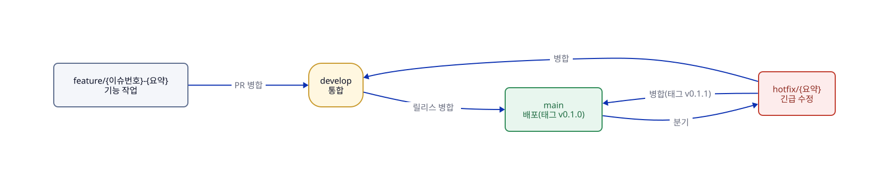

# AuDDum 개발 워크플로

| 항목 | 내용 |
| --- | --- |
| 버전 | v1 |
| 작성일 | 2026-10-12 |
| 작성자 | 태풍 |
| 관련 문서 | [컨벤션](../engineering/컨벤션.md), [로컬 환경](로컬-환경.md), [아키텍처](../engineering/아키텍처.md) |

## 요약

브랜치는 **git flow**를 따르고, 커밋은 Conventional Commits 형식으로 쓴다.

- 브랜치: `main`(운영), `develop`(통합), `feature/*`, `hotfix/*`. release 브랜치는 두지 않는다.
- 커밋: `type(scope): 제목`, 이슈 번호를 연결한다.
- 이 문서의 규칙은 진행하면서 조정할 수 있고, 조정하면 이 문서를 먼저 고친다.

## 목차

1. [브랜치 전략(git flow)](#1-브랜치-전략git-flow)
2. [커밋·PR·이슈 규칙](#2-커밋pr이슈-규칙)
3. [API 문서와 프런트 협업](#3-api-문서와-프런트-협업)

## 1. 브랜치 전략(git flow)



그림의 원본: [개발-워크플로-브랜치.d2](../diagrams/개발-워크플로-브랜치.d2)

| 브랜치 | 분기 | 병합 대상 | 역할 |
| --- | --- | --- | --- |
| `main` | — | — | **운영에 배포되는 코드.** 직접 커밋하지 않고 `develop` 병합과 hotfix 병합으로만 바뀐다. 병합마다 태그(`vX.Y.Z`)를 붙인다. |
| `develop` | `main` | — | **다음 배포를 위한 통합 브랜치.** feature가 모이는 곳이다. |
| `feature/*` | `develop` | `develop` | 기능 하나를 만든다. |
| `hotfix/*` | `main` | `main`, `develop` | 운영 장애의 긴급 수정 |

**규칙**

- 브랜치 이름은 `feature/{이슈번호}-{영문-요약}` 형식이다. 예: `feature/12-poll-create`
- feature는 `develop`으로 **PR을 거쳐** 병합하고, 병합 방식은 **squash**다. 기능 하나가 `develop`에 커밋 하나로 남는다.
- 배포할 때는 `develop`을 `main`으로 **PR + merge commit**(`--no-ff`)으로 병합하고 태그를 붙인다. 별도 release 브랜치와 QA 수정 단계는 두지 않는다.
- hotfix는 `main`에서 분기해 `main`으로 같은 방식으로 병합한 뒤 `develop`에도 병합한다.
- `main`과 `develop`은 GitHub 브랜치 보호로 직접 푸시를 막고, PR은 CI(빌드·테스트)가 통과해야 병합한다. 혼자 작업하므로 승인 인원은 0으로 두되 **셀프 리뷰를 PR에 남긴다.**
- 한 feature는 가능한 한 하루~이틀 안에 끝낼 크기로 쪼갠다.
- 버전은 `0.x.0`(MVP 전), 첫 공개 배포를 `1.0.0`으로 한다.

**배포와의 연결**

- `main`에 병합되면 CI/CD가 이미지를 만들어 배포한다. ([배포](배포.md)의 CI/CD)
- `develop`에는 배포하지 않는다. 별도 스테이징 환경은 두지 않는다.

## 2. 커밋·PR·이슈 규칙

**커밋 메시지** — Conventional Commits

```text
type(scope): 제목

본문(선택): 무엇을 왜 바꿨는지

Refs #12
```

| type | 쓰는 때 |
| --- | --- |
| `feat` | 기능 추가 |
| `fix` | 버그 수정 |
| `refactor` | 동작 변화 없는 구조 개선 |
| `test` | 테스트 추가·수정 |
| `docs` | 문서 |
| `chore` | 빌드·설정·의존성 |
| `ci` | CI/CD 설정 |

- `scope`는 도메인이나 영역이다. 예: `poll`, `vote`, `member`, `report`, `admin`, `auth`, `support`, `db`
- 제목은 한글로 쓰고 마침표를 붙이지 않는다. 예: `feat(poll): 투표 생성 API 추가`
- feature 브랜치 안의 커밋은 자유롭게 쌓고, PR 제목을 같은 형식으로 써서 squash 커밋 메시지가 된다.

**PR**

| 항목 | 규칙 |
| --- | --- |
| 제목·본문 | 제목은 커밋 규칙과 같다. 본문에 변경 내용, 관련 이슈(`Closes #12`), 테스트 방법, 참고 문서를 적는다. |
| 문서 동기화 | 사용자에게 보이는 동작이 바뀌면 기능 페이지 등 관련 문서도 같은 PR에서 고친다. API를 바꾸면 생성 문서(`openapi.json`, API 목록)도 다시 만든다. |
| 로드맵 | 이슈를 닫는 PR에서는 `로드맵.md`의 해당 항목 체크박스(`[ ]` → `[x]`)와 이슈 번호도 같이 고친다. |
| 큰 이슈 | PR 여러 개로 나눈다. 각 PR은 단독으로 빌드·테스트를 통과하고 되돌릴 수 있는 단위로 자른다(크기 숫자 기준은 두지 않는다). 마지막 PR만 `Closes #12`, 나머지는 `Refs #12`로 이슈를 연결한다. |
| 리뷰 뒤 수정 | `src/main`의 동작이나 테스트의 검증 내용이 바뀌면 다시 리뷰한다. 이름·주석·포맷·문서만 바뀌면 재리뷰를 생략하고 PR 본문에 "리뷰 후 가독성 수정"으로 적는다. 애매하면 재리뷰한다. |
| 템플릿 | `.github/pull_request_template.md`에 본문 항목(변경 내용, 관련 이슈, 테스트 방법, 참고 문서)과 체크리스트가 있다. |
| CI | PR과 develop·main 푸시에서 GitHub Actions(`.github/workflows/ci.yml`)가 `scripts/docs-check`(문서 ID 검사)와 `./gradlew build`를 돌린다. 통과한 뒤에 병합한다. |

**이슈**

- 구현 로드맵의 작업을 이슈로 만들고 마일스톤(M1~M7)에 묶는다.
- 라벨: `feature`, `bug`, `docs`, `chore`와 도메인 라벨(`poll`, `vote` 등)
- 이슈 하나가 feature 브랜치 하나, PR 하나에 대응한다.

## 3. API 문서와 프런트 협업

- API의 기준은 코드에서 만든 [openapi.json](../generated/openapi.json)과 [API 목록](../generated/API-목록.md)이다. API를 바꾸면 **같은 PR에서 `DOCS_UPDATE=1 ./gradlew test --tests '*OpenApiDocTest'`로 다시 만든다**(안 하면 빌드가 실패한다). 공통 규칙은 [API 공통 규칙](../engineering/API-공통-규칙.md)이다.
- 새 API는 구현 전에 합의한다. 컨트롤러의 문서 클래스(`*WebApiDocs`)와, 아직 동작하지 않는 빈 메서드(501 응답)만 먼저 PR로 올려 병합하면 `openapi.json`에 API가 나타나 프런트가 먼저 개발할 수 있다. 구현 PR이 빈 메서드를 실제 동작으로 바꾼다.
- 프런트가 쓰는 JSON 예시는 명세서의 예시를 기준으로 한다.
- **Swagger UI(springdoc-openapi)**를 쓴다. 컨트롤러에서 문서를 생성해 프런트가 바로 호출해 볼 수 있게 한다. 운영 환경에서는 노출하지 않는다(`prod` 프로파일에서 끈다).
- 명세서가 정책과 설계 이유의 기준이고, Swagger는 요청·응답 구조의 실제 확인용이다. 둘이 어긋나면 명세서를 기준으로 코드를 고친다.
- Spring Boot 4.1에 맞는 springdoc 버전은 의존성을 추가할 때(M1) 확인한다.
- 프런트와 API는 같은 사이트의 서브도메인이라 로컬 개발에서도 쿠키 동작(SameSite, CORS)을 맞춰서 확인해야 한다.
