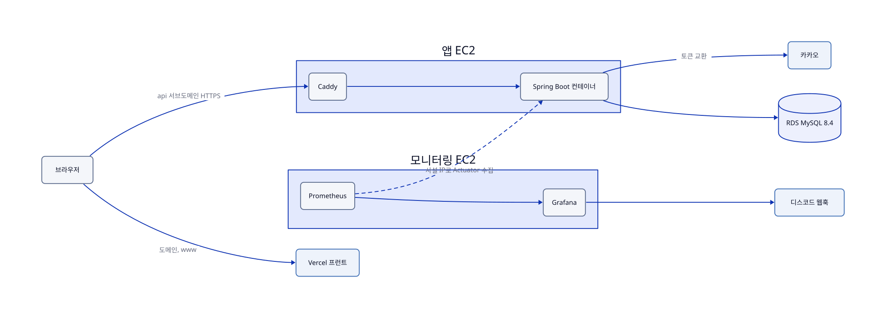
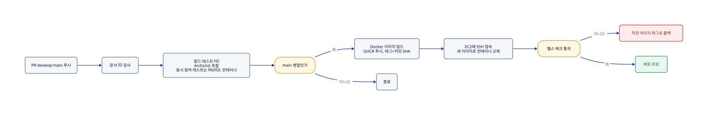

# AuDDum 배포

| 항목 | 내용 |
| --- | --- |
| 버전 | v1 |
| 작성일 | 2026-10-12 |
| 작성자 | 태풍 |
| 관련 문서 | [테스트 전략](../engineering/테스트-전략.md), [인증](../engineering/인증.md), [로컬 환경](로컬-환경.md), [아키텍처](../engineering/아키텍처.md) |

## 요약

배포 환경과 운영 방식을 정한다. 배포는 EC2 한 대 + RDS + Vercel 프런트이고, GitHub Actions → GHCR → SSH 순으로 올린다. 별도 소형 EC2에 Prometheus·Grafana를 둔다.

확정: EC2 한 대와 RDS, Vercel 프런트, 가비아 도메인, Flyway, Caddy, GHCR, SSH 배포, `api` 서브도메인.

## 목차

1. [배포 구성](#1-배포-구성)
2. [도메인·HTTPS·쿠키·CORS](#2-도메인https쿠키cors)
3. [CI/CD](#3-cicd)
4. [환경 설정과 비밀 값](#4-환경-설정과-비밀-값)
5. [운영](#5-운영)
6. [미정 항목](#6-미정-항목)

## 1. 배포 구성

서버는 EC2 한 대이고 DB는 RDS로 분리한다. 프런트는 Vercel에 올린다. 확정된 선택이다. 인스턴스는 앱 EC2 t4g.small, 모니터링 EC2 t4g.small, RDS db.t4g.micro이고, 월 비용은 구현 단계에서 견적으로 확인한다.

그림의 원본: [배포-서버-구성.d2](../diagrams/배포-서버-구성.d2)

| 구성 요소 | 역할 | 비고 |
| --- | --- | --- |
| Vercel | 프런트엔드 배포 | 도메인 연결, 프리뷰 배포는 로그인 쿠키가 붙지 않는다 |
| EC2 | Caddy와 Spring Boot 컨테이너 실행 | 서버 1대이므로 배포 중 짧은 중단이 생길 수 있다 |
| Caddy | HTTPS 종단, 인증서 자동 발급·갱신 | Secure 쿠키에 HTTPS가 필요하다 |
| Spring Boot | API 서버 | Docker 컨테이너로 실행 |
| RDS MySQL 8.4 | 모든 데이터 저장 | 단일 AZ, 자동 백업 사용 |
| 카카오 인증 서버 | 소셜 로그인 | 서버가 토큰 교환을 직접 한다 |

- RDS의 보안 그룹은 EC2에서 오는 연결만 허용하고 외부에서 직접 접속할 수 없게 한다.
- EC2는 80·443과 관리용 SSH만 열고, SSH는 허용한 IP로 제한한다.
- 모니터링은 앱 서버와 분리한 소형 EC2에서 하고(6장), 앱의 Actuator 포트는 그 서버에서만 접근하게 한다. Redis, 메시지 큐, 검색 엔진은 아키텍처 설계서대로 두지 않는다.

## 2. 도메인·HTTPS·쿠키·CORS

프런트와 API를 같은 사이트의 서브도메인으로 둔다. 도메인은 가비아에서 구매하고, 서브도메인 이름은 api로 정했다.

| 이름 | 가리키는 곳 | 비고 |
| --- | --- | --- |
| `example.com`, `www` | Vercel | 가비아 DNS에 Vercel이 안내하는 레코드를 등록 |
| `api` | EC2 고정 IP(A 레코드) | EC2에 Elastic IP를 붙인다 |

- HTTPS는 Caddy가 인증서를 자동 발급·갱신한다. 발급에는 80·443이 열려 있고 `api` 레코드가 EC2를 가리켜야 한다.
- 두 서브도메인이 같은 사이트라서 `SameSite=Lax` 쿠키가 프런트에서 보낸 API 요청에 붙는다. 쿠키는 `api` 호스트에만 발급하므로 Domain 속성은 두지 않는다.
- CORS는 프런트 origin(`https://도메인`, `https://www.도메인`)만 허용하고 자격 증명(쿠키)을 허용한다. 와일드카드는 쓰지 않는다.
  - 쓰기 요청의 Origin 검사도 같은 목록을 쓴다.
  - 목록은 `FRONTEND_BASE_URL`의 origin(항상 허용)에 선택 환경 변수 `CORS_ALLOWED_ORIGINS`(쉼표 구분, `auddum.cors.allowed-origins`)의 항목을 더한 것이다.
  - 예: `FRONTEND_BASE_URL=https://도메인`, `CORS_ALLOWED_ORIGINS=https://www.도메인`
  - Origin 검사는 CORS 필터보다 먼저 동작해 목록 밖 쓰기 요청을 403 `FORBIDDEN`(problem+json)으로 거절한다.
- 카카오 개발자 콘솔의 리다이렉트 URI는 `https://api.도메인/login/oauth2/code/kakao`로 등록한다. 로컬 개발용 URI는 따로 등록한다.
- 로그인 후 이동할 주소는 서비스 내부 경로만 받고 외부 주소는 홈으로 보낸다. 로그인 성공·실패 뒤 이동하는 프런트 주소는 `FRONTEND_BASE_URL` 설정값이다.
- Vercel 프리뷰 배포(`*.vercel.app`)는 다른 사이트라서 로그인 쿠키가 붙지 않는다. 로그인이 필요한 확인은 운영 도메인이나 로컬에서 한다.

## 3. CI/CD

GitHub Actions로 구성한다. 도구는 GitHub Actions, GHCR, SSH 배포로 정했다.

1. PR과 develop·main 푸시: 문서 ID 검사(`scripts/docs-check`) 뒤에 빌드와 테스트(H2, 동시 참여 테스트는 MySQL 컨테이너)를 실행한다. 브랜치 전략은 [개발 워크플로](개발-워크플로.md)의 git flow를 따른다. ArchUnit 구조 테스트도 여기에 포함된다.
2. 동시 참여 테스트는 같은 빌드에서 Testcontainers(`mysql:8.4`)로 돌린다.
3. main에 병합되면(`develop` 배포 PR 또는 hotfix) Docker 이미지를 만들어 레지스트리(GHCR)에 올린다.
4. EC2에 SSH로 접속해 새 이미지를 받아 컨테이너를 교체한다.
5. 헬스 체크가 통과하는지 확인하고, 실패하면 직전 이미지 태그로 되돌린다.

그림의 원본: [배포-자동-배포.d2](../diagrams/배포-자동-배포.d2)

- 이미지 태그는 커밋 SHA로 붙여 되돌릴 대상을 분명히 한다.
- 배포용 SSH 키와 레지스트리 토큰은 GitHub Secrets에 둔다.
- 서버가 1대라서 교체 중 수 초의 중단이 생기며, 지금 규모에서는 감수한다.

## 4. 환경 설정과 비밀 값

- 프로파일은 `local`(compose의 로컬 MySQL)과 `prod`(RDS)로 나눈다. 테스트는 H2를 쓰고 `src/test/resources/application.yaml`로 설정한다. 파일 구성은 [로컬 환경](로컬-환경.md)에 있다.
- `prod`에서는 Swagger UI와 `/v3/api-docs`를 끈다.
- 비밀 값은 코드와 git에 두지 않고 서버의 환경 변수 파일로 주입한다. 대상은 카카오 클라이언트 id·secret, JWT 서명 키, 익명 쿠키 HMAC 키, DB 비밀번호다.
  - 운영에서는 카카오 id·secret, `JWT_SECRET`, `ANON_COOKIE_SECRET`, `FRONTEND_BASE_URL`이 필수 환경 변수다(없으면 기동 실패).
- 서명 키 두 개는 서로 다른 값을 쓰고, 노출되면 교체한다. MVP는 키 하나로 운영하고 노출되면 교체한다(전원 재로그인). 무중단 교체는 이후에 본다.
- 운영 DB 스키마는 `ddl-auto`에 맡기지 않고 Flyway로 관리한다(확정). 규칙은 아래와 같다.

  | 규칙 | 내용 |
  | --- | --- |
  | 실행 | 마이그레이션은 앱 기동 시 자동 실행한다. 운영은 `ddl-auto=validate`로 두어 엔티티와 스키마가 어긋나면 기동을 실패시킨다. |
  | 수정 금지 | 이미 병합된 마이그레이션 파일은 고치지 않고 새 번호의 파일을 추가한다(협업 중인 로컬 DB의 체크섬 오류를 막는다). |
  | 되돌리기 | 롤백 스크립트 없이 새 마이그레이션을 추가한다. |
  | 테스트 | H2도 같은 마이그레이션 SQL로 스키마를 만들어 유니크·CHECK 제약 누락을 잡는다. H2에서 안 도는 MySQL 전용 문법은 쓰지 않고, 막히면 그 부분만 자동 생성으로 내린다. |

- 시각은 KST로 저장하고, API는 KST 오프셋(+09:00)을 포함해 내려준다.

## 5. 운영

| 항목 | 내용 |
| --- | --- |
| 백업 | RDS 자동 백업을 켜고 보관 기간은 7일이다. |
| 로그 | 토큰, 쿠키, 카카오 응답 원문은 남기지 않는다. 위조 익명 쿠키 시도와 리프레시 토큰 재사용 감지는 기록한다. |
| 모니터링 | 앱 서버와 분리한 소형 EC2에 Prometheus와 Grafana를 두고(로그가 필요하면 Loki 추가), 앱은 Actuator·Micrometer 지표만 노출한다. |
| 수집 | 같은 VPC의 사설 IP로 하고 Actuator 포트는 외부에 열지 않는다. |
| 알림 | Grafana 알림을 디스코드 웹훅으로 받는다. 모니터링 서버가 죽으면 알림이 안 오므로 외부 업타임 체크를 알림용으로 따로 둔다. CloudWatch 기본 지표(RDS 연결 수 등)는 보조로 쓴다. |
| 장애 | 앱 컨테이너는 재시작 정책으로 복구하고, 문제가 있는 배포는 직전 이미지로 되돌린다. DB 복구는 RDS 백업 시점으로 한다. |
| 감수하는 것 | 단일 서버라 EC2 장애 시 서비스가 중단된다. 포트폴리오 규모에서 감수한다. |

## 6. 미정 항목

- 약관·개인정보 동의 저장과 탈퇴 시 삭제 범위(개인정보 처리방침 단계에서 정한다).
