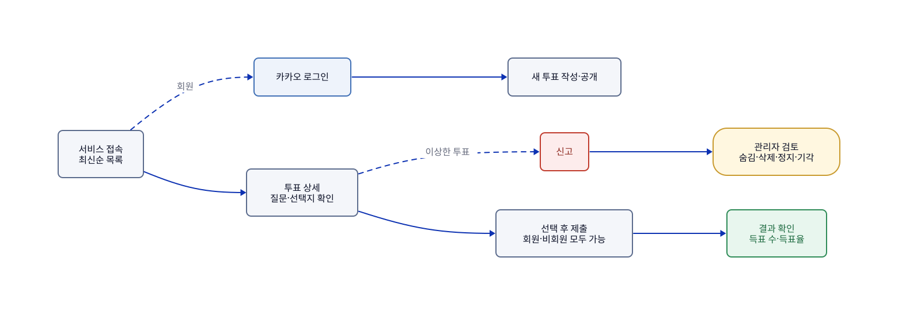

# AuDDum 문서 안내

## 요약

AuDDum(어떰)의 설계 문서가 `docs/`에 있다. 기능을 알고 싶으면 [`features/`](features/README.md)의 기능 페이지 하나만 읽으면 된다. 같은 규칙을 여러 문서가 설명하더라도 **정본은 한 곳**이고, 문서가 서로 다르면 정본이 맞다.

서비스의 핵심 규칙은 다섯 가지다.

- 마감 전에는 참여한 사람에게만 결과를 보여주고, 마감 후에는 모두에게 보여준다.
- 한 투표에 한 번만 참여할 수 있고, 제출한 선택은 바꿀 수 없다. 이미 참여했으면 선택과 관계없이 409다.
- 회원 상태는 쓰기 요청마다 DB에서 확인한다. 정지 회원은 참여·신고·생성·삭제 등 모든 쓰기가 불가다.
- 투표는 수정할 수 없고 작성자는 삭제만 할 수 있다. 숨김은 관리자가 복구할 수 있고 삭제는 복구할 수 없다.
- 신고는 관리자가 검토하며 건수만으로 자동 처리하지 않는다.

## 목차

1. [문서 지도](#1-문서-지도)
2. [기능 지도](#2-기능-지도)
3. [어디서 찾나(정본)](#3-어디서-찾나정본)
4. [번호 범례](#4-번호-범례)
5. [표기 규칙](#5-표기-규칙)
6. [자동 검사](#6-자동-검사)

## 1. 문서 지도

처음이면 위에서 아래로 읽는다. 기능을 구현할 때는 이슈의 `참고 문서`나 기능 페이지만 읽어도 된다. 문서 전체를 통째로 읽지 않는다.

| 층 | 문서 | 한 줄 설명 | 언제 읽나 |
| --- | --- | --- | --- |
| 방향 | [PRD](product/PRD.md) | 목표, 대상 사용자, 범위(세부 정책은 기능 페이지가 최신) | 서비스의 목표와 범위를 알고 싶을 때 |
| 방향 | [로드맵](product/로드맵.md) | 마일스톤 M1~M7과 완료 기준 | 무엇을 언제 할지 볼 때 |
| 기능 | [기능 페이지 7개](features/README.md) | 시나리오, 정책, 흐름, 규칙, 테스트 위치 | 한 기능이 어떻게 동작하는지 볼 때 |
| 도메인 | [용어집](domain/용어집.md) | 문서·대화·코드에서 같은 뜻으로 쓰는 말과 영문 이름 | 처음 읽을 때, 말뜻이 헷갈릴 때 |
| 도메인 | [도메인-모델](domain/도메인-모델.md) | 애그리거트, 행위, 규칙(R), 상태 전이, 값 객체 | 엔티티와 도메인 규칙을 구현할 때 |
| 계약 | [API 공통 규칙](engineering/API-공통-규칙.md), [API 목록](generated/API-목록.md) | 공통 규칙, 오류 응답 형식, 엔드포인트와 오류 코드 | API를 만들거나 호출할 때 |
| 계약 | [ERD](ERD.md) | 테이블, 제약, 인덱스 | 스키마와 마이그레이션을 다룰 때 |
| 만드는 법 | [아키텍처](engineering/아키텍처.md) | 패키지 구조, 레이어 규칙, 서비스·응답 규칙 | 코드를 어디에 두고 누가 누구를 부르는지 볼 때 |
| 만드는 법 | [인증](engineering/인증.md) | 토큰, 익명 쿠키, 회원 상태 확인 | 인증을 다룰 때 |
| 만드는 법 | [동시성·중복 방지](engineering/동시성-중복-방지.md) | 중복 참여를 막는 두 겹, 동시 요청 처리 | 참여·신고의 동시 요청을 다룰 때 |
| 만드는 법 | [컨벤션](engineering/컨벤션.md) | 코드·테스트 컨벤션 | 코드를 쓸 때 |
| 만드는 법 | [테스트 전략](engineering/테스트-전략.md) | 테스트를 어떻게 나누고 확인하는가 | 테스트를 쓸 때 |
| 만드는 법 | [설계-결정](engineering/설계-결정.md) | 다른 문서에 없는 확정 결정과 코드 관행 | 리뷰에서 다시 지적하지 않는 결정을 볼 때 |
| 절차 | [개발 워크플로](howto/개발-워크플로.md) | 브랜치(git flow), 커밋·PR·이슈, 프런트 협업 | 개발을 시작하거나 PR을 올릴 때 |
| 절차 | [로컬 환경](howto/로컬-환경.md) | 로컬 실행, 마이그레이션, 카카오 앱, 관리자 계정 | 환경을 준비할 때 |
| 절차 | [배포](howto/배포.md) | 배포 구성, 도메인·HTTPS, CI/CD, 환경 설정, 운영 | 배포를 다룰 때 |
| 그림 | [다이어그램](diagrams/README.md) | 문서에 들어가는 그림의 원본(D2)과 생성물(SVG) | 그림을 고치거나 새로 그릴 때 |
| 이력 | [sketch](records/sketches/README.md) | 이슈 하나의 의도·접근·결과 | 어떤 이유로 이렇게 바뀌었는지 볼 때 |

`ERD`는 코드에서 생성하는 문서로 바꿀 예정이라 지금은 `docs/` 바로 아래에 둔다.

## 2. 기능 지도

서비스의 핵심 루프는 목록 → 상세 → 참여 → 결과이고, 로그인 없이 이어진다. 투표 만들기와 삭제는 로그인한 회원, 신고 처리는 관리자 영역이다.

그림의 원본: [index-기능-지도.d2](diagrams/index-기능-지도.d2)

| 기능 페이지 | 사용자 시나리오 |
| --- | --- |
| [01-둘러보기](features/01-둘러보기.md) | UC-01 비회원의 투표 목록 조회, UC-02 비회원의 투표 상세 조회 |
| [02-투표-만들기](features/02-투표-만들기.md) | UC-07 회원의 투표 생성, UC-08 잘못된 입력으로 투표 생성 실패, UC-09 정지 회원의 투표 생성 시도, UC-17 작성자의 투표 삭제 |
| [03-참여하기](features/03-참여하기.md) | UC-03 비회원의 투표 참여, UC-04 비회원의 중복 참여 시도, UC-10 회원의 투표 참여, UC-11 회원의 중복 참여 시도, UC-12 마감된 투표 참여 시도 |
| [04-결과-보기](features/04-결과-보기.md) | UC-13 투표 결과 조회 |
| [05-신고하기](features/05-신고하기.md) | UC-14 투표 신고 |
| [06-관리자-조치](features/06-관리자-조치.md) | UC-15 관리자의 신고 검토 및 조치, 운영 시나리오 OP-01~10 |
| [07-로그인과-회원](features/07-로그인과-회원.md) | UC-05 카카오 로그인 및 최초 가입, UC-06 기존 회원의 로그인, UC-16 회원 상태 변화와 접근 범위 |

## 3. 어디서 찾나(정본)

같은 내용이 여러 문서에 나올 때 아래 문서가 정본이다. 다른 문서는 요약이거나 포인터이고, 어긋나면 정본을 따른다.

| 알고 싶은 것 | 정본 | 정본의 위치 |
| --- | --- | --- |
| 사용자 시나리오(UC), 정책(P), 운영 시나리오(OP) | `features/` 아래 해당 페이지 | 이럴 때는, 정책 정의, 운영 시나리오 |
| 기능별 규칙 요약과 흐름도 | `features/` 아래 해당 페이지 | 규칙, 흐름 |
| 예외 상황별 응답 | `features/` 아래 해당 페이지 | 이럴 때는, 규칙(코드는 [오류 코드 표](generated/오류-코드.md)) |
| 오류 코드와 상태 코드 | [오류 코드 표](generated/오류-코드.md) | 코드에서 자동으로 만든다 |
| 엔드포인트, 엔드포인트별 오류 코드, 쓰는 기능 | [API 목록](generated/API-목록.md) | 코드에서 자동으로 만든다. 요청·응답 필드는 [openapi.json](generated/openapi.json) |
| API 공통 규칙, 오류 응답 형식 | [API 공통 규칙](engineering/API-공통-규칙.md) | 기본 경로, 페이징, 식별자, 오류 응답 형식 |
| 참여 처리 순서와 판정 | [03-참여하기](features/03-참여하기.md) | 흐름 |
| 도메인 행위·규칙·메서드 이름 | [도메인-모델](domain/도메인-모델.md) | 회원·투표·참여·신고·관리자 조치 애그리거트 |
| 용어와 영문 이름 | [용어집](domain/용어집.md) | 전체 |
| 상태 전이, enum 값 | [도메인-모델](domain/도메인-모델.md) | 각 애그리거트 |
| 테이블, 제약, 인덱스 | [ERD](ERD.md) | 테이블 정의, 제약조건과 인덱스 |
| 토큰·쿠키·익명 쿠키 | [인증](engineering/인증.md) | 토큰 인증, 익명 식별 쿠키 |
| 중복 참여 방지, 동시 요청 | [동시성·중복 방지](engineering/동시성-중복-방지.md) | 전체 |
| 패키지·레이어·서비스·응답 규칙 | [아키텍처](engineering/아키텍처.md) | 애플리케이션 구조 |
| 코드·테스트 컨벤션 | [컨벤션](engineering/컨벤션.md) | 전체 |
| 커밋·PR·이슈 규칙, 브랜치 | [개발 워크플로](howto/개발-워크플로.md) | 브랜치 전략, 커밋·PR·이슈 규칙 |
| 이미 정한 결정(리뷰에서 다시 지적하지 않음) | [설계-결정](engineering/설계-결정.md) | 전체 |
| 마일스톤과 완료 기준 | [로드맵](product/로드맵.md) | 전체 |

문서에서 메서드 이름을 쓰는 곳은 도메인 모델뿐이다. 다른 문서는 "회원 상태 확인"처럼 동작으로 쓴다. 이름이 바뀌어도 한 곳만 고치려는 것이다.

## 4. 번호 범례

문서 곳곳에 나오는 번호의 뜻과 찾는 곳이다.

| 번호 | 뜻 | 찾는 곳 |
| --- | --- | --- |
| `P-xx` | 확정 정책 | `features/` 해당 페이지의 `정책 정의` 표. P-01~P-30이고 19번은 비어 있다. P-28은 미정이다([05-신고하기](features/05-신고하기.md)) |
| `OP-xx` | 관리자 운영 시나리오 | [06-관리자-조치](features/06-관리자-조치.md)의 `운영 시나리오` 표(OP-01~10) |
| `UC-xx` | 사용자 시나리오 | `features/` 해당 페이지의 `이럴 때는` 표. 17개 전체는 위 "2. 기능 지도" |
| `R-<애그리거트>-<번호>` | 도메인 규칙 | [도메인-모델](domain/도메인-모델.md)의 각 애그리거트 절 |
| `#숫자` | GitHub 이슈 | `gh issue view 숫자` |

- **정의는 한 곳이다.** P·OP·UC는 표의 첫 칸, R은 굵게 쓴 곳(`**R-POLL-nn**`)이 정의다. 그 밖의 언급은 참조다.
- R의 애그리거트 접두어는 MEMBER(회원), POLL(투표), VOTE(참여), REPORT(신고), ACTION(관리자 조치)이다.
- 번호는 한 번 붙이면 바꾸지 않는다. 규칙을 없애도 번호를 다시 쓰지 않는다. 숫자 순서와 표의 순서는 다를 수 있다.

## 5. 표기 규칙

### 읽기 쉽게 쓰는 원칙

비개발자가 읽을 수 있게 쓰면 개발자도 읽을 수 있다. 독자별로 문서를 나누지 않고 한 벌로 쓴다. 모든 문서가 이 원칙을 따른다.

| 원칙 | 내용 |
| --- | --- |
| 쉬운 말이 본문 | 문장은 비개발자가 읽는 수준으로 쓴다. 기술 용어는 괄호나 끝 칸에 붙인다 |
| 한 사실은 한 곳 | 같은 내용을 여러 문서·절에 되풀이하지 않는다. 다른 곳은 링크나 ID로만 가리킨다 |
| 위에서 멈춰도 됨 | 문서 맨 위 몇 줄(요약)만 읽어도 이해되고, 내려갈수록 자세해진다 |
| 키워드가 앞 | 제목·문단·목록·표의 칸은 가장 중요한 말로 시작한다. 사람은 줄의 앞부분만 훑는다 |
| 한 문장에 정보 하나 | 문장은 100자 안팎이다. 넘으면 나눈다. "앞서 설명했듯이", "아래와 같다" 같은 말에 대한 말은 뺀다 |
| 용어는 처음에 풀이 | 처음 나올 때 한 줄로 풀고, 길면 [용어집](domain/용어집.md)으로 링크한다 |
| 표는 짧게 | 표의 한 칸은 한두 문장이다. 길어지면 목록이나 표 아래 문단으로 뺀다 |

기능 페이지는 이에 더해 [features/README](features/README.md)의 원칙을 따른다.

### 강조와 서식

**굵은 글씨는 아껴야 눈에 띈다.** 아래 네 곳에만 쓴다.

| 서식 | 쓰는 곳 | 예 |
| --- | --- | --- |
| 굵은 글씨 | 목록·표 칸의 머리 라벨(같은 모양으로 반복) | `- **마감은 저장하지 않고 계산한다.** Poll이 판단한다.` |
| 굵은 글씨 | 절마다 핵심 문장 하나까지 | 요약이나 `한눈에`에서 꼭 기억할 한 문장 |
| 굵은 글씨 | 놓치면 사고 나는 숫자 | 질문은 **1~500자**, 선택지는 **2~5개** |
| 굵은 글씨 | 도메인 규칙의 정의 | `**R-POLL-01**`(검사 도구가 읽는다) |
| 제목(`###`) | 줄 전체를 차지하는 소제목 | 굵은 글씨 한 줄(`**규칙**`) 대신 쓴다. 목차와 링크(`#규칙`)에 잡힌다 |
| 알림 상자 | 기능 페이지의 한계(`> [!NOTE]`), 되돌릴 수 없는 작업(`> [!WARNING]`) | 문서당 2개까지, 연달아 두지 않는다 |
| 코드 글꼴 | 코드 이름, 파일·경로, 명령, 오류 코드, ID | `VoteTest`, `409 ALREADY_VOTED` |

- 제목은 `###`까지만 쓴다. `####`가 필요하면 절이나 문서를 나눌 신호다.
- 같은 수준의 제목은 같은 모양(명사형)으로 쓴다.

### 미확정 표시

미확정을 나타내는 표시는 세 가지만 쓴다.

| 표시 | 뜻 |
| --- | --- |
| 표시 없음 | 확정이다. 코드가 다르면 코드를 고친다. |
| `[기술 초안]` | 구현 전의 설계 제안이다. 구현하면서 바뀔 수 있고, 바뀌면 같은 PR에서 문서를 고친다. |
| 미정(결정 시점) | 아직 정하지 않았고 정할 시점이 있다. 예: 미정(M5 구현 때). |

"초안", "제안", "구현 시 정한다", "추후" 같은 말은 위 셋 중 맞는 것으로 바꿔 쓴다.

### 규칙 쓰는 모양

- **핵심 먼저.** 규칙이 여럿인 절은 맨 위에 핵심 3~5줄을 둔다.
- **결정 / 이유 / 바꿀 때.** 설계 결정은 이 세 항목을 나눠 쓴다. 이유를 규칙 문장 사이에 끼우지 않는다.
- **갈래가 있으면 표.** 대상마다 답이 다른 규칙(예: 가시성, 예외 종류)은 문장 나열 대신 표로 쓴다.
- **줄은 짧게.** 한 줄에 규칙 하나다(200자 안팎). 표의 칸은 줄을 나눌 수 없으니, 길어지면 표 대신 목록을 쓴다.

근거: [NN/g F자 읽기 패턴](https://www.nngroup.com/articles/f-shaped-pattern-reading-web-content/), [Google 서식 규칙](https://developers.google.com/style/text-formatting), [Microsoft 훑어 읽기 좋은 글](https://learn.microsoft.com/en-us/style-guide/scannable-content/), [토스 테크니컬 라이팅](https://github.com/toss/technical-writing), [GitHub 알림 상자](https://docs.github.com/en/get-started/writing-on-github/getting-started-with-writing-and-formatting-on-github/basic-writing-and-formatting-syntax#alerts)

## 6. 자동 검사

`scripts/docs-check`가 CI에서 빌드 전에 돈다. **사람이 기억하지 않아도 아래는 어긋나면 CI가 실패한다.**

| 검사 | 실패하는 경우 |
| --- | --- |
| 번호(ID) | 정의 없는 참조, 중복 정의, 형식 오류, 도메인 모델 밖의 R 정의 |
| 링크·이름 | 깨진 상대 링크, 옮기거나 없앤 문서의 이름, docs·src의 절 번호(§) 참조 |
| 기능 페이지의 사실 | 적은 오류 코드·상태가 코드와 다르다. 적은 테스트 클래스가 없다. 아직 없는 것은 같은 줄에 "구현 전"이라고 적는다 |
| 기능 페이지의 API | "사용하는 API"가 `openapi.json`에 없다. 어느 기능에도 걸리지 않은 API가 있다 |
| 이력 | 기능 페이지 이력과 sketch가 서로를 가리키지 않는다 |

가독성은 실패시키지 않고 개수만 보고한다(긴 문장, `####` 제목, 줄 전체 굵은 글씨, 알림 상자 초과, 굵은 글씨가 많은 절). 기계 기준이라 틀리게 잡을 수 있어서다. `scripts/docs-check --readability`로 위치를 본다.

검사하지 못하는 것: 약식으로 줄여 쓴 참조(`UC-02, 13`), 그림(SVG)이 원본(`.d2`)과 같은지, ERD가 마이그레이션과 같은지.
