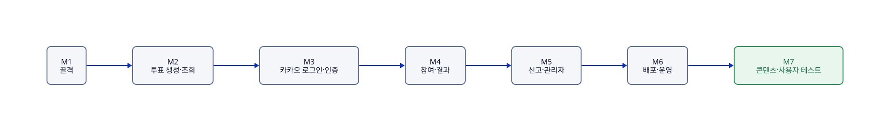

# AuDDum 구현 로드맵

| 항목 | 내용 |
| --- | --- |
| 버전 | v1 |
| 작성일 | 2026-10-12 |
| 작성자 | 태풍 |
| 관련 문서 | [AuDDum 개발 워크플로](../howto/개발-워크플로.md), [AuDDum API 명세서](../API-명세.md), [AuDDum 배포](../howto/배포.md) |

## 요약

MVP를 7개 마일스톤으로 나눠 만든다. 인증이 필요 없는 조회부터 시작해 위험이 큰 부분(로그인, 동시 참여)을 앞쪽에 두고, 각 마일스톤은 개발 기준 브랜치(`develop`)에 합칠 수 있는 단위로 끝낸다. 일정은 정하지 않았고 순서와 완료 기준만 적는다.

- **M1 골격 → M2 투표 → M3 로그인 → M4 참여 → M5 신고·관리자 → M6 배포 → M7 사용자 테스트**
- 마일스톤마다 **완료 기준(DoD, 끝났다고 말하려면 만족해야 하는 조건)**을 만족해야 다음으로 넘어간다.
- 작업은 이슈로 만들고 [개발 워크플로](../howto/개발-워크플로.md)의 브랜치·커밋 규칙을 따른다.

## 목차

1. [전체 흐름](#1-전체-흐름)
2. [M1 프로젝트 골격](#2-m1-프로젝트-골격)
3. [M2 투표 생성·조회](#3-m2-투표-생성조회)
4. [M3 카카오 로그인과 인증](#4-m3-카카오-로그인과-인증)
5. [M4 참여와 결과](#5-m4-참여와-결과)
6. [M5 신고와 관리자](#6-m5-신고와-관리자)
7. [M6 배포와 운영 환경](#7-m6-배포와-운영-환경)
8. [M7 콘텐츠 준비와 사용자 테스트](#8-m7-콘텐츠-준비와-사용자-테스트)
9. [공통 완료 기준](#9-공통-완료-기준)

## 1. 전체 흐름

그림의 원본: [로드맵-전체-흐름.d2](../diagrams/로드맵-전체-흐름.d2)

| 단계 | 목표 | 핵심 위험 | 순서 이유 |
| --- | --- | --- | --- |
| M1 | 모든 기능이 올라갈 뼈대 | 의존성·설정 문제 | 이후 작업의 전제 |
| M2 | 인증 없는 조회·생성 흐름 | 도메인 규칙 누락 | 가장 단순한 수직 기능으로 구조를 검증한다. |
| M3 | 로그인, JWT, 회원 상태 확인 | 카카오 연동, 쿠키·CORS | 위험이 커서 일찍 부딪힌다. |
| M4 | 참여와 결과 공개 | 동시성, 중복 참여 | 서비스의 핵심이며 테스트가 가장 중요하다. |
| M5 | 신고와 관리자 처리 | 트랜잭션, 권한 | 핵심 흐름이 끝난 뒤 운영 기능을 붙인다. |
| M6 | CI/CD와 모니터링 | 서버·HTTPS·쿠키 | 사용자 테스트 전에 운영 환경을 갖춘다. |
| M7 | 시드 투표와 사용자 20~50명 테스트 | 콘텐츠 부족 | PRD의 운영 목표 검증 |

**체크 표시.** 작업과 완료 기준 앞의 `[x]`는 끝난 것, `[ ]`는 남은 것이다. 끝난 항목 뒤의 이슈 번호가 근거다. 이슈를 닫는 PR에서 해당 체크박스도 같이 바꾼다(`개발-워크플로.md`의 '커밋·PR·이슈 규칙').

## 2. M1 프로젝트 골격

**작업**

- [x] 패키지 구조 생성: `member`, `auth`, `poll`, `vote`, `report`, `admin`, `support` (#3)
- [x] 의존성 추가(로컬 환경 문서), Swagger UI 설정(`prod`에서는 끔), `compose.yaml`에 MySQL 8.4, `local`·`prod` 프로파일 (#1, #2)
- [x] 오류 응답: ProblemDetail과 오류 코드 체계, 공통 예외 처리([API 명세서](../API-명세.md) 1·7장) (#4)
- [x] Flyway `V1__init_schema.sql`에 [ERD 설계](../ERD.md)의 8개 테이블·제약·제약용 인덱스 (#5). 조회 최적화 인덱스는 MVP 이후 성능을 측정하고 추가한다.
- [x] ArchUnit 구조 테스트: 순환 의존, 다른 도메인 repository 사용 금지, 서비스의 `*JpaRepository`·다른 서비스 의존 금지, `common` 금지 (#6)
- [x] GitHub Actions: PR에서 빌드·테스트 (#7)
- [x] `.editorconfig`, PR 템플릿 (#8)
- [ ] 브랜치 보호 (GitHub 설정이라 확인이 필요하다)

**완료 기준**

- [x] `./gradlew build`가 통과한다.
- [ ] 앱이 로컬 MySQL로 기동된다. (수동 확인)
- [x] 마이그레이션이 로컬 MySQL과 테스트 H2에서 모두 적용된다. (`FlywayV1SchemaTest`, Testcontainers MySQL 테스트)
- [ ] 헬스 체크가 응답한다. (설정과 테스트가 아직 없다)

## 3. M2 투표 생성·조회

**작업**

- [x] 도메인: `Poll`, `PollOption`, 값 객체(PublicId, PollQuestion, OptionContent, Position, ClosesAt) (#9)
- [x] API: `POST /polls` (#10), `GET /polls`(커서 페이징)와 `GET /polls/{pollId}` (#11)
- [x] 공개 ID 발급과 중복 재발급, 선택지 중복 비교(대소문자·악센트 무시) (#10)

이 단계의 작성자는 임시 신원(`X-Member-Id` 헤더)을 썼고 M3(#13)에서 실제 인증으로 바꿨다.

**완료 기준**

- [x] 질문·선택지·마감 시각 검증이 [도메인 모델](../domain/도메인-모델.md) 규칙대로 거부한다.
- [x] 목록이 최신순 커서로 이어지고 마지막에 `nextCursor`가 null이다.
- [x] 도메인 단위 테스트(`isClosed` 경계 포함)와 API 테스트가 있다.

## 4. M3 카카오 로그인과 인증

**작업**

- [x] `oauth2Login` 설정, `OAuth2UserService`(가입·재가입), Success·Failure 핸들러 (#12)
- [x] JWT 발급, 쿠키 속성(HttpOnly, Secure, SameSite=Lax), 리프레시 토큰 해시 저장·교체·재사용 감지 (#13)
- [x] API: `/auth/refresh`, `/auth/logout` (#13)
- [x] M2의 임시 신원을 실제 인증으로 교체. `CurrentMemberIdResolver`는 토큰 인증 정보를 읽도록 바꿨고 헤더 신원은 없앴다. (#13)
- [x] 쓰기 서비스의 회원 상태 확인: 정지 403·탈퇴·없음 401, 존재하지 않는 회원 ID가 500이 되던 문제 해결 (#14)
- [x] `DELETE /members/me`: 소셜 연동 삭제, 탈퇴 이벤트로 리프레시 토큰 삭제, 쿠키 삭제. 탈퇴 회원 재발급은 401 (#14)
- [x] 정지 회원의 투표 생성 403 `MEMBER_SUSPENDED` (#14)
- [x] CSRF 대응(Origin 검증)과 CORS 허용 목록: `CORS_ALLOWED_ORIGINS`와 Origin 검사가 같은 목록을 쓴다. (#49)
- [x] `GET /members/me`: `MemberQueryService`, 정지 회원 조회 가능, 탈퇴·없는 회원 401 (#47)
- [x] `GET /polls/{pollId}`가 숨김·삭제 투표를 작성자·관리자(DB의 role이 ADMIN, 토큰 role은 보지 않음)에게 `status`와 함께 200으로 내린다. (#48)
  - 관리자 판정은 `MemberReader.isAdmin`이다.
  - 관리자 API의 403 `FORBIDDEN` 검사는 M5의 #52에서 이 판정으로 구현한다.

**완료 기준**

- [ ] 로컬에서 카카오 로그인 → 쿠키 발급 → 보호된 API 호출이 동작한다. (수동 확인)
- [x] 정지·탈퇴 회원의 쓰기가 403·401로 막히고, 탈퇴 시 연동 정보와 토큰이 삭제된다. (`MemberStatusAndWithdrawTest`)
- [x] 리프레시 재사용 시 전체 폐기, 10초 유예 동작을 테스트로 확인한다. (`RefreshTokenServiceTest`, `RefreshTokenTest`)

## 5. M4 참여와 결과

**작업**

- [x] 도메인: `Vote`, `Voter`, `AnonId`, 익명 쿠키(UUID + HMAC 서명) 발급·검증 (#15)
- [x] API: `POST /polls/{pollId}/votes`와 결과 공개 규칙(참여 후, 마감 후) (#16)
- [x] 처리 순서: 투표 조회 → 참여자 결정 → 회원 상태 → 기존 참여 → 마감 → 선택지 소속 → 저장 (#16)
- [x] 유니크 제약 위반 시 409(동시 요청에서 진 쪽) (#16)
- [x] `GET /polls/{pollId}`에 `myChoice`·`result` 반영 (#16, #63)
- [x] 투표 목록의 참여 수 (#62)

**완료 기준**

- [x] **동시 참여 테스트**: 같은 참여자가 동시에 요청해도 기록이 정확히 1건이고 한 요청만 201, 나머지는 409다. MySQL 컨테이너에서 실행하며 #17에서 Testcontainers `mysql:8.4`로 `./gradlew test`에 포함했다.
- [x] 위조된 익명 쿠키가 새로 발급되고 시도가 로그로 남는다. (`AnonIdentityResolverTest`)
- [x] 마감 경계(P-11)와 이미 참여한 사람의 마감 후 조회가 테스트로 확인된다. (`VoteTest`, `VoteParticipatorTest`)

## 6. M5 신고와 관리자

**작업**

- [x] 도메인: `Report`(#18), `AdminAction`(#19)
- [x] 신고자 값 객체 `Reporter` 도입 (#60)
  - 참여의 `Voter`와 공유하지 않는다(`report`는 `vote`에 의존할 수 없다).
  - 익명 쿠키 발급·검증(`AnonCookieProvider` 등)을 `support.anon`으로 옮겼다. UUID만 다루므로 vote·report가 함께 쓴다.
- [x] 신고 접수 API: `POST /polls/{pollId}/reports` (#18)
- [x] 관리자 신고 목록·상세 API: `GET /admin/reports`(접수 순, 상태 필터, 투표별 신고 수), `GET /admin/reports/{id}` (#19, 조회 PR)
- [x] 관리자 조치 API: 신고 기각 `POST /admin/reports/{id}/dismiss`, 투표 숨김·삭제 `PATCH /admin/polls/{id}/status`(`status`: HIDDEN·DELETED, 그 투표의 접수 신고를 함께 종료), 회원 정지 `POST /admin/members/{id}/suspend`. 신고 기각, 투표 조치, 회원 정지는 별도 API다. (#19, 조치 PR)
  - 컨트롤러는 `@CurrentMemberId`를 써서 미로그인을 401로 낸다(`@OptionalMemberId`면 `AdminAccessValidator`가 null을 403으로 거절한다). 서비스는 첫 단계에서 `AdminAccessValidator.validateAdmin`을 부른다.
- [ ] 관리자 투표 복구·정지 해제 API (#20)
- [ ] 신고 도배 방어와 중복 시도 로그 보관 기간 정하기(P-28)
- [x] 조치 한 번에 대상 상태 변경, 신고 상태 변경, 이력 기록을 한 트랜잭션으로 처리 (#19)
- [x] 같은 투표의 PENDING 신고 일괄 종료, 같은 신고에 조치가 동시에 들어오면 한쪽만 성공(409) (#19)
- [ ] 작성자의 투표 삭제 API: 숨긴 투표 삭제 불가 규칙 (#76). 신고·관리자 기능과 독립이라 따로 진행한다.
- [x] 관리자 API의 403 `FORBIDDEN` 검사: `AdminAccessValidator`가 `MemberReader.isAdmin`으로 판단하고 시도를 기록, 미로그인은 401. 정지·탈퇴 관리자는 권한 없음 (#52)
- [ ] 관리자 계정 부여 절차 확인(로컬 환경 문서의 관리자 계정 부여). 관리자가 한 명뿐인데 정지되면 API로 복구할 수 없으므로 DB로 직접 푸는 절차도 적는다. (#20)
- [x] 계정 상태(`status`·`suspendedAt`·`withdrawnAt`)를 값 객체 `AccountStatus`로 묶을지 정지 행위를 만들 때 검토한다: 묶지 않고 `Member.suspend(now)`만 추가했다. 정지 해제(#20)까지 보고 다시 판단한다. (#19)

**이슈 간 의존 관계**(순서는 이슈를 시작할 때 정한다)

- #60(`Reporter`·익명 쿠키 처리 위치) → #18(신고 접수) → #19(신고 목록·조치)
- #52(관리자 API 접근 검사) → #19, #20(투표 복구·정지 해제)
- #76(작성자 투표 삭제)은 다른 이슈에 의존하지 않는다.

**완료 기준**

- [x] 조치 중 실패하면 전부 롤백된다. (`AdminReportActionRollbackTest`)
- [x] 신고 중복 409, 이미 처리된 신고 재조치 409가 테스트로 확인된다. (`AdminReportActionChainTest`, `AdminReportActionConcurrencyTest`)

## 7. M6 배포와 운영 환경

**작업**

- [ ] EC2·RDS·Vercel 구성, 가비아 도메인, `api` 서브도메인, Caddy HTTPS (#22)
- [ ] GitHub Actions 배포: GHCR 푸시, SSH 배포, 헬스 체크, 롤백 (#21)
- [ ] 운영용 카카오 앱과 리다이렉트 URI, 환경 변수 파일 주입 (#22)
- [ ] Prometheus·Grafana 모니터링 서버, 디스코드 알림, 외부 업타임 체크 (#23)
- [ ] RDS 백업(7일) (#22)

**완료 기준**

- [ ] `main` 병합으로 자동 배포되고 헬스 체크 실패 시 이전 이미지로 돌아간다.
- [ ] 운영 도메인에서 카카오 로그인과 참여가 동작한다. (프런트와 쿠키·CORS 포함)
- [ ] Actuator 포트가 외부에서 닫혀 있고 알림이 도착한다.

## 8. M7 콘텐츠 준비와 사용자 테스트

**작업**

- [ ] 시드 투표 20~30개 작성 (#25)
- [ ] 개인정보 처리방침과 약관, 탈퇴 시 삭제 범위 확정([API 명세서](../API-명세.md) 8장) (#24)
- [ ] 친구·지인 20~50명 테스트, 지표 확인([PRD](PRD.md) 8장) (#25)
- [ ] 반복 허위 신고자를 어떻게 다룰지 정하기(운영하면서)

**완료 기준**

- [ ] 개인정보 처리방침이 공개되어 있다.
- [ ] 테스트 결과를 바탕으로 목표 지표를 조정한다.

## 9. 공통 완료 기준

모든 마일스톤의 PR은 아래를 만족해야 병합한다.

- 빌드·테스트(ArchUnit 포함)가 통과한다.
- 동작이 바뀌면 [API 명세서](../API-명세.md) 등 관련 문서를 같은 PR에서 고쳤다.
- 정책에서 정한 예외 응답(상태 코드, 오류 코드)을 테스트로 확인했다.
- 토큰·쿠키 값이 로그에 남지 않는다.
