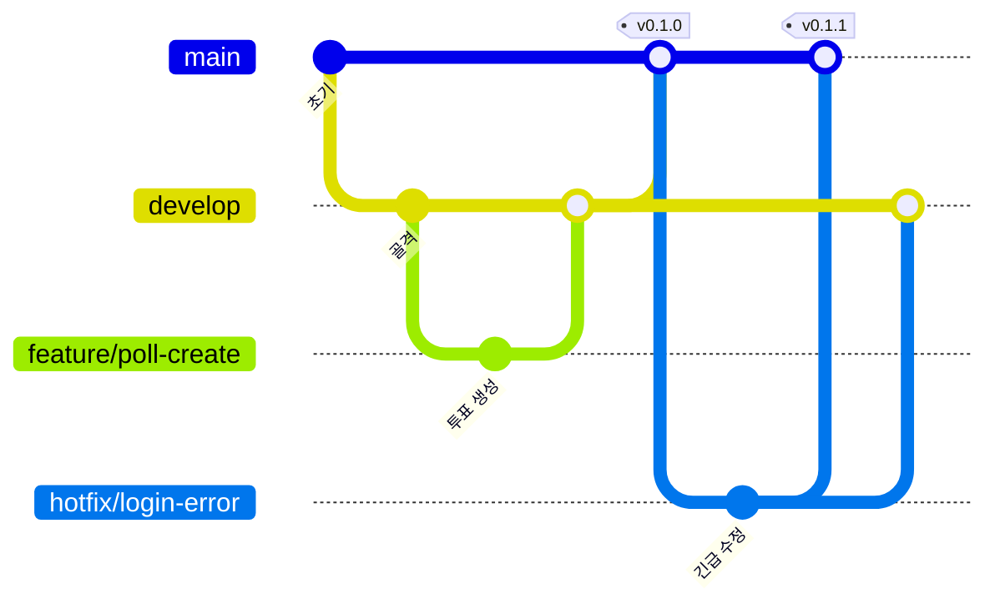

# AuDDum 개발 가이드

| 항목 | 내용 |
| --- | --- |
| 버전 | v1 |
| 작성일 | 2026-10-12 |
| 작성자 | 태풍 |
| 관련 문서 | [AuDDum 아키텍처 설계서](아키텍처.md), [AuDDum 테스트·배포 설계서](테스트-배포.md), [AuDDum 구현 로드맵](로드맵.md) |

## 요약

개발을 시작하기 전에 정해 두는 협업 규칙과 로컬 환경이다. 브랜치는 **git flow**를 따르고, 커밋은 Conventional Commits 형식으로 쓴다. 코드 구조 규칙은 아키텍처 설계서가 기준이며 이 문서는 그 밖의 도구와 약속만 다룬다.

- 브랜치: `main`(운영), `develop`(통합), `feature/*`, `hotfix/*`. release 브랜치는 두지 않는다.
- 커밋: `type(scope): 제목`, 이슈 번호를 연결한다.
- 로컬: Docker Compose의 MySQL 8.4와 `local` 프로파일, 비밀 값은 환경 변수 파일로 분리한다.
- 이 문서의 도구·이름 규칙은 제안이며 진행하면서 조정한다.

## 목차

1. [브랜치 전략(git flow)](#1-브랜치-전략git-flow)
2. [커밋·PR·이슈 규칙](#2-커밋pr이슈-규칙)
3. [코드 컨벤션](#3-코드-컨벤션)
4. [로컬 개발 환경](#4-로컬-개발-환경)
5. [DB 마이그레이션](#5-db-마이그레이션)
6. [카카오 개발자 앱 등록](#6-카카오-개발자-앱-등록)
7. [관리자 계정 부여](#7-관리자-계정-부여)
8. [API 문서와 프런트 협업](#8-api-문서와-프런트-협업)

## 1. 브랜치 전략(git flow)



| 브랜치 | 분기 | 병합 대상 | 역할 |
| --- | --- | --- | --- |
| `main` | — | — | **운영에 배포되는 코드.** 직접 커밋하지 않고 `develop` 병합과 hotfix 병합으로만 바뀐다. 병합마다 태그(`vX.Y.Z`)를 붙인다. |
| `develop` | `main` | — | **다음 배포를 위한 통합 브랜치.** feature가 모이는 곳이다. |
| `feature/*` | `develop` | `develop` | 기능 하나를 만든다. |
| `hotfix/*` | `main` | `main`, `develop` | 운영 장애의 긴급 수정 |

**규칙**

- 브랜치 이름은 `feature/{이슈번호}-{영문-요약}` 형식이다. 예: `feature/12-poll-create`
- feature는 `develop`으로 **PR을 거쳐** 병합하고, 병합 방식은 **squash**다. 기능 하나가 `develop`에 커밋 하나로 남는다.
- 배포할 때는 `develop`을 `main`으로 **PR + merge commit**(`--no-ff`)으로 병합하고 태그를 붙인다. 별도 release 브랜치와 QA 수정 단계는 두지 않는다.
- hotfix는 `main`에서 분기해 `main`으로 같은 방식으로 병합한 뒤 `develop`에도 병합한다.
- `main`과 `develop`은 GitHub 브랜치 보호로 직접 푸시를 막고, PR은 CI(빌드·테스트)가 통과해야 병합한다. 혼자 작업하므로 승인 인원은 0으로 두되 **셀프 리뷰를 PR에 남긴다.**
- 한 feature는 가능한 한 하루~이틀 안에 끝낼 크기로 쪼갠다.
- 버전은 `0.x.0`(MVP 전), 첫 공개 배포를 `1.0.0`으로 한다.

**배포와의 연결**

- `main`에 병합되면 CI/CD가 이미지를 만들어 배포한다. ([테스트·배포 설계서](테스트-배포.md) 4장)
- `develop`에는 배포하지 않는다. 별도 스테이징 환경은 두지 않는다.

## 2. 커밋·PR·이슈 규칙

**커밋 메시지** — Conventional Commits

```text
type(scope): 제목

본문(선택): 무엇을 왜 바꿨는지

Refs #12
```

| type | 쓰는 때 |
| --- | --- |
| `feat` | 기능 추가 |
| `fix` | 버그 수정 |
| `refactor` | 동작 변화 없는 구조 개선 |
| `test` | 테스트 추가·수정 |
| `docs` | 문서 |
| `chore` | 빌드·설정·의존성 |
| `ci` | CI/CD 설정 |

- `scope`는 도메인이나 영역이다. 예: `poll`, `vote`, `member`, `report`, `admin`, `auth`, `support`, `db`
- 제목은 한글로 쓰고 마침표를 붙이지 않는다. 예: `feat(poll): 투표 생성 API 추가`
- feature 브랜치 안의 커밋은 자유롭게 쌓고, PR 제목을 같은 형식으로 써서 squash 커밋 메시지가 된다.

**PR**

- 제목은 커밋 규칙과 같다. 본문에 **변경 내용, 관련 이슈(`Closes #12`), 테스트 방법, 참고 문서**를 적는다.
- 사용자에게 보이는 동작이 바뀌면 API 명세 등 관련 문서도 같은 PR에서 고친다.
- PR 템플릿은 `.github/pull_request_template.md`에 있다. 본문 항목(변경 내용, 관련 이슈, 테스트 방법, 참고 문서)과 체크리스트가 들어 있다.
- PR과 develop·main 푸시에서 GitHub Actions(`.github/workflows/ci.yml`)가 `./gradlew build`를 돌린다. 통과한 뒤에 병합한다.

**이슈**

- 구현 로드맵의 작업을 이슈로 만들고 마일스톤(M1~M7)에 묶는다.
- 라벨: `feature`, `bug`, `docs`, `chore`와 도메인 라벨(`poll`, `vote` 등)
- 이슈 하나가 feature 브랜치 하나, PR 하나에 대응한다.

## 3. 코드 컨벤션

구조와 설계 규칙은 [아키텍처 설계서](아키텍처.md) 2장이 기준이다. 아래는 거기에 없는 도구와 이름 약속만 적는다.

**아키텍처 문서의 규칙(요약)**

- 도메인별 패키지, 클래스는 기본 package-private, 밖에 여는 것은 서비스 진입점뿐
- 엔티티에 setter 금지, 규칙은 도메인 객체에 두고 서비스는 흐름과 트랜잭션만
- 서비스는 애그리거트를 반환하고 응답 구성은 controller가 한다. 쓰기는 Command, 읽기는 Query 서비스
- 다른 도메인의 repository를 직접 쓰지 않고 `common` 패키지를 만들지 않는다. admin 같은 조합 계층도 예외가 아니라 다른 도메인의 서비스 진입점으로만 부른다. ArchUnit(`ArchitectureTest`)이 검증한다. repository 규칙은 도메인 안의 `infrastructure` 패키지 이름에 의존하므로 그 이름을 지킨다.

**이 문서에서 정하는 것(제안)**

| 항목 | 규칙 |
| --- | --- |
| 포맷 | `.editorconfig`로 들여쓰기(Java 공백 4칸, YAML·JSON 2칸)·줄바꿈(LF)·인코딩(UTF-8)을 통일하고 Java 한 줄은 130자까지 쓴다. 자동 포맷터(Spotless)는 도입하지 않는다. 필요해지면 다시 정한다. |
| 클래스 이름 | `{도메인}WebApi`(`@WebApi`, `api`), `{도메인}WebApiDocs`(Swagger 어노테이션만 모은 추상 클래스, 컨트롤러가 상속), `{도메인}CommandService`, `{도메인}QueryService`, `{도메인}JpaRepository`(Spring Data, `infrastructure`), 요청·응답은 `{동작}Request`·`{동작}Response` |
| 테스트 이름 | `@Test` 메서드 이름만 **한글**로 쓴다. 헬퍼 메서드·변수·상수·픽스처 이름은 영어다. `@DisplayName`은 쓰지 않는다. 예: `마감된_투표에는_참여할_수_없다()`. 클래스는 `{대상}Test` |
| 테스트 작성 방식 | 웹 계층은 `WebApiTestSupport`(`MockMvcTester mvcTester`, `JsonMapper`)를 상속하고, 서비스는 `@MockitoBean`으로 대체한다. 요청과 검증은 `mvcTester.get().uri(..).assertThat().hasStatus(HttpStatus.X).apply(print()).bodyJson().hasPathSatisfying("$.code", v -> v.assertThat().isEqualTo(..))`처럼 한 줄기로 이어 쓰고, 지역 변수는 `var`를 쓴다. 단위 테스트는 `UnitTestSupport`, 서비스 통합은 `IntegrationTestSupport`, 반복되는 테스트 데이터는 `{도메인}Fixture` 클래스로 모은다(필요해질 때 만든다). |
| var | 지역 변수 `var`는 **테스트 코드에서만** 쓴다. `src/main`은 타입을 명시한다. |
| Lombok | `@Getter`, `@RequiredArgsConstructor`, `@NoArgsConstructor(access = PROTECTED)`는 허용한다. 엔티티에 `@Setter`·`@Data`는 쓰지 않는다. |
| null | 반환값에서 null 대신 `Optional`을 쓰고, 필수 인자는 생성 시점에 검증한다. |
| 주석 | 코드가 말하지 않는 **이유**만 적는다. 정책 번호(P-xx, UC-xx)를 근거로 달 수 있다. |
| 용어 | [도메인 모델](도메인-모델.md)의 유비쿼터스 언어를 코드 이름에 그대로 쓴다. (투표=Poll, 참여=Vote) |

## 4. 로컬 개발 환경

**준비물**

- Java 25 (Liberica), Docker
- 저장소의 `gradlew`로 빌드한다. Gradle toolchain이 Java 25를 요구한다.

**구성**

- `compose.yaml`에 MySQL 8.4(`mysql` 서비스, 데이터베이스 `auddum`)를 둔다. Spring Boot가 `spring-boot-docker-compose`로 앱 기동 때 함께 올려 준다. 호스트 포트는 **3307**이다. 다른 프로젝트의 MySQL이 3306을 쓰는 경우가 많아 피했다.
- 프로파일은 `local`(로컬 MySQL)과 `prod`(RDS)로 나누고 파일도 나눈다. 기본 프로파일은 `local`이다. ([테스트·배포 설계서](테스트-배포.md) 5장)
  - `src/main/resources/application.yaml`: 공통(앱 이름, JPA, KST)
  - `src/main/resources/application-local.yaml`: 로컬 MySQL 접속, `.env`를 읽는다.
  - `src/main/resources/application-prod.yaml`: RDS 접속(환경 변수만 사용), Swagger UI와 `/v3/api-docs`를 끈다.
- 테스트는 H2를 쓴다. `src/test/resources/application.yaml`이 메인 설정을 대신하므로 테스트에서는 `local`·`prod` 파일이 읽히지 않는다.
- 비밀 값(카카오 클라이언트 id·secret, JWT 서명 키, 익명 쿠키 HMAC 키, DB 비밀번호)은 코드와 git에 넣지 않는다. 로컬은 `.env` 또는 환경 변수로 주입하고, `.env`는 `.gitignore`에 넣는다. 샘플은 `.env.example`로 커밋한다. `application-local.yaml`에는 비밀 값 없이 `${DB_PASSWORD}` 같은 환경 변수 참조만 둔다.
- 시각은 KST를 기준으로 한다. `spring.jpa.properties.hibernate.jdbc.time_zone: Asia/Seoul`과 커넥션 초기화 `SET time_zone = '+09:00'`(`spring.datasource.hikari.connection-init-sql`)로 JPA와 DB 접속을 맞춘다.

**로컬 실행**

1. `cp .env.example .env` 후 `DB_PASSWORD`, `DB_ROOT_PASSWORD`를 채운다.
2. `./gradlew bootRun` — compose가 MySQL을 먼저 올리고 앱이 뜬다. 앱을 끄면 컨테이너도 함께 내려간다.
3. `curl http://localhost:8080/actuator/health`가 `{"status":"UP"}`이면 기동한 것이다. 8080을 다른 앱이 쓰면 `SERVER_PORT=18080 ./gradlew bootRun`처럼 포트를 바꾼다.

**의존성**

`spring-boot-starter-security`, `spring-boot-starter-validation`, `spring-boot-starter-actuator`, springdoc-openapi, Flyway(`flyway-core`, `flyway-mysql`), MySQL 드라이버, JWT(JJWT), 테스트용 ArchUnit을 `build.gradle.kts`에 추가했다. 버전은 Spring Boot 의존성 관리를 따른다. 관리 밖인 springdoc-openapi·JJWT·ArchUnit만 `build.gradle.kts`에서 버전을 직접 정한다.

## 5. DB 마이그레이션

- Flyway로 스키마를 관리하고 위치는 `src/main/resources/db/migration`이다.
- 파일 이름은 `V{번호}__{설명}.sql`이다. 예: `V1__init_schema.sql`
- `V1`에 [ERD 설계](ERD.md)의 테이블 8개, 제약조건, 인덱스를 옮긴다.
- 이미 병합된 마이그레이션은 **수정하지 않고** 새 파일을 추가한다.
- 공통 설정은 `ddl-auto=validate`(엔티티와 스키마가 어긋나면 기동 실패)이고, 테스트는 `none`이라 H2도 같은 Flyway SQL로만 스키마를 만든다.
- H2에서 도는 문법만 쓴다. 막히는 부분은 해당 부분만 자동 생성으로 내린다. ([테스트·배포 설계서](테스트-배포.md) 5장)

## 6. 카카오 개발자 앱 등록

| 항목 | 내용 |
| --- | --- |
| 앱 | 개발용과 운영용을 **따로** 만들어 키를 분리한다. |
| 리다이렉트 URI(로컬) | `http://localhost:8080/login/oauth2/code/kakao` |
| 리다이렉트 URI(운영) | `https://api.도메인/login/oauth2/code/kakao` |
| 동의 항목 | 카카오 고유 식별자만 쓴다. 닉네임·프로필·이메일은 저장하지 않으므로 받지 않는다. |
| 비밀 값 | 클라이언트 id·secret은 환경 변수로 주입한다. |

## 7. 관리자 계정 부여

관리자 권한은 API로 바꿀 수 없고 DB에서 직접 부여한다. ([ERD 설계](ERD.md))

- 먼저 카카오 로그인으로 **일반 회원으로 가입**한 뒤, 운영 DB에서 `role`을 `ADMIN`으로 직접 바꾼다.
- 이 SQL은 마이그레이션에 넣지 않고 수동으로 실행한다. 누가 언제 바꿨는지는 작업 기록(이슈 또는 PR 코멘트)에 남긴다.
- 관리자는 초기에 1명이다. 늘릴 때도 같은 절차를 따른다.
- 권한은 요청마다 토큰의 `role`과 DB의 `role`을 모두 확인한다. ([인증·중복 참여 설계서](인증-중복-참여.md))

## 8. API 문서와 프런트 협업

- API의 기준은 [API 명세서](API-명세.md)다. 구현이 명세와 달라지면 **같은 PR에서 명세를 고친다.**
- 프런트가 쓰는 JSON 예시는 명세서의 예시를 기준으로 한다.
- **Swagger UI(springdoc-openapi)**를 쓴다. 컨트롤러에서 문서를 생성해 프런트가 바로 호출해 볼 수 있게 한다. 운영 환경에서는 노출하지 않는다(`prod` 프로파일에서 끈다).
- 명세서가 정책과 설계 이유의 기준이고, Swagger는 요청·응답 구조의 실제 확인용이다. 둘이 어긋나면 명세서를 기준으로 코드를 고친다.
- Spring Boot 4.1에 맞는 springdoc 버전은 의존성을 추가할 때(M1) 확인한다.
- 프런트와 API는 같은 사이트의 서브도메인이라 로컬 개발에서도 쿠키 동작(SameSite, CORS)을 맞춰서 확인해야 한다.
