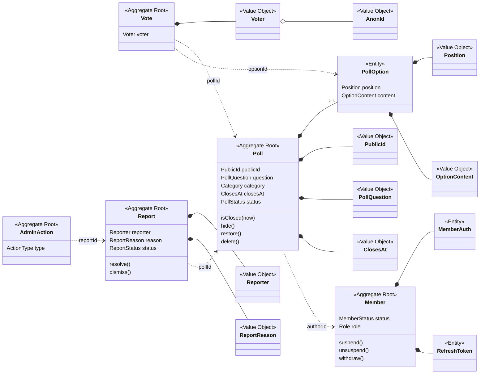
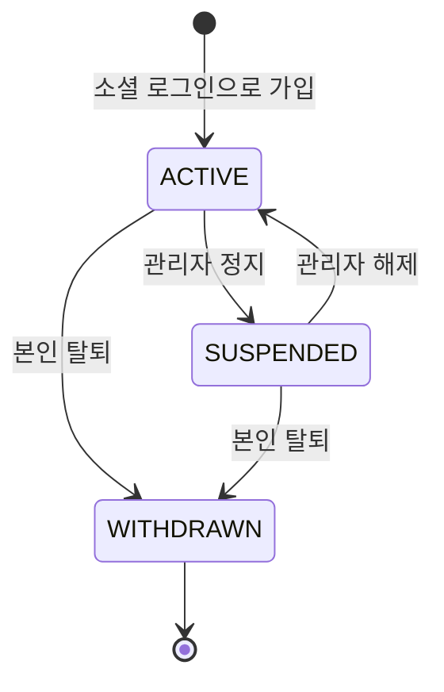
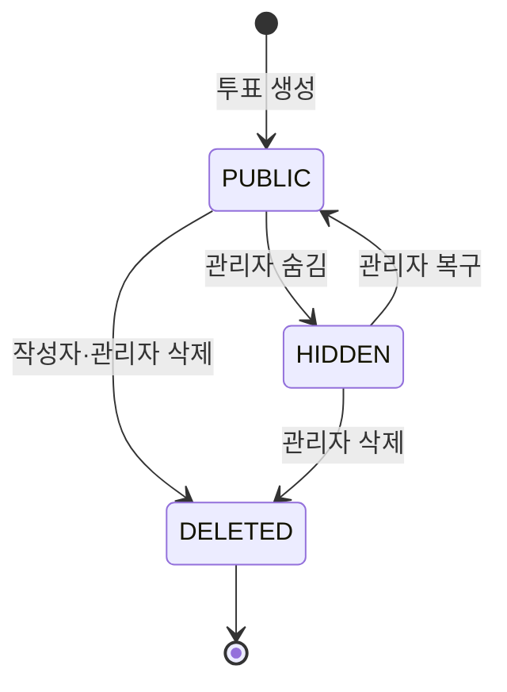
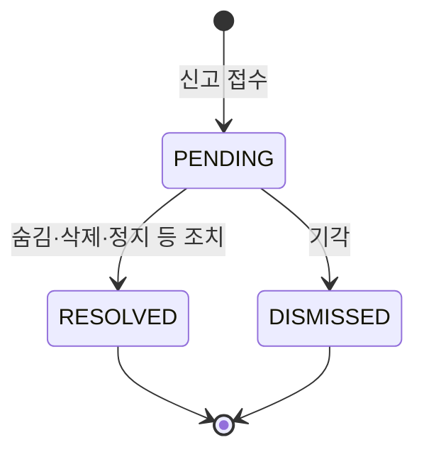

# AuDDum 도메인 모델

| 항목 | 내용 |
| --- | --- |
| 버전 | v1 |
| 작성일 | 2026-10-12 |
| 작성자 | 태풍 |
| 관련 문서 | [AuDDum 예외·정책 명세서](예외-정책.md), [AuDDum ERD 설계](ERD.md), [AuDDum 아키텍처 설계서](아키텍처.md) |

## 요약

AuDDum(어떰)의 도메인 모델을 애그리거트 단위로 정리했다. 애그리거트는 회원(Member), 투표(Poll), 참여(Vote), 신고(Report), 관리자 조치(AdminAction) 다섯 개다. 각 애그리거트의 속성, 행위, 규칙과 상태 열거형을 적었고, 코드와 대화에서 같은 말을 쓰도록 용어집과 값 객체(VO)를 함께 둔다.

- 규칙은 도메인 객체가 지키고, 서비스는 흐름과 트랜잭션만 맡는다. (아키텍처 설계서)
- 애그리거트 사이는 객체가 아니라 ID로만 참조한다.
- 행위 이름과 값 객체 구성은 설계 제안이며 구현 중 조정할 수 있다. 테이블과 제약은 ERD 문서가 기준이다.

## 목차

1. [유비쿼터스 언어](#1-유비쿼터스-언어)
2. [모델 개요](#2-모델-개요)
3. [회원 애그리거트](#3-회원-애그리거트)
4. [투표 애그리거트](#4-투표-애그리거트)
5. [참여 애그리거트](#5-참여-애그리거트)
6. [신고 애그리거트](#6-신고-애그리거트)
7. [관리자 조치 애그리거트](#7-관리자-조치-애그리거트)
8. [값 객체](#8-값-객체)

## 1. 유비쿼터스 언어

기획·설계·코드·API에서 같은 말을 같은 뜻으로 쓰기 위한 용어집이다. 한글 용어가 문서와 대화의 기준이고, 코드와 API는 영문 이름을 쓴다.

| 용어 | 영문(코드) | 정의 |
| --- | --- | --- |
| 투표 | Poll | 질문 하나와 선택지 2~5개로 이뤄진 선택형 투표. 회원이 만든다. |
| 선택지 | PollOption | 투표 안의 선택 항목. 투표 안의 순번(`position` 1~5)으로 가리킨다. |
| 참여 | Vote | 한 참여자가 한 투표에서 선택지 하나를 고른 기록. 만든 뒤 바꾸거나 지우지 않는다. |
| 참여자 | Voter | 참여를 한 주체를 가리키는 값. 회원 ID 또는 익명 식별자 중 정확히 하나다. |
| 신고자 | Reporter | 신고를 한 주체를 가리키는 값. 참여자와 모양은 같지만 신고 애그리거트의 별개 값 객체다(M5에서 구현). |
| 회원 | Member | 소셜(카카오) 로그인으로 가입한 사용자. 투표를 만들 수 있다. |
| 비회원 | (익명 참여자) | 로그인하지 않은 사용자. 참여와 신고만 할 수 있고 익명 식별자로 구분한다. |
| 익명 식별자 | AnonId | 비회원 구분용 UUID. 서명된 쿠키로 전달한다. 신원 확인 수단이 아닌 보조 수단이다. |
| 공개 ID | PublicId | 외부에 노출하는 투표 식별자(12자 영숫자). 내부 `id`는 노출하지 않는다. |
| 관리자 | Admin | `role`이 ADMIN인 회원. 신고 검토와 회원·투표 조치를 한다. |
| 카테고리 | Category | 투표의 분류. 썸(SOME), 소개팅(BLIND_DATE), 연락(CONTACT), 연애 중(IN_RELATIONSHIP), 이별(BREAKUP), 연애 가치관(LOVE_VALUES), 기타(ETC) |
| 마감 시각 | closesAt | 투표가 마감되는 시각. 선택이며, 없으면 마감 없는 투표다. |
| 마감 | closed | 서버 시각이 마감 시각 이상인 상태. 저장하지 않고 계산한다. |
| 결과 | result | 선택지별 득표 수(`count`)와 전체 참여 수(`total`). 비율은 계산하지 않는다. |
| 공개 상태 | PollStatus | 공개(PUBLIC), 숨김(HIDDEN), 삭제(DELETED) |
| 숨김 | HIDDEN | 관리자가 노출을 막은 상태. 관리자가 복구할 수 있다. |
| 삭제 | DELETED | 작성자 또는 관리자가 지운 상태. 복구할 수 없고 기록은 남는다. |
| 회원 상태 | MemberStatus | 정상(ACTIVE), 정지(SUSPENDED), 탈퇴(WITHDRAWN) |
| 정지 | SUSPENDED | 관리자가 이용을 막은 상태. 기간 없이 수동으로 해제할 때까지 유지한다. |
| 탈퇴 | WITHDRAWN | 본인이 떠난 상태. 작성한 투표는 익명화해 유지하고 참여 기록은 보존한다. |
| 신고 | Report | 부적절한 투표를 알리는 접수. 투표당 신고자당 1회다. |
| 신고 사유 | ReportReason | 혐오·욕설(ABUSE_HATE), 성적 괴롭힘(SEXUAL_HARASSMENT), 개인정보(PERSONAL_INFO), 스팸(SPAM), 기타(ETC) |
| 신고 상태 | ReportStatus | 접수(PENDING), 처리(RESOLVED), 기각(DISMISSED) |
| 조치 | AdminAction | 관리자가 한 처리와 그 이력. 처리자·시각·조치·사유를 남기고 수정·삭제하지 않는다. |

**용어 사용 규칙**

- "투표"는 Poll이고, 선택지를 고르는 행위와 그 기록은 "참여"(Vote)다. "투표하다"를 참여의 뜻으로 섞어 쓰지 않는다.
- 숨김과 삭제는 다르다. 숨김은 복구할 수 있고 삭제는 복구할 수 없다.
- 정지와 탈퇴는 다르다. 정지는 관리자가, 탈퇴는 본인이 한다.
- "참여자"와 "신고자"는 각각 회원 ID 또는 익명 식별자를 가리킨다. 모양이 같아도 애그리거트마다 의미와 규칙이 달라질 수 있어서 값 객체(`Voter`, `Reporter`)를 공유하지 않는다.

## 2. 모델 개요

실선 마름모(`*--`)는 한 애그리거트 안의 구성, 점선(`..>`)은 ID로만 참조하는 애그리거트 사이의 관계다.

## 3. 회원 애그리거트

### 회원 (Member)

> 가입한 사용자의 **상태와 로그인 정보**를 소유한다. 정지·탈퇴 규칙을 이 객체가 지킨다.

`Aggregate Root`

**속성**

| 속성 | 타입 | 설명 |
| --- | --- | --- |
| `id` | `Long` | 식별자 |
| `status` | `MemberStatus` | 회원 상태 |
| `role` | `Role` | 권한. API로 바꿀 수 없다. |
| `lastLoginAt` | `LocalDateTime` | 마지막 로그인 일시 |
| `suspendedAt` | `LocalDateTime` | 정지 일시 (정지 전에는 null) |
| `withdrawnAt` | `LocalDateTime` | 탈퇴 일시 (탈퇴 전에는 null) |
| `createdAt`, `updatedAt` | `LocalDateTime` | 생성·수정 일시 |
| `refreshTokens` | `RefreshToken` | 리프레시 토큰 - 회원당 여러 건 (동시 로그인 허용) |

**행위**

| 행위 | 설명 |
| --- | --- |
| `static signUp()` | 회원 가입. 상태를 ACTIVE, 권한을 MEMBER로 둔다. |
| `recordLogin(now)` | 마지막 로그인 일시를 저장한다. |
| `suspend(now)` | 이용 정지 |
| `unsuspend()` | 정지 해제 |
| `withdraw(now)` | 탈퇴. 상태와 탈퇴 일시를 바꾼다. 소셜 연동 정보 삭제는 서비스가 같은 트랜잭션에서 함께 하고, 리프레시 토큰은 서비스가 발행하는 `MemberWithdrawnEvent`를 auth가 같은 트랜잭션에서 받아 삭제한다(MemberAuth는 회원을 참조하는 별도 엔티티이고 회원이 목록으로 갖지 않는다). |
| `isActive()` | 정상 상태인가? |
| `validateActive()` | 정상 상태인지 점검한다. 정지·탈퇴이면 거절한다. (정지 회원이 할 수 있는 쓰기는 로그아웃·탈퇴뿐이라 이 둘은 호출하지 않는다. 탈퇴는 이미 탈퇴한 회원만 401로 거절한다.) |
| `validateNotWithdrawn()` | 탈퇴한 회원이면 거절한다(401). 정지 회원은 통과한다. 탈퇴·재발급·내 정보 조회가 쓴다. |
| `isAdmin()` | 관리자 권한인가? |

**규칙**

- 탈퇴하면 작성한 투표는 **익명화**해 유지하고, 참여 기록은 **보존**하며 결과 집계에 계속 반영한다.
- 같은 소셜 계정으로 다시 가입하면 이전 회원과 연결되지 않는 **새 회원**이 만들어진다.
- 같은 사람이 다른 제공자(예: 카카오와 구글)로 로그인하면 **별개의 회원**이다. 계정 연결·병합은 지원하지 않는다(이메일을 수집하지 않고, 미검증 이메일로 병합하면 계정 탈취 위험이 있다). 필요해지면 로그인한 회원이 직접 연동을 추가하는 방식을 따로 설계한다.
- 정지는 **기간 없이 수동으로 해제**할 때까지 유지한다.
- 관리자 권한은 API가 아니라 DB에서 직접 부여한다.

#### 회원 상태 (MemberStatus)

`Enum`

| 상수 | 의미 |
| --- | --- |
| `ACTIVE` | 정상 |
| `SUSPENDED` | 정지 |
| `WITHDRAWN` | 탈퇴 |

**상태 전이**

| 전이 | 행위자 | 규칙 |
| --- | --- | --- |
| ACTIVE → SUSPENDED | 관리자 | 이용 정지. 기간 없이 수동으로 해제할 때까지 유지한다. (P-13) |
| SUSPENDED → ACTIVE | 관리자 | 정지 해제 |
| ACTIVE → WITHDRAWN | 본인 | 탈퇴. 연동 정보와 리프레시 토큰을 삭제하고, 작성 투표는 익명화해 유지하며 참여 기록은 보존한다. (P-04) |
| SUSPENDED → WITHDRAWN | 본인 | 정지 중에도 탈퇴할 수 있다. 정지 회피 목적의 탈퇴·재가입은 한계로 명시한다. (P-14) |
| WITHDRAWN → 없음 | — | 되돌릴 수 없다. 같은 소셜 계정으로 다시 가입하면 새 회원이다. (P-14) |

#### 권한 (Role)

`Enum`

| 상수 | 의미 |
| --- | --- |
| `MEMBER` | 일반 회원 (기본값) |
| `ADMIN` | 관리자 |

#### 소셜 연동 (MemberAuth)

`Entity`

**속성**

| 속성 | 타입 | 설명 |
| --- | --- | --- |
| `id` | `Long` | 식별자 |
| `provider` | `AuthProvider` | 연동 제공자. 지금은 KAKAO뿐이고 제공자를 늘릴 때 열거형과 클라이언트 설정에 추가한다. **`Natural ID`** |
| `providerUserId` | `String` | 제공자의 고유 식별자(카카오 id, 구글 sub 등) **`Natural ID`** |
| `createdAt`, `updatedAt` | `LocalDateTime` | 생성·수정 일시 (`BaseEntity`가 자동으로 채운다) |

**규칙**

- (provider, providerUserId)는 **유일**하다. 같은 소셜 계정은 하나의 회원에만 연결된다.
- 회원을 식별하는 정보는 이 엔티티에만 두고 Member에는 두지 않는다.
- 탈퇴하면 삭제한다.

#### 리프레시 토큰 (RefreshToken)

`Entity`

**속성**

| 속성 | 타입 | 설명 |
| --- | --- | --- |
| `id` | `Long` | 식별자 |
| `memberId` | `Long` | 토큰 주인 회원의 ID (회원 엔티티를 참조하지 않는다) |
| `tokenHash` | `String` | 토큰 해시값 (원문은 저장하지 않는다) |
| `expiresAt` | `LocalDateTime` | 만료 일시 (발급 후 14일) |
| `revokedAt` | `LocalDateTime` | 폐기 일시 (폐기 전에는 null) |
| `createdAt`, `updatedAt` | `LocalDateTime` | 생성·수정 일시 |

**행위**

| 행위 | 설명 |
| --- | --- |
| `issue(memberId, tokenHash, expiresAt)` | 발급 |
| `revoke(now)` | 폐기. 이미 폐기됐으면 처음 폐기한 시각을 유지한다. |
| `isRevoked()` | 폐기된 토큰인가? |
| `isWithinGrace(now)` | 폐기 후 10초 이내(정확히 10초 포함)인가? 폐기되지 않았으면 false |

만료는 토큰(JWT `exp`)이 판단하므로 엔티티는 만료를 판단하지 않는다. `expiresAt`은 기록용이다.

**규칙**

- 재발급할 때마다 새 토큰을 만들고 이전 토큰은 폐기한다.
- 폐기된 토큰이 다시 오면(재사용) 그 회원의 토큰을 **모두 폐기**한다. 단, 폐기 후 **10초 이내**의 동시 재발급은 허용한다.
- 로그아웃은 현재 기기의 토큰만 폐기하고, 탈퇴는 모두 삭제한다.

## 4. 투표 애그리거트

### 투표 (Poll)

> 질문과 선택지, 마감, 공개 상태를 소유한다. **마감 판단과 상태 전이**는 이 객체의 책임이다.

`Aggregate Root`

**속성**

| 속성 | 타입 | 설명 |
| --- | --- | --- |
| `id` | `Long` | 내부 식별자. 외부에 노출하지 않는다. |
| `publicId` | `PublicId` | 공개 ID **`Natural ID`** |
| `authorId` | `Long` | 작성자 회원 ID (탈퇴해도 유지) |
| `question` | `PollQuestion` | 질문 |
| `category` | `Category` | 카테고리 |
| `status` | `PollStatus` | 공개 상태 |
| `closesAt` | `ClosesAt` | 마감 시각 (없으면 마감 없는 투표) |
| `createdAt`, `updatedAt` | `LocalDateTime` | 생성·수정 일시 |
| `options` | `PollOption` | 선택지 - 2~5개 |

**행위**

| 행위 | 설명 |
| --- | --- |
| `static create(authorId, question, category, options, closesAt, now)` | 투표 생성. 상태를 PUBLIC으로 두고 공개 ID를 부여한다. |
| `validateCreatableAfter(latest, now)` | 같은 작성자의 직전 투표 뒤에 만들 수 있는지 점검한다. 질문이 같으면 `DUPLICATE_POLL`, 직전 생성 후 30초가 지나지 않았으면 `POLL_RATE_LIMITED`이고 둘이 겹치면 `DUPLICATE_POLL`이 우선한다. |
| `isClosed(now)` | 마감되었는가? 서버 시각이 마감 시각 이상이면 마감이다. |
| `isPublic()` | 공개 상태인가? |
| `validateVotable(now)` | 참여 가능 상태(공개이면서 마감 전)인지 점검한다. |
| `getOption(position)` | 이 투표의 선택지를 찾아 돌려준다. 없으면 `INVALID_OPTION`이다. |
| `positionOf(optionId)` | 선택지 id의 순번을 돌려준다. |
| `isResultOpen(participated, now)` | 결과를 보여 줄 수 있는가? 마감되었거나 참여했으면 공개다(P-03·P-25). |
| `hide()` | 숨김 |
| `restore()` | 숨김 복구 |
| `deleteByAuthor(memberId)` | 작성자 삭제 |
| `deleteByAdmin()` | 관리자 삭제 |
| `isAuthor(memberId)` | 작성자인가? |

**규칙**

- 질문은 앞뒤 공백을 제거한 뒤 **1~500자**(유니코드 문자 단위)이고 줄바꿈이 없다. 줄바꿈은 `\n`, `\r`, `\u000B`, `\u000C`, `\u0085`, `\u2028`, `\u2029`를 말한다. 앞뒤의 줄바꿈은 공백 제거로 사라지고 중간의 줄바꿈은 거부한다. 카테고리는 필수다.
- 선택지는 **2~5개**이고 앞뒤 공백을 제거한 뒤 각 **1~50자**(유니코드 문자 단위)이며 서로 중복될 수 없다. 제거한 값을 저장하고, 대소문자와 악센트를 구분하지 않고 비교한다.
- 같은 작성자는 직전 투표(삭제·숨김 포함)와 같은 질문(앞뒤 공백 제거 후, 대소문자 구분)을 만들 수 없고, 직전 생성 후 30초가 지나야 다시 만들 수 있다.
- 마감 시각은 선택이다. 있으면 생성 시점(now)보다 뒤여야 하고(같은 시각도 거부) 상한은 없다.
- 생성 후 질문·선택지·마감 시각은 **수정할 수 없다**. 작성자는 **삭제만 할 수 있다**.
- **마감은 저장하지 않고 계산한다**. now는 서비스가 요청 시점에 한 번 정해 넘긴다. 목록 응답의 마감 표시(`closed`)는 controller가 변환 시점의 now로 `isClosed`를 호출해 채운다. 참여 정보가 붙는 상세 응답은 조회 서비스가 요청 시각 하나로 정한 값(`PollDetail.closed`)을 쓴다.
- 값 객체나 생성 규칙을 어기면 `VALIDATION_FAILED`이고, 어느 필드가 왜 틀렸는지(`field`, `reason`)를 `errors`에 담는다(요청 검증이 먼저 걸러도 도메인이 한 번 더 지킨다).
- 숨김은 관리자만 하고, 관리자가 숨긴 투표는 작성자가 **삭제할 수 없다**.
- 신고가 쌓여도 처리 전까지는 PUBLIC을 유지한다. 건수만으로 자동 처리하지 않는다.
- 작성자를 정지해도 그 회원의 기존 투표는 그대로 둔다.

#### 공개 상태 (PollStatus)

`Enum`

| 상수 | 의미 |
| --- | --- |
| `PUBLIC` | 공개 |
| `HIDDEN` | 숨김 |
| `DELETED` | 삭제 |

**상태 전이**

| 전이 | 행위자 | 규칙 |
| --- | --- | --- |
| PUBLIC → HIDDEN | 관리자 | 신고 검토 결과 숨김 |
| PUBLIC → DELETED | 작성자, 관리자 | 작성자 삭제(UC-17) 또는 관리자 삭제 |
| HIDDEN → PUBLIC | 관리자 | 복구 |
| HIDDEN → DELETED | 관리자 | 관리자가 숨긴 투표는 작성자가 삭제할 수 없다. (P-30) |
| DELETED → 없음 | — | 삭제는 되돌릴 수 없다. 숨김만 관리자가 복구할 수 있다. (P-01) |

전이를 어기면 오류는 다음과 같다.

- 삭제된 투표에 하는 숨김·삭제: `POLL_NOT_FOUND`
- 숨김이 아닌 투표의 복구: `POLL_NOT_HIDDEN`
- 숨김 투표를 작성자가 삭제: `POLL_NOT_DELETABLE`
- 작성자가 아닌 사람의 삭제: 공개 투표면 `FORBIDDEN`, 숨김·삭제 투표면 존재를 숨기려고 `POLL_NOT_FOUND`(P-01)
- 이미 숨겨진 투표를 다시 숨기면 아무 일도 하지 않는다.

**조회 규칙**: PUBLIC은 모두에게 보인다. HIDDEN과 DELETED는 일반 사용자에게 404이고 작성자와 관리자에게만 보인다. (P-01)

#### 카테고리 (Category)

`Enum`

| 상수 | 의미 |
| --- | --- |
| `SOME` | 썸 |
| `BLIND_DATE` | 소개팅 |
| `CONTACT` | 연락 |
| `IN_RELATIONSHIP` | 연애 중 |
| `BREAKUP` | 이별 |
| `LOVE_VALUES` | 연애 가치관 |
| `ETC` | 기타 |

#### 선택지 (PollOption)

`Entity`

**속성**

| 속성 | 타입 | 설명 |
| --- | --- | --- |
| `id` | `Long` | 식별자 |
| `position` | `Position` | 표시 순서 (1~5) **`Natural ID`** |
| `content` | `OptionContent` | 선택지 내용 |

**행위** (모두 package-private, Poll을 통해서만 호출)

| 행위 | 설명 |
| --- | --- |
| `PollOption(position, content)` | 생성 |

**규칙**

- 외부에는 선택지 id를 노출하지 않고 position으로 가리킨다.
- 한 투표 안에서 position과 content는 각각 **유일**하다.

## 5. 참여 애그리거트

### 참여 (Vote)

> 한 참여자가 한 투표에서 고른 선택의 **불변 기록**이다. 중복 참여는 DB 유니크 제약이 마지막으로 막는다.

`Aggregate Root`

**속성**

| 속성 | 타입 | 설명 |
| --- | --- | --- |
| `id` | `Long` | 식별자 |
| `pollId` | `Long` | 투표 ID **`Natural ID`** |
| `optionId` | `Long` | 선택지 ID |
| `voter` | `Voter` | 참여자 (회원 ID 또는 익명 식별자) **`Natural ID`** |
| `createdAt`, `updatedAt` | `LocalDateTime` | 참여·수정 일시 |

**행위**

| 행위 | 설명 |
| --- | --- |
| `static cast(poll, position, voter, now)` | 참여 기록 생성. 투표가 참여 가능한지(공개·마감 전)와 선택지 소속을 확인한 뒤 만든다. |

**규칙**

- 생성 후 **변경·**삭제할 수 없다****. 선택을 바꾸는 방법은 없다.
- 한 참여자는 한 투표에 **한 번만** 참여한다(투표 + 참여자). **DB 유니크 제약이 최종 방어선**이다.
- 참여자는 회원 ID와 익명 식별자 중 **정확히 하나**다.
- 선택지는 반드시 같은 투표의 선택지여야 한다. DB 복합 외래키로도 보장한다.
- 같은 참여자가 다시 보내면 선택과 관계없이 409 `ALREADY_VOTED`다. 마감 후에도 같다(P-12).
- 정지 회원은 **참여할 수 없다**. 탈퇴한 회원의 참여 기록은 **보존**하며 집계에 반영한다.
- 비회원 참여 기록과 회원 ID는 **연결하지 않는**다.

## 6. 신고 애그리거트

### 신고 (Report)

> 부적절한 투표에 대한 **접수와 처리 상태**를 소유한다.

`Aggregate Root`

**속성**

| 속성 | 타입 | 설명 |
| --- | --- | --- |
| `id` | `Long` | 식별자 |
| `pollId` | `Long` | 신고 대상 투표 ID **`Natural ID`** |
| `reporter` | `Reporter` | 신고자 (회원 ID 또는 익명 식별자) **`Natural ID`** |
| `reason` | `ReportReason` | 신고 사유 |
| `status` | `ReportStatus` | 신고 상태 |
| `createdAt`, `updatedAt` | `LocalDateTime` | 접수·수정 일시 |
| `handledAt` | `LocalDateTime` | 처리 일시 (처리 전에는 null) |
| `handledBy` | `Long` | 처리한 관리자 ID (처리 전에는 null) |

**행위**

| 행위 | 설명 |
| --- | --- |
| `static submit(pollId, reporter, reason, now)` | 신고 접수. 상태를 PENDING으로 둔다. |
| `resolve(adminId, now)` | 조치 후 종료 |
| `dismiss(adminId, now)` | 기각 |
| `isPending()` | 처리 대기 상태인가? |

**규칙**

- 한 신고자는 한 투표를 **한 번만** 신고할 수 있다(투표 + 신고자). **중복 신고는 한 건만 인정한다**.
- 사유는 허용된 5가지뿐이다. `ETC`일 때만 상세 텍스트를 받고 필수다.
- **종료된 신고는 다시 처리할 수 없다.** 상태 전이는 신고 상태 절에 있다.
- 같은 투표의 PENDING 신고는 한 번의 조치로 함께 종료한다.
- 숨김·삭제된 투표에는 **신고할 수 없다**. 정지 회원은 신고할 수 없다.

#### 신고 사유 (ReportReasonCode)

`Enum`

| 상수 | 의미 |
| --- | --- |
| `ABUSE_HATE` | 혐오·욕설 |
| `SEXUAL_HARASSMENT` | 성적 괴롭힘 |
| `PERSONAL_INFO` | 개인정보 |
| `SPAM` | 스팸 |
| `ETC` | 기타 |

#### 신고 상태 (ReportStatus)

`Enum`

| 상수 | 의미 |
| --- | --- |
| `PENDING` | 접수 (처리 대기) |
| `RESOLVED` | 처리 완료 |
| `DISMISSED` | 기각 |

**상태 전이**

| 전이 | 행위자 | 규칙 |
| --- | --- | --- |
| PENDING → RESOLVED | 관리자 | 숨김·삭제·정지 등 조치를 하고 종료. 대상 투표가 이미 삭제된 신고도 이 값으로 종료한다. |
| PENDING → DISMISSED | 관리자 | 기각 |

## 7. 관리자 조치 애그리거트

### 관리자 조치 (AdminAction)

> 관리자가 한 조치의 **추가 전용 이력**이다.

`Aggregate Root`

**속성**

| 속성 | 타입 | 설명 |
| --- | --- | --- |
| `id` | `Long` | 식별자 |
| `adminId` | `Long` | 조치한 관리자 회원 ID |
| `type` | `ActionType` | 조치 종류 |
| `targetPollId` | `Long` | 대상 투표 ID (투표 조치일 때) |
| `targetMemberId` | `Long` | 대상 회원 ID (회원 조치일 때) |
| `reportId` | `Long` | 신고 ID (신고에서 비롯된 조치일 때) |
| `reason` | `String` | 조치 사유 (회원에게 노출하지 않는다) |
| `createdAt`, `updatedAt` | `LocalDateTime` | 조치·수정 일시 |

**행위**

| 행위 | 설명 |
| --- | --- |
| `static record(adminId, type, target, reportId, reason, now)` | 조치 이력 기록 |

**규칙**

- **추가만 가능하고 수정·삭제하지 않는다**.
- 모든 조치에 처리자, 처리 시각, 조치 내용, 사유를 남긴다.
- 사유는 필수다.
- 대상 상태 변경, 신고 상태 변경, 이력 기록은 **한 트랜잭션**으로 처리한다. 실패하면 전부 롤백한다.

#### 조치 종류 (ActionType)

`Enum`

| 상수 | 의미 |
| --- | --- |
| `HIDE_POLL` | 투표 숨김 |
| `DELETE_POLL` | 투표 삭제 |
| `RESTORE_POLL` | 숨김 복구 |
| `SUSPEND_MEMBER` | 회원 정지 |
| `UNSUSPEND_MEMBER` | 정지 해제 |
| `DISMISS_REPORT` | 신고 기각 |

## 8. 값 객체

식별자가 없고 값 자체로 같음을 판단하며, 만들 때 규칙을 검증하는 개념이다. 불변으로 두며 Java `record`로 작성하고 compact constructor에서 검증한다. 아래 설계로 DB 컬럼은 바뀌지 않는다(엔티티에 임베디드로 매핑). **[기술 초안]**

| VO | 소속 | 담는 값 | 만들 때 검증하는 규칙 |
| --- | --- | --- | --- |
| PublicId | Poll | 12자 영숫자 문자열 | 길이 12, 영숫자만. 생성 시 중복이면 다시 발급한다. |
| PollQuestion | Poll | 질문 문자열 | 앞뒤 공백을 제거한 뒤 1~500자, 줄바꿈 없음(유니코드 문자 단위, 줄바꿈의 범위는 §4). 제거한 값을 저장한다. |
| OptionContent | PollOption | 선택지 문자열 | 앞뒤 공백을 제거한 뒤 1~50자, 줄바꿈 없음. 제거한 값을 저장한다. 한 투표 안에서 서로 달라야 한다(Poll이 확인). |
| Position | PollOption | 순번 | 1~5 |
| ClosesAt | Poll | 마감 시각(선택) | 생성 시점에 미래. `isClosed(now)`로 마감을 계산한다. |
| AnonId | Vote | UUID | 서명 검증을 통과한 값만 만든다. 신고가 쓰는 익명 식별자와 쿠키 처리의 위치는 M5에서 정한다. |
| Voter | Vote | 회원 ID 또는 AnonId | 둘 중 정확히 하나. 참여의 "같은 참여자" 판단에 쓴다. |
| Reporter | Report | 회원 ID 또는 익명 식별자 | 둘 중 정확히 하나. 신고의 "같은 신고자" 판단에 쓴다. `Voter`와 별개의 값 객체이며 M5에서 구현한다. |
| ReportReason | Report | 신고 사유 코드(ReportReasonCode)와 `ETC` 상세 | `ETC`일 때만 상세 필수. 글자 수 상한은 구현에서 확정(임시 200자) |

상태값(PollStatus, MemberStatus, ReportStatus)과 Category는 enum으로 두고, 전이 규칙은 해당 엔티티의 메서드가 지킨다(3~6장).
