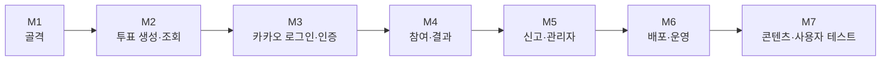

# AuDDum 구현 로드맵

| 항목 | 내용 |
| --- | --- |
| 버전 | v1 |
| 작성일 | 2026-10-12 |
| 작성자 | 태풍 |
| 관련 문서 | [AuDDum 개발 가이드](개발-가이드.md), [AuDDum API 명세서](API-명세.md), [AuDDum 테스트·배포 설계서](테스트-배포.md) |

## 요약

MVP를 7개 마일스톤으로 나눠 만든다. 인증이 필요 없는 조회부터 시작해 위험이 큰 부분(로그인, 동시 참여)을 앞쪽에 두고, 각 마일스톤은 `develop`에 병합 가능한 단위로 끝낸다. 일정은 정하지 않았고 순서와 완료 기준만 적는다.

- **M1 골격 → M2 투표 → M3 로그인 → M4 참여 → M5 신고·관리자 → M6 배포 → M7 사용자 테스트**
- 마일스톤마다 **완료 기준(DoD)**을 만족해야 다음으로 넘어간다.
- 작업은 이슈로 만들고 [개발 가이드](개발-가이드.md)의 브랜치·커밋 규칙을 따른다.

## 목차

1. [전체 흐름](#1-전체-흐름)
2. [M1 프로젝트 골격](#2-m1-프로젝트-골격)
3. [M2 투표 생성·조회](#3-m2-투표-생성조회)
4. [M3 카카오 로그인과 인증](#4-m3-카카오-로그인과-인증)
5. [M4 참여와 결과](#5-m4-참여와-결과)
6. [M5 신고와 관리자](#6-m5-신고와-관리자)
7. [M6 배포와 운영 환경](#7-m6-배포와-운영-환경)
8. [M7 콘텐츠 준비와 사용자 테스트](#8-m7-콘텐츠-준비와-사용자-테스트)
9. [공통 완료 기준](#9-공통-완료-기준)

## 1. 전체 흐름

| 단계 | 목표 | 핵심 위험 | 순서 이유 |
| --- | --- | --- | --- |
| M1 | 모든 기능이 올라갈 뼈대 | 의존성·설정 문제 | 이후 작업의 전제 |
| M2 | 인증 없는 조회·생성 흐름 | 도메인 규칙 누락 | 가장 단순한 수직 기능으로 구조를 검증한다. |
| M3 | 로그인, JWT, 회원 상태 확인 | 카카오 연동, 쿠키·CORS | 위험이 커서 일찍 부딪힌다. |
| M4 | 참여와 결과 공개 | 동시성, 중복 참여 | 서비스의 핵심이며 테스트가 가장 중요하다. |
| M5 | 신고와 관리자 처리 | 트랜잭션, 권한 | 핵심 흐름이 끝난 뒤 운영 기능을 붙인다. |
| M6 | CI/CD와 모니터링 | 서버·HTTPS·쿠키 | 사용자 테스트 전에 운영 환경을 갖춘다. |
| M7 | 시드 투표와 사용자 20~50명 테스트 | 콘텐츠 부족 | PRD의 운영 목표 검증 |

## 2. M1 프로젝트 골격

**작업**

- 패키지 구조 생성: `member`, `auth`, `poll`, `vote`, `report`, `admin`, `support`
- 의존성 추가(개발 가이드 4장), Swagger UI 설정(`prod`에서는 끔), `compose.yaml`에 MySQL 8.4, `local`·`prod` 프로파일
- 오류 응답: ProblemDetail과 오류 코드 체계, 공통 예외 처리([API 명세서](API-명세.md) 1·7장)
- Flyway `V1__init_schema.sql`에 [ERD 설계](ERD.md)의 8개 테이블·제약·제약용 인덱스(조회 최적화 인덱스는 M4에서 `EXPLAIN` 확인 후 추가)
- ArchUnit 구조 테스트(순환 의존, 다른 도메인 repository 사용 금지, `common` 금지)
- GitHub Actions: PR에서 빌드·테스트
- `.editorconfig`, PR 템플릿, 브랜치 보호

**완료 기준**

- `./gradlew build`가 통과하고 앱이 로컬 MySQL로 기동된다.
- 마이그레이션이 로컬 MySQL과 테스트 H2에서 모두 적용된다.
- 헬스 체크가 응답한다.

## 3. M2 투표 생성·조회

**작업**

- 도메인: `Poll`, `PollOption`, 값 객체(PublicId, PollQuestion, OptionContent, Position, ClosesAt)
- API: `POST /polls`, `GET /polls`(커서 페이징), `GET /polls/{pollId}`
- 이 단계의 작성자는 임시 신원을 쓰고 M3에서 실제 인증으로 바꾼다.
- 공개 ID 발급과 중복 재발급, 선택지 중복 비교(대소문자·악센트 무시)

**완료 기준**

- 질문·선택지·마감 시각 검증이 [도메인 모델](도메인-모델.md) 규칙대로 거부한다.
- 목록이 최신순 커서로 이어지고 마지막에 `nextCursor`가 null이다.
- 도메인 단위 테스트(`isClosed` 경계 포함)와 API 테스트가 있다.

## 4. M3 카카오 로그인과 인증

**작업**

- `oauth2Login` 설정, `OAuth2UserService`(가입·재가입), Success·Failure 핸들러
- JWT 발급, 쿠키 속성(HttpOnly, Secure, SameSite=Lax), 리프레시 토큰 해시 저장·교체·재사용 감지
- 공통 인가 계층: 쓰기 요청마다 회원 상태 확인, 관리자 권한 확인
- CSRF 대응(Origin 검증), CORS 허용 목록
- API: `/auth/refresh`, `/auth/logout`, `GET·DELETE /members/me`
- M2의 임시 신원을 실제 인증으로 교체
- M2에서 미룬 것: 정지 회원의 투표 생성 403 `MEMBER_SUSPENDED`, 존재하지 않는 회원 ID(`X-Member-Id`)가 500이 되는 문제를 회원 상태·존재 확인으로 처리. `support/web`의 `CurrentMemberIdResolver`를 인증 정보에서 회원 ID를 꺼내도록 바꾸고, 운영 배포 전에 헤더 신원을 없앤다.

**완료 기준**

- 로컬에서 카카오 로그인 → 쿠키 발급 → 보호된 API 호출이 동작한다.
- 정지·탈퇴 회원의 쓰기가 403·401로 막히고, 탈퇴 시 연동 정보와 토큰이 삭제된다.
- 리프레시 재사용 시 전체 폐기, 10초 유예 동작을 테스트로 확인한다.

## 5. M4 참여와 결과

**작업**

- 도메인: `Vote`, `Identity`, `AnonId`, 익명 쿠키(UUID + HMAC 서명) 발급·검증
- API: `POST /polls/{pollId}/votes`와 결과 공개 규칙(참여 후, 마감 후)
- 처리 순서: 투표 조회 → 신원 결정 → 회원 상태 → 기존 참여 → 마감 → 선택지 소속 → 저장
- 유니크 제약 위반 시 새 트랜잭션에서 재조회(같은 선택 200, 다른 선택 409)
- `GET /polls/{pollId}`에 `myChoice`·`result` 반영
- 조회 최적화 인덱스: 대량 시드 데이터로 `EXPLAIN` 쿼리 플랜을 확인하고, 필요한 인덱스를 새 마이그레이션으로 추가한다(전후 수치 기록, [ERD](ERD.md) 5장)

**완료 기준**

- **동시 참여 테스트**: 같은 신원이 동시에 요청해도 기록이 정확히 1건이고 응답이 200·201·409 규칙대로다. (MySQL 컨테이너에서 실행)
- 위조된 익명 쿠키가 새로 발급되고 시도가 로그로 남는다.
- 마감 경계(서버 시각 ≥ 마감 시각)와 이미 참여한 사람의 마감 후 조회가 테스트로 확인된다.

## 6. M5 신고와 관리자

**작업**

- 도메인: `Report`, `AdminAction`
- API: `POST /polls/{pollId}/reports`, 관리자 신고 목록·상세·조치·복구·정지 해제
- 조치 한 번에 대상 상태 변경, 신고 상태 변경, 이력 기록을 한 트랜잭션으로 처리
- 같은 투표의 PENDING 신고 일괄 종료, 두 관리자 동시 처리 시 한쪽만 성공(409)
- 투표 삭제 API(작성자·숨김 투표 삭제 불가 규칙)
- 관리자 계정 부여 절차 확인(개발 가이드 7장)

**완료 기준**

- 숨김·삭제 투표가 일반 사용자에게 404, 작성자·관리자에게 200이다.
- 조치 중 실패하면 전부 롤백된다.
- 신고 중복 409, 이미 처리된 신고 재조치 409가 테스트로 확인된다.

## 7. M6 배포와 운영 환경

**작업**

- EC2·RDS·Vercel 구성, 가비아 도메인, `api` 서브도메인, Caddy HTTPS
- GitHub Actions 배포: GHCR 푸시, SSH 배포, 헬스 체크, 롤백
- 운영용 카카오 앱과 리다이렉트 URI, 환경 변수 파일 주입
- Prometheus·Grafana 모니터링 서버, 디스코드 알림, 외부 업타임 체크
- RDS 백업(7일)

**완료 기준**

- `main` 병합으로 자동 배포되고 헬스 체크 실패 시 이전 이미지로 돌아간다.
- 운영 도메인에서 카카오 로그인과 참여가 동작한다. (프런트와 쿠키·CORS 포함)
- Actuator 포트가 외부에서 닫혀 있고 알림이 도착한다.

## 8. M7 콘텐츠 준비와 사용자 테스트

**작업**

- 시드 투표 20~30개 작성
- 개인정보 처리방침과 약관, 탈퇴 시 삭제 범위 확정([API 명세서](API-명세.md) 8장)
- 친구·지인 20~50명 테스트, 지표 확인([PRD](PRD.md) 8장)

**완료 기준**

- 개인정보 처리방침이 공개되어 있다.
- 테스트 결과를 바탕으로 목표 지표를 조정한다.

## 9. 공통 완료 기준

모든 마일스톤의 PR은 아래를 만족해야 병합한다.

- 빌드·테스트(ArchUnit 포함)가 통과한다.
- 동작이 바뀌면 [API 명세서](API-명세.md) 등 관련 문서를 같은 PR에서 고쳤다.
- 정책에서 정한 예외 응답(상태 코드, 오류 코드)을 테스트로 확인했다.
- 토큰·쿠키 값이 로그에 남지 않는다.
