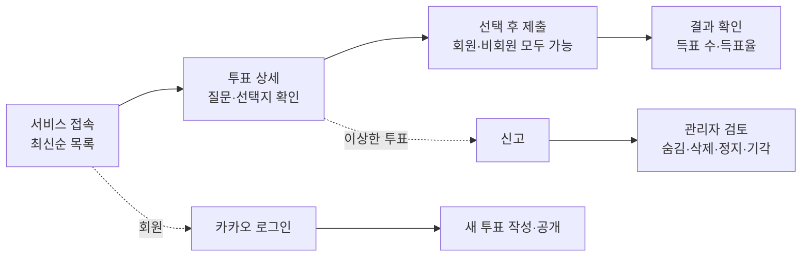
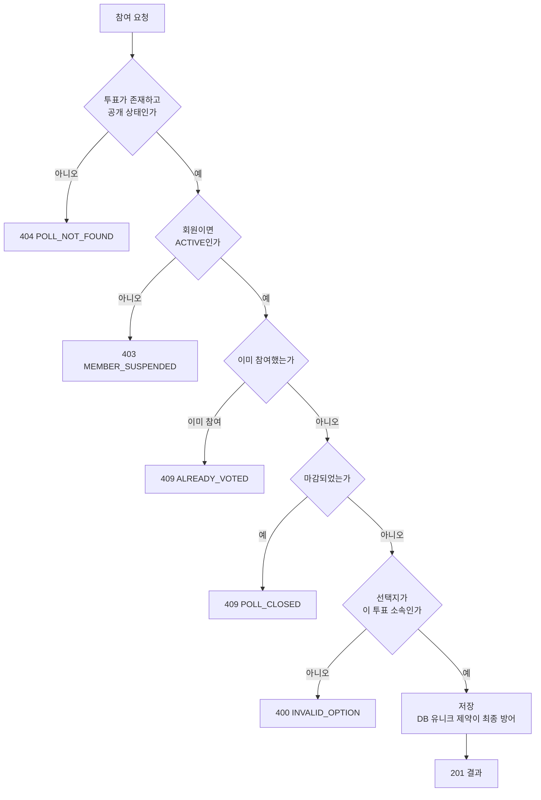
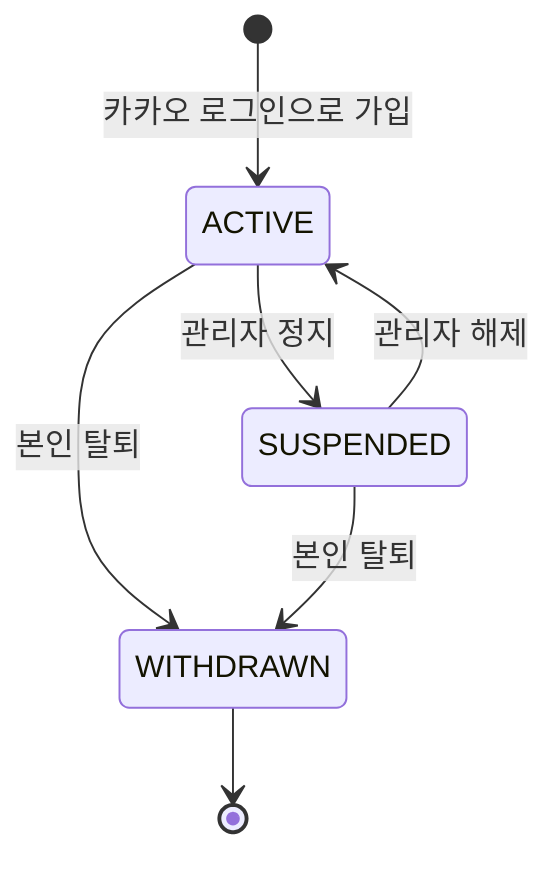

# AuDDum 사용자 시나리오 명세서

| 항목 | 내용 |
| --- | --- |
| 버전 | v2 |
| 작성일 | 2026-10-12 |
| 작성자 | 태풍 |
| 관련 문서 | [AuDDum(어떰) PRD](PRD.md), [AuDDum 예외·정책 명세서](예외-정책.md) |

## 요약

AuDDum(어떰)의 유스케이스 17개를 액터·사전 조건·흐름·예외·검증 규칙 순서로 정리했다. 핵심 규칙은 다섯 가지다.

- 마감 전에는 참여한 사람에게만 결과를 보여주고, 마감 후에는 모두에게 보여준다.
- 한 투표에 한 번만 참여할 수 있고, 제출한 선택은 바꿀 수 없다. 이미 참여했으면 선택과 관계없이 409다.
- 회원 상태는 쓰기 요청마다 DB에서 확인한다. 정지 회원은 참여·신고·생성·삭제 등 모든 쓰기가 불가다.
- 투표는 수정할 수 없고 작성자는 삭제만 할 수 있다. 숨김은 관리자가 복구할 수 있고 삭제는 복구할 수 없다.
- 신고는 관리자가 검토하며 건수만으로 자동 처리하지 않는다.

## 목차

1. [유스케이스 목록](#1-유스케이스-목록)
2. [조회·참여 시나리오](#2-조회참여-시나리오)
3. [인증 시나리오](#3-인증-시나리오)
4. [투표 생성·삭제 시나리오](#4-투표-생성삭제-시나리오)
5. [신고·관리자·회원 상태 시나리오](#5-신고관리자회원-상태-시나리오)

## 1. 유스케이스 목록

유스케이스 17개 중 12개가 P0다. 조회 → 참여 → 결과 확인과 투표 생성이 서비스의 핵심 루프이기 때문이다. UC-09·14·15·16·17은 P1이지만 MVP 범위에 포함된다.

| ID | 유스케이스 | 액터 | 우선순위 |
| --- | --- | --- | --- |
| UC-01 | 비회원의 투표 목록 조회 | 비회원 | P0 |
| UC-02 | 비회원의 투표 상세 조회 | 비회원 | P0 |
| UC-03 | 비회원의 투표 참여 | 비회원 | P0 |
| UC-04 | 비회원의 중복 참여 시도 | 비회원 | P0 |
| UC-05 | 카카오 로그인 및 최초 가입 | 비회원 → 회원 | P0 |
| UC-06 | 기존 회원의 로그인 | 회원 | P0 |
| UC-07 | 회원의 투표 생성 | 일반 회원 | P0 |
| UC-08 | 잘못된 입력으로 투표 생성 실패 | 일반 회원 | P0 |
| UC-09 | 정지 회원의 투표 생성 시도 | 정지 회원 | P1 |
| UC-10 | 회원의 투표 참여 | 일반 회원 | P0 |
| UC-11 | 회원의 중복 참여 시도 | 일반 회원 | P0 |
| UC-12 | 마감된 투표 참여 시도 | 비회원, 회원 | P0 |
| UC-13 | 투표 결과 조회 | 비회원, 회원 | P0 |
| UC-14 | 투표 신고 | 비회원, 회원 | P1 |
| UC-15 | 관리자의 신고 검토 및 조치 | 관리자 | P1 |
| UC-16 | 회원 상태 변화와 접근 범위 | 회원, 정지 회원, 탈퇴 회원 | P1 |
| UC-17 | 작성자의 투표 삭제 | 일반 회원(작성자) | P1 |

조회에서 결과 확인까지는 로그인 없이 이어지고, 투표 만들기와 삭제는 로그인 회원, 신고 처리는 관리자 영역이다.

### 작성 원칙

- 모든 검증은 서버가 수행한다. 프론트엔드의 버튼 비활성화는 검증이 아니다.
- 비회원 쿠키는 신원 확인 수단이 아니라 중복 참여를 줄이는 보조 수단이다. 쿠키 삭제나 다른 기기 사용까지 막을 수 없다.
- HTTP 상태 코드는 시나리오를 읽기 위한 요약이다. 정확한 코드와 상태는 API 명세가 기준이다.
- 예외 상황의 전체 응답 표와 정책 결정 목록은 「AuDDum 예외·정책 명세서 v2」에 있다.

## 2. 조회·참여 시나리오

조회와 참여는 비회원과 회원이 같은 순서로 검증하고 신원 식별 방식만 다르다. 중복 참여는 마지막 저장 단계의 DB 유니크 제약이 최종 차단한다.

UC-03, 10, 11, 12가 공유하는 서버 처리 순서다. 이미 참여한 사람은 마감 후에도 중복 처리가 먼저 적용되어 `ALREADY_VOTED`(409)를 받는다.

### UC-01 비회원의 투표 목록 조회

| 항목 | 내용 |
| --- | --- |
| 액터 | 비회원 (회원도 동일) |
| 사전 조건 | 없음 |
| 기본 흐름 | ① 목록 요청 → ② 서버가 공개 상태 투표만 최신순으로 커서 기반 조회 → ③ 질문·카테고리·참여 수·마감 여부·생성 시각 반환 |
| 대안 흐름 | 공개 투표가 없으면 빈 목록을 200으로 반환. 마감된 투표도 마감 표시와 함께 포함. 카테고리 필터는 MVP에서 제외하고 표시만 한다. |
| 예외 | 커서·페이지 크기 형식 오류 → 400, 서버·DB 오류 → 500 (내부 오류 상세는 노출하지 않음) |
| 사후 조건 | 데이터 변경 없음 |
| 검증 규칙 | 숨김·삭제 투표는 제외. 페이지 크기에 서버 상한. 정렬은 생성순으로 증가하는 내부 ID 기준이고 커서도 이 ID로 만든다. |

### UC-02 비회원의 투표 상세 조회

| 항목 | 내용 |
| --- | --- |
| 액터 | 비회원 (회원도 동일) |
| 사전 조건 | 대상 투표가 존재한다. |
| 기본 흐름 | ① 목록에서 투표 선택 → ② 서버가 존재 여부와 공개 상태 확인 → ③ 질문·카테고리·선택지 2~5개·마감 시간·마감 여부·참여 수 반환 |
| 대안 흐름 | 마감된 투표는 조회되지만 참여 불가로 내려간다. 이미 참여한 사용자에게는 본인 선택과 결과를 함께 반환한다. 마감 전 미참여자에게는 선택지와 전체 참여 수만 담는다. |
| 예외 | 존재하지 않는 ID → 404, ID 형식 오류 → 400. 숨김·삭제된 투표는 일반 사용자 404, 작성자·관리자는 조회 가능(삭제된 투표는 복구 불가) |
| 사후 조건 | 데이터 변경 없음 |
| 검증 규칙 | 공개 상태 확인. 마감 여부는 서버 시각 기준으로 계산. 참여 여부는 쿠키 또는 회원 식별자로 판단. |

### UC-03 비회원의 투표 참여

| 항목 | 내용 |
| --- | --- |
| 액터 | 비회원 |
| 사전 조건 | 투표가 공개 상태이고 마감 전이며, 이 비회원의 참여 기록이 없다. |
| 기본 흐름 | ① 선택지를 고르고 제출 → ② 서버가 투표·선택지·익명 식별 쿠키를 읽음(쿠키가 없으면 새로 발급) → ③ 존재·공개 상태·마감 검증 → ④ 선택지가 해당 투표 소속인지 검증 → ⑤ 트랜잭션으로 저장(중복은 DB 유니크 제약이 최종 차단) → ⑥ 201과 결과 반환 |
| 대안 흐름 | 쿠키는 첫 참여 시점에 발급하며 조회만 하는 방문자에게는 발급하지 않는다. 영속 쿠키이며 만료는 1년이다. 저장 후 응답이 유실되어 쿠키가 남지 않으면 다음 요청이 새 익명 ID로 처리되어 재참여가 가능하다. 이는 한계로 명시한다. |
| 예외 | 투표 없음 → 404, 선택지 없음·타 투표 소속 → 400, 마감 후 → 409(UC-12), 이미 참여 → 선택과 관계없이 409(UC-04), 쿠키 위조·변조 → 서명 검증 실패로 무효 처리하고 새 쿠키를 발급하며 시도를 기록, DB 저장 오류 → 500과 전체 롤백(부분 저장 금지) |
| 사후 조건 | 투표 기록 1건 생성, 결과 집계에 반영, 익명 식별 쿠키가 브라우저에 저장됨 |
| 검증 규칙 | 투표와 선택지는 존재와 소속을 모두 검증. 마감은 서버 시각으로 판단. 쿠키는 서버가 발급·서명한 값만 유효. 중복 방지는 사전 검사가 아니라 DB 유니크 제약(투표 + 익명 식별자)이 최종 방어선이다. |

### UC-04 비회원의 중복 참여 시도

| 항목 | 내용 |
| --- | --- |
| 액터 | 비회원 |
| 사전 조건 | 같은 익명 식별 쿠키로 해당 투표에 이미 참여했다. |
| 기본 흐름 | ① 새로고침·뒤로가기·선택 변경 등으로 다시 제출 → ② 서버가 기존 기록을 확인(동시 요청에서 유니크 제약을 위반한 쪽은 선택과 관계없이 409) → ③ 새 기록을 저장하지 않고 선택과 관계없이 409로 반환 |
| 대안 흐름 | 네트워크 재시도로 같은 선택지를 다시 보내도 409다. 클라이언트는 상세 조회의 `myChoice`로 화면을 맞춘다. 선택은 변경할 수 없다. |
| 예외 | 쿠키를 삭제했거나 다른 기기·브라우저를 쓰면 새 사용자로 보이며 막을 수 없다(정책상 허용되는 한계). 동일 쿠키의 동시 요청은 하나만 저장되고, 진 쪽은 409. |
| 사후 조건 | 투표 기록은 첫 번째 1건만 유지 |
| 검증 규칙 | 서버 측 중복 검증 필수. 선택 변경 API는 없음. 중복 시도는 로그로 남겨 어뷰징 분석에 쓴다. |

### UC-10 회원의 투표 참여

| 항목 | 내용 |
| --- | --- |
| 액터 | 일반 회원(ACTIVE) |
| 사전 조건 | 로그인된 ACTIVE 회원이고, 투표가 공개·미마감 상태이며, 이 회원의 참여 기록이 없다. |
| 기본 흐름 | ① 선택지를 고르고 제출 → ② 서버가 로그인 정보로 회원을 식별하고 DB의 상태(ACTIVE) 확인 → ③ 투표 존재·공개·마감 검증 → ④ 선택지 소속 검증 → ⑤ 회원 식별자와 함께 저장(중복은 DB 유니크 제약이 최종 차단) → ⑥ 201과 결과 반환 |
| 대안 흐름 | 익명 식별 쿠키를 가진 회원은 회원 식별자를 우선 사용하고 쿠키는 중복 판단에 쓰지 않는다. 비회원으로 참여한 뒤 로그인해 다시 참여하는 것은 두 신원을 연결하지 않으므로 막을 수 없는 한계다. |
| 예외 | 미로그인 → 같은 API에서 비회원 참여(UC-03)로 처리(참여 API는 하나이며 인증 정보 유무로 구분), 정지 회원 → 403, 투표 없음 → 404, 선택지 불일치 → 400, 마감 → UC-12, 중복 → UC-11, DB 오류 → 500과 롤백 |
| 사후 조건 | 회원 식별자가 포함된 투표 기록 1건이 생성되어 결과에 반영된다. |
| 검증 규칙 | UC-03과 같다. 다만 중복 판단 기준이 (투표 + 회원)이다. 회원 정보는 요청 본문이 아니라 인증 정보에서만 읽는다. |

### UC-11 회원의 중복 참여 시도

| 항목 | 내용 |
| --- | --- |
| 액터 | 일반 회원(ACTIVE) |
| 사전 조건 | 이 회원이 해당 투표에 이미 참여했다. |
| 기본 흐름 | ① 다른 기기·브라우저를 포함해 같은 투표에 다시 제출 → ② 서버가 (투표 + 회원) 기록을 확인(동시 요청에서 유니크 제약을 위반한 쪽은 선택과 관계없이 409) → ③ 저장 없이 선택과 관계없이 409로 반환 |
| 대안 흐름 | 응답 유실 후 같은 선택지를 재전송해도 409다. 클라이언트는 상세 조회로 확인한다. |
| 예외 | 같은 회원의 동시 요청은 하나만 성공. 로그아웃 후 비회원으로 같은 투표에 다시 참여하는 우회 경로는 막을 수 없는 한계다. |
| 사후 조건 | 투표 기록은 첫 번째 1건만 유지 |
| 검증 규칙 | 회원의 중복 방지는 기기와 무관하게 회원 식별자로 보장한다. 선택 변경 API는 없다. |

### UC-12 마감된 투표 참여 시도

| 항목 | 내용 |
| --- | --- |
| 액터 | 비회원, 회원 |
| 사전 조건 | 투표에 마감 시간이 있고 서버 현재 시각이 마감 시간 이후다. |
| 기본 흐름 | ① 화면을 열어둔 채 마감이 지난 뒤 제출(또는 API 직접 호출) → ② 서버가 서버 시각과 마감 시각 비교 → ③ 참여 기록이 없으면 저장 없이 409(오류 코드로 마감 구분) → ④ 사용자는 결과 조회 화면으로 이동 |
| 대안 흐름 | 마감 시간이 없는 투표는 계속 참여할 수 있다. 이미 참여한 사용자가 마감 후 같은 요청을 재시도하면 중복 참여 처리를 우선해 선택과 관계없이 409 `ALREADY_VOTED`를 반환한다. |
| 예외 (경계 시점) | 서버 시각이 마감 시각 이상이면 마감으로 본다. 요청을 받은 시점에 한 번만 판단하며 처리 중 마감이 지나도 수신 시점 기준으로 인정한다. 서버가 여러 대여도 시각 기준은 동기화된 서버 시각으로 통일한다. |
| 사후 조건 | 데이터 변경 없음. 마감 후에도 결과는 계속 조회할 수 있다. |
| 검증 규칙 | 마감 검증은 참여 API마다 서버가 수행한다. 클라이언트 시각·남은 시간 표시·버튼 비활성화는 신뢰하지 않는다. |

### UC-13 투표 결과 조회

| 항목 | 내용 |
| --- | --- |
| 액터 | 비회원, 회원 |
| 사전 조건 | 투표가 존재하고 조회 가능한 공개 상태다. |
| 기본 흐름 | ① 참여 직후 또는 상세·목록에서 결과 요청 → ② 서버가 저장된 투표 기록으로 선택지별 득표수·득표율·전체 참여 수 계산 → ③ 선택지(입력 순서 유지)와 함께 반환 |
| 대안 흐름 | 참여가 0건이면 득표수와 득표율을 모두 0으로 반환한다. 마감 전에는 참여한 사람에게만 공개하고, 마감된 투표는 참여하지 않은 사람도 조회할 수 있다. |
| 예외 | 투표 없음 또는 숨김·삭제 상태 → 404, DB 오류 → 500. 집계와 기록이 다르면 기록을 기준으로 하고 오류를 남긴다. |
| 사후 조건 | 데이터 변경 없음 |
| 검증 규칙 | 결과의 원천은 저장된 투표 기록이다. 전체 참여 수는 선택지별 득표수의 합과 같아야 한다. |

## 3. 인증 시나리오

로그인은 서버가 카카오 인증의 전 과정을 처리하고, 프론트엔드는 인가 코드나 카카오 토큰을 다루지 않는다. 로그인 상태는 JWT(액세스·리프레시 토큰)를 HttpOnly 쿠키로 전달해 유지한다.

### UC-05 카카오 로그인 및 최초 가입

| 항목 | 내용 |
| --- | --- |
| 액터 | 비회원(가입 후 회원), 카카오 인증 서버 |
| 사전 조건 | 카카오 계정이 있고 이 서비스에 가입한 기록이 없다. |
| 기본 흐름 | ① 로그인 버튼으로 서버의 로그인 시작 주소로 이동 → ② 서버가 CSRF 방지용 state를 생성·보관하고 카카오 인가 페이지로 리다이렉트 → ③ 사용자가 카카오에서 로그인·동의 → ④ 카카오가 인가 코드를 서버 콜백으로 전달 → ⑤ 서버가 state를 검증하고 토큰을 받아 카카오 고유 식별자 조회 → ⑥ 회원이 없으면 ACTIVE 신규 회원을 생성(인증 정보와 회원 정보는 분리 저장) → ⑦ JWT 발급 → ⑧ 로그인된 상태로 서비스로 복귀 |
| 대안 흐름 | 카카오 화면에서 취소하면 가입 없이 프런트 오류 화면(`code=ACCESS_DENIED`)으로 이동한다. 약관·개인정보 동의는 가입 직후 1회 받는다. 카카오 식별자만 저장하고 닉네임·프로필은 저장하지 않는다. 탈퇴한 카카오 계정은 새 회원으로 가입할 수 있고 이전 데이터와 연결하지 않는다. |
| 예외 | state 불일치·누락 → 400(또는 401)으로 가입 중단, 인가 코드 만료·재사용 → 401, 카카오 API 장애·타임아웃 → 502/503과 재시도 안내(회원 미생성), 같은 카카오 계정의 거의 동시 최초 로그인 → 회원 생성은 유니크 제약으로 한 번만 성공하고 나머지는 기존 회원 조회로 처리 |
| 사후 조건 | 회원 1건(ACTIVE)이 생성되고 사용자는 로그인된 상태가 된다. |
| 검증 규칙 | 리다이렉트 URI는 카카오 콘솔에 사전 등록한 주소만 쓰고, 로그인 후 돌아갈 주소는 서비스 내부 경로만 허용한다(오픈 리다이렉트 방지). 카카오 식별자에 DB 유니크 제약. 카카오 액세스 토큰은 저장하지 않는다. |

### UC-06 기존 회원의 로그인

| 항목 | 내용 |
| --- | --- |
| 액터 | 회원, 카카오 인증 서버 |
| 사전 조건 | 카카오 식별자로 가입된 회원이 존재한다. |
| 기본 흐름 | ① UC-05의 1~5단계를 동일하게 수행 → ② 카카오 식별자로 기존 회원을 찾고 상태 확인 → ③ JWT 발급 → ④ 로그인된 상태로 이용 |
| 대안 흐름 | 정지(SUSPENDED) 회원은 로그인과 조회는 가능하지만 투표 생성·참여·신고는 불가하다. 탈퇴(WITHDRAWN) 회원은 기존 회원으로 로그인할 수 없고 같은 카카오 계정으로 로그인하면 새 회원으로 가입된다. 이미 로그인된 상태에서 재로그인하면 로그인 상태를 갱신하며, 동시 로그인은 기기 수 제한 없이 허용한다. |
| 예외 | state 불일치·인가 코드 오류 → 400/401, 카카오 장애 → 502/503, 카카오 식별자는 있으나 회원 레코드가 없는 불일치 → 500으로 처리하고 운영 알림 대상으로 기록 |
| 사후 조건 | 로그인 상태가 발급되고 마지막 로그인 시각만 기록된다. |
| 검증 규칙 | 회원 상태는 로그인 시점에 확인하고, 이후 모든 쓰기 요청에서도 서버가 DB의 상태를 다시 확인한다. 인증(누구인가)과 권한(무엇을 할 수 있는가)을 분리하고, 관리자 권한은 일반 회원 로그인과 별개로 부여한다. |

## 4. 투표 생성·삭제 시나리오

투표는 검증을 통과하면 즉시 공개되고, 생성 후에는 수정할 수 없으며 작성자는 삭제만 할 수 있다.

### UC-07 회원의 투표 생성

| 항목 | 내용 |
| --- | --- |
| 액터 | 일반 회원(ACTIVE) |
| 사전 조건 | 로그인되어 있고 서버에 저장된 회원 상태가 ACTIVE다. |
| 기본 흐름 | ① 질문·선택지 2~5개·카테고리 1개를 입력하고 필요하면 마감 시간 지정 → ② 제출 → ③ 서버가 인증·회원 상태 확인 → ④ 입력값 검증 → ⑤ 투표와 선택지를 한 트랜잭션으로 저장 → ⑥ 즉시 공개(관리자 승인 없음) → ⑦ 201과 새 투표 식별자 반환 → ⑧ 상세 화면으로 이동 |
| 대안 흐름 | 마감 시간을 입력하지 않으면 마감 없는 투표로 저장. 마감 시간은 서버 현재 시각보다 미래여야 하고 상한은 없다. 직전과 같은 질문으로 연속 생성하면 차단하고, 연속 생성 간격만 제한한다(일일 총량 제한 없음, 간격 수치는 배포로 조정). |
| 예외 | 로그인하지 않음 → 401, 정지 회원 → 403(UC-09), 입력값 오류 → 400(UC-08), 연속 생성 간격 위반 → 429, 직전 동일 질문 → 409, 저장 중 DB 오류 → 500과 전체 롤백(선택지 없는 투표 금지) |
| 사후 조건 | 투표 1건과 선택지 2~5건이 저장되고, 공개 상태이며 참여 수는 0이다. |
| 검증 규칙 | 질문은 앞뒤 공백 제거 후 1~500자(유니코드 문자 단위), 줄바꿈 불가. 선택지는 2~5개이며 빈 값이 아니고 최대 50자이며 중복 불허. 카테고리는 7개 허용값 중 정확히 하나. 마감 시간은 입력 시 현재보다 미래. 텍스트만 허용하고 이미지·첨부 필드는 받지 않는다. 출력 시 스크립트가 실행되지 않도록 이스케이프 정책을 둔다. |

### UC-08 잘못된 입력으로 투표 생성 실패

| 항목 | 내용 |
| --- | --- |
| 액터 | 일반 회원(ACTIVE) |
| 사전 조건 | 로그인된 ACTIVE 회원 |
| 기본 흐름 | ① 규칙에 맞지 않는 입력을 제출(API 직접 호출 포함) → ② 서버가 검증 중 위반을 발견 → ③ 아무것도 저장하지 않고 400을 반환(위반 필드와 이유 포함) → ④ 사용자가 고쳐 다시 제출 |
| 대안 흐름 | 프론트엔드가 먼저 검증해도 서버는 동일한 검증을 반드시 수행한다. 여러 필드가 동시에 틀리면 위반을 한 번에 모두 반환한다. |
| 실패 처리할 입력 | 질문이 없거나 공백뿐, 질문 500자 초과·줄바꿈 포함, 선택지 1개 이하 또는 6개 이상, 빈 선택지·50자 초과·중복 선택지, 카테고리 누락·허용되지 않은 값·2개 이상 선택, 마감 시간이 과거이거나 형식 오류, MVP 범위 밖 필드(이미지·링크 첨부 등) |
| 사후 조건 | 데이터 변경 없음 |
| 검증 규칙 | 글자 수는 유니코드 문자 단위로 센다. 이모지·결합 문자의 세부 처리는 구현 시 확인한다. 검증 오류 응답 형식은 API 명세에서 확정했다(ProblemDetail, 400 `VALIDATION_FAILED`). |

### UC-09 정지 회원의 투표 생성 시도

| 항목 | 내용 |
| --- | --- |
| 액터 | 정지 회원(SUSPENDED) |
| 사전 조건 | 로그인된 상태이고 서버에 저장된 회원 상태가 SUSPENDED다(정지 전에 이미 로그인했던 경우 포함). |
| 기본 흐름 | ① 정지 회원이 생성 요청(화면에서 버튼을 숨겨도 API 직접 호출 가능) → ② 서버가 요청 시점에 DB에서 회원 상태를 조회(JWT에 담긴 과거 상태를 믿지 않음) → ③ 저장 없이 403 반환(정지 상태를 구분할 오류 코드 포함) |
| 대안 흐름 | 정지는 기간 없이 관리자가 수동으로 해제한다. 정지 사유 안내는 오류 코드로만 구분한다. |
| 예외 | 정지 처리와 생성 요청이 거의 동시에 들어오면 정지 이전에 접수된 요청은 그대로 처리한다. |
| 사후 조건 | 데이터 변경 없음 |
| 검증 규칙 | 로그아웃·탈퇴를 뺀 모든 쓰기 서비스가 회원 상태를 검증한다. 정지 회원은 투표 참여와 신고도 불가하다. |

### UC-17 작성자의 투표 삭제

| 항목 | 내용 |
| --- | --- |
| 액터 | 일반 회원(ACTIVE), 해당 투표의 작성자 |
| 사전 조건 | 로그인된 ACTIVE 회원이고 삭제할 투표의 작성자다. |
| 기본 흐름 | ① 작성자가 본인 투표에서 삭제 선택 → ② 서버가 인증·회원 상태(ACTIVE)·작성자 일치 여부 확인 → ③ 투표 상태를 삭제로 변경(논리 삭제, 투표 기록은 보존) → ④ 성공 응답 → ⑤ 일반 사용자에게는 즉시 비공개(조회 시 404) |
| 대안 흐름 | 삭제된 투표는 작성자와 관리자만 조회할 수 있고 복구할 수 없다. 관리자가 숨김 처리한 투표는 작성자가 삭제할 수 없다. 삭제된 투표에 접수된 신고는 UC-15에서 종료 처리한다. |
| 예외 | 로그인하지 않음 → 401, 정지 회원 → 403, 작성자가 아님 → 403, 투표 없음 또는 이미 삭제됨 → 404, 삭제와 참여가 동시에 들어오면 삭제 직전에 도착한 참여는 그대로 처리, DB 오류 → 500과 롤백 |
| 사후 조건 | 투표 상태가 삭제로 바뀌고 투표 기록은 보존되며 일반 사용자에게 결과가 노출되지 않는다. |
| 검증 규칙 | 작성자 일치 여부는 서버가 인증 정보로 판단하며 요청의 회원 ID는 신뢰하지 않는다. 탈퇴로 익명화된 투표는 작성자를 식별할 수 없어 작성자가 삭제할 수 없다. 삭제한 주체와 시각을 기록한다. |

## 5. 신고·관리자·회원 상태 시나리오

신고는 건수와 관계없이 자동 처리되지 않고 항상 관리자가 검토한다. 회원 상태는 로그인이 유지되는 동안에도 바뀔 수 있어서 서버가 쓰기 요청마다 DB의 상태를 다시 확인한다.

### UC-14 투표 신고

| 항목 | 내용 |
| --- | --- |
| 액터 | 비회원, 회원 (정지 회원은 신고할 수 없다) |
| 사전 조건 | 대상 투표가 존재하고 조회 가능한 공개 상태다. |
| 기본 흐름 | ① 투표 상세에서 신고 선택 → ② 사유 5가지(욕설·혐오 표현, 성희롱, 개인정보 노출, 광고·도배, 기타) 중 하나를 고르고 제출 → ③ 서버가 투표 존재·공개 상태·사유 값 검증 → ④ 신고를 접수 상태로 저장하고 관리자 검토 대상으로 등록 → ⑤ 201 반환 |
| 대안 흐름 | 신고가 접수되어도 투표는 자동으로 숨겨지거나 삭제되지 않는다. 한 투표에 한 번만 신고할 수 있고 중복 신고는 409로 거부한다. 비회원 신고자는 익명 식별 쿠키로 구분하며 신뢰도에 한계가 있다. '기타' 사유는 짧은 텍스트를 받는다. 처리 결과는 신고자에게 알리지 않는다. |
| 예외 | 투표 없음 또는 이미 숨김·삭제된 투표 → 404, 허용되지 않은 사유 → 400, 정지 회원 → 403, DB 오류 → 500 |
| 사후 조건 | 신고 1건이 접수 상태로 저장되고 투표의 노출 상태는 변하지 않는다. |
| 검증 규칙 | 신고 사유는 허용값만 받는다. 신고자별 중복 신고는 DB 제약(투표 + 신고자 식별자)으로 막는다. |

### UC-15 관리자의 신고 검토 및 조치

| 항목 | 내용 |
| --- | --- |
| 액터 | 관리자 |
| 사전 조건 | 관리자 권한이 있고 검토 대기 중인 신고가 있다. |
| 기본 흐름 | ① 관리자가 접수된 신고 목록 조회 → ② 신고 상세와 대상 투표 확인 → ③ 조치 선택(기각, 투표 숨김, 투표 삭제, 작성자 이용 정지 중 하나 또는 조합) → ④ 서버가 권한을 확인하고 대상 상태 변경·신고 상태 변경·조치 이력 기록을 한 트랜잭션으로 처리 → ⑤ 일반 사용자에게 변경된 노출 상태가 즉시 반영 |
| 대안 흐름 | 기각은 투표를 유지한 채 신고만 처리 완료로 바꾼다. 숨김만 관리자가 복구할 수 있고 삭제는 복구할 수 없다. 이용 정지된 회원의 기존 투표는 그대로 유지한다. |
| 예외 | 관리자 권한 없음 → 403(미로그인 401, 404로 숨기지 않음), 이미 처리된 신고에 재조치 → 409, 두 관리자가 동시에 처리 → 한쪽만 성공하고 다른 쪽은 409, 대상 투표가 이미 삭제됨 → 신고만 종료 처리, DB 오류 → 500과 전체 롤백 |
| 사후 조건 | 신고·투표·(필요 시) 회원 상태가 갱신되고 조치 이력이 남는다. |
| 검증 규칙 | 관리자 권한은 매 요청마다 서버가 검증하고 일반 회원 권한과 분리한다. 모든 조치에 처리자·처리 시각·조치 내용·사유를 이력으로 남긴다. 신고 상태값과 이력 구조는 API 명세에서 확정했다. |

### UC-16 회원 상태 변화와 접근 범위

상태별 접근 범위는 아래와 같다.

| 상태 | 로그인 | 조회 | 투표 참여 | 투표 생성 | 신고 |
| --- | --- | --- | --- | --- | --- |
| ACTIVE | 가능 | 가능 | 가능 | 가능 | 가능 |
| SUSPENDED | 가능 | 가능 | 불가 | 불가 | 불가 |
| WITHDRAWN | 기존 회원으로는 불가(같은 카카오 계정은 새 회원으로 가입) | 비회원과 동일 | 비회원과 동일 | 불가 | 비회원과 동일 |

정지와 탈퇴는 로그인 상태가 유지되는 동안에도 일어나므로 서버가 쓰기 요청마다 DB의 상태를 다시 확인한다.

| 항목 | 내용 |
| --- | --- |
| 액터 | 회원, 정지 회원, 탈퇴 회원, 관리자 |
| 사전 조건 | 회원 상태가 ACTIVE에서 SUSPENDED 또는 WITHDRAWN으로 바뀌었거나 바뀌는 중이다. |
| 기본 흐름 | ① 관리자 조치 또는 회원 본인의 탈퇴 요청으로 상태 변경 → ② 이후 쓰기 요청 → ③ 서버가 요청 시점의 DB 상태를 확인 → ④ 상태에 따라 허용 또는 거부(정지·탈퇴 상태의 쓰기 요청은 403, 탈퇴로 인증이 무효화된 경우 401) |
| 대안 흐름 | 정지 해제(SUSPENDED → ACTIVE)는 관리자가 수동으로 하며 이후 요청부터 정상 이용한다. 정지 회원이 로그아웃하고 비회원으로 투표하는 우회는 막을 수 없는 한계다. 정지 중에도 탈퇴할 수 있고, 탈퇴한 카카오 계정으로 다시 로그인하면 새 회원으로 가입되고 이전 데이터와 연결하지 않는다(정지 회피를 위한 탈퇴·재가입은 한계). |
| 예외 | 로그인 유지 중 정지·탈퇴되면 JWT에 담긴 상태는 반영이 늦으므로 쓰기 요청마다 DB 상태를 확인한다. 탈퇴 회원이 작성한 투표는 익명화해 유지하고 투표 기록은 보존하며 결과 집계에 계속 반영한다. 리프레시 토큰은 서버에 해시로 저장해 교체·폐기한다(인증·중복 참여 설계서). |
| 사후 조건 | 회원 상태에 맞는 접근 범위가 서버에서 일관되게 적용된다. |
| 검증 규칙 | 상태 검증은 서버의 서비스에서 회원 도메인 객체의 규칙으로 처리하고 컨트롤러에 흩어 놓지 않는다(규칙은 `도메인-모델.md` §3). 화면 숨김은 검증이 아니다. 탈퇴 시 삭제할 개인정보 범위는 개인정보 처리방침 작성 때 정한다. |
