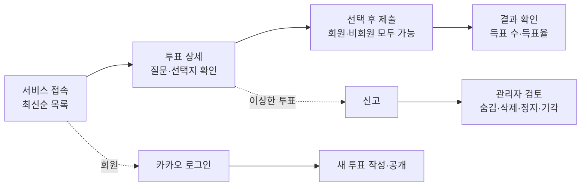

# AuDDum 사용자 시나리오 명세서

| 항목 | 내용 |
| --- | --- |
| 버전 | v2 |
| 작성일 | 2026-10-12 |
| 작성자 | 태풍 |
| 관련 문서 | [AuDDum(어떰) PRD](product/PRD.md), [AuDDum 예외·정책 명세서](engineering/예외-응답.md) |

## 요약

AuDDum(어떰)의 유스케이스 17개를 액터·사전 조건·흐름·예외·검증 규칙 순서로 정리했다. 핵심 규칙은 다섯 가지다.

- 마감 전에는 참여한 사람에게만 결과를 보여주고, 마감 후에는 모두에게 보여준다.
- 한 투표에 한 번만 참여할 수 있고, 제출한 선택은 바꿀 수 없다. 이미 참여했으면 선택과 관계없이 409다.
- 회원 상태는 쓰기 요청마다 DB에서 확인한다. 정지 회원은 참여·신고·생성·삭제 등 모든 쓰기가 불가다.
- 투표는 수정할 수 없고 작성자는 삭제만 할 수 있다. 숨김은 관리자가 복구할 수 있고 삭제는 복구할 수 없다.
- 신고는 관리자가 검토하며 건수만으로 자동 처리하지 않는다.

## 목차

1. [유스케이스 목록](#1-유스케이스-목록)
2. [조회·참여 시나리오](#2-조회참여-시나리오)
3. [인증 시나리오](#3-인증-시나리오)
4. [투표 생성·삭제 시나리오](#4-투표-생성삭제-시나리오)
5. [신고·관리자·회원 상태 시나리오](#5-신고관리자회원-상태-시나리오)

## 1. 유스케이스 목록

유스케이스 17개 중 12개가 P0다. 조회 → 참여 → 결과 확인과 투표 생성이 서비스의 핵심 루프이기 때문이다. UC-09·14·15·16·17은 P1이지만 MVP 범위에 포함된다.

| ID | 유스케이스 | 액터 | 우선순위 |
| --- | --- | --- | --- |
| UC-01 | 비회원의 투표 목록 조회 | 비회원 | P0 |
| UC-02 | 비회원의 투표 상세 조회 | 비회원 | P0 |
| UC-03 | 비회원의 투표 참여 | 비회원 | P0 |
| UC-04 | 비회원의 중복 참여 시도 | 비회원 | P0 |
| UC-05 | 카카오 로그인 및 최초 가입 | 비회원 → 회원 | P0 |
| UC-06 | 기존 회원의 로그인 | 회원 | P0 |
| UC-07 | 회원의 투표 생성 | 일반 회원 | P0 |
| UC-08 | 잘못된 입력으로 투표 생성 실패 | 일반 회원 | P0 |
| UC-09 | 정지 회원의 투표 생성 시도 | 정지 회원 | P1 |
| UC-10 | 회원의 투표 참여 | 일반 회원 | P0 |
| UC-11 | 회원의 중복 참여 시도 | 일반 회원 | P0 |
| UC-12 | 마감된 투표 참여 시도 | 비회원, 회원 | P0 |
| UC-13 | 투표 결과 조회 | 비회원, 회원 | P0 |
| UC-14 | 투표 신고 | 비회원, 회원 | P1 |
| UC-15 | 관리자의 신고 검토 및 조치 | 관리자 | P1 |
| UC-16 | 회원 상태 변화와 접근 범위 | 회원, 정지 회원, 탈퇴 회원 | P1 |
| UC-17 | 작성자의 투표 삭제 | 일반 회원(작성자) | P1 |

조회에서 결과 확인까지는 로그인 없이 이어지고, 투표 만들기와 삭제는 로그인 회원, 신고 처리는 관리자 영역이다.

### 작성 원칙

- 모든 검증은 서버가 수행한다. 프론트엔드의 버튼 비활성화는 검증이 아니다.
- 비회원 쿠키는 신원 확인 수단이 아니라 중복 참여를 줄이는 보조 수단이다. 쿠키 삭제나 다른 기기 사용까지 막을 수 없다.
- HTTP 상태 코드는 시나리오를 읽기 위한 요약이다. 정확한 코드와 상태는 API 명세가 기준이다.
- 예외 상황의 전체 응답 표와 정책 결정 목록은 「AuDDum 예외·정책 명세서 v2」에 있다.

## 2. 조회·참여 시나리오

조회와 참여는 비회원과 회원이 같은 순서로 검증하고 신원 식별 방식만 다르다. 중복 참여는 마지막 저장 단계의 DB 유니크 제약이 최종 차단한다.

참여(UC-03·04·10·11·12)의 서버 처리 순서와 시나리오는 [03-참여하기](features/03-참여하기.md)에 있다.

목록·상세(UC-01·02)는 [01-둘러보기](features/01-둘러보기.md)에, 결과 조회(UC-13)는 [04-결과-보기](features/04-결과-보기.md)에 있다.

## 3. 인증 시나리오

카카오 로그인·최초 가입(UC-05)과 기존 회원의 로그인(UC-06)은 [07-로그인과-회원](features/07-로그인과-회원.md)에 있다.

## 4. 투표 생성·삭제 시나리오

투표 생성(UC-07), 잘못된 입력(UC-08), 정지 회원의 생성 시도(UC-09), 작성자의 삭제(UC-17)는 [02-투표-만들기](features/02-투표-만들기.md)에 있다.

## 5. 신고·관리자·회원 상태 시나리오

투표 신고(UC-14)는 [05-신고하기](features/05-신고하기.md)에, 관리자의 신고 검토·조치(UC-15)는 [06-관리자-조치](features/06-관리자-조치.md)에, 회원 상태 변화와 접근 범위(UC-16)는 [07-로그인과-회원](features/07-로그인과-회원.md)에 있다.
