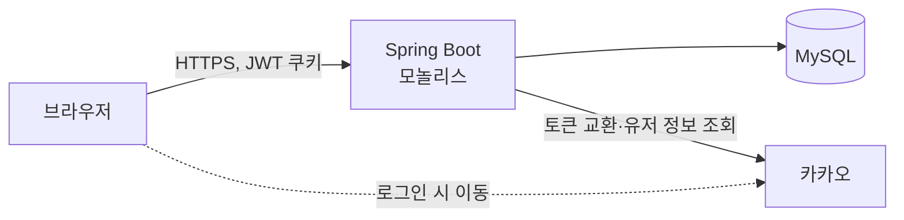
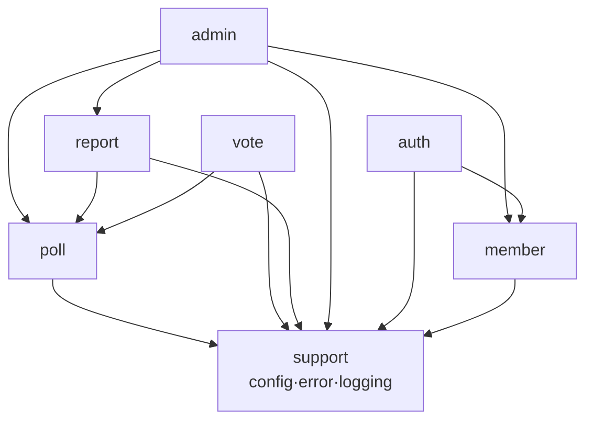
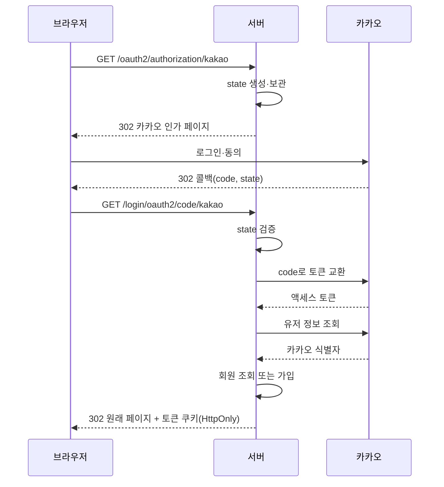

# AuDDum 아키텍처 설계서

| 항목 | 내용 |
| --- | --- |
| 버전 | v1 |
| 작성일 | 2026-10-12 |
| 작성자 | 태풍 |
| 관련 문서 | [AuDDum ERD 설계](ERD.md), [AuDDum API 명세서](API-명세.md), [AuDDum 인증·중복 참여 설계서](인증-중복-참여.md) |

## 요약

어떰은 모놀리식 Spring Boot 애플리케이션 하나와 MySQL로 시작한다. 설계는 DDD 실용형이다. 도메인별 패키지와 애그리거트로 경계를 나누고, 규칙은 도메인 객체에 두며, 쓰기와 읽기 서비스를 분리한다. 서비스는 애그리거트를 반환하고 응답 구성은 controller가 맡는다. 로그인은 서버 주도 카카오 인증과 JWT 쿠키다. 보류한 항목은 마지막 절에 모았다.

## 목차

1. [시스템 구성](#1-시스템-구성)
2. [애플리케이션 구조](#2-애플리케이션-구조)
3. [인증·인가 설계](#3-인증인가-설계)
4. [데이터·횡단 관심사](#4-데이터횡단-관심사)
5. [기술 결정 요약](#5-기술-결정-요약)

## 1. 시스템 구성

배포 단위는 하나다. Spring Boot 모놀리스 하나가 API를 제공하고 MySQL에 모든 데이터를 저장한다. Redis, 메시지 큐, 검색 엔진은 처음부터 두지 않고 실제 문제가 측정되면 추가한다.

로그인은 서버가 카카오와 직접 통신하고 브라우저는 카카오 토큰을 다루지 않는다. 브라우저와는 HTTPS로 통신하고 로그인 상태는 JWT 쿠키로 유지한다. 배포 환경은 테스트·배포 설계서에 있다(EC2 한 대, RDS, Vercel).

## 2. 애플리케이션 구조

패키지는 도메인별로 나누고, 각 도메인 안에 controller, 쓰기·읽기 서비스, repository, domain을 둔다. 도메인 6개는 PRD의 영역과 같다(선택지는 poll에 포함). 설계 방식은 DDD 실용형이며 아래 원칙을 따른다.

- 의존은 화살표 방향 한 방향이고 순환 의존은 만들지 않는다. admin은 report·poll·member를 모두 쓴다.
- 도메인 사이 호출은 서비스의 공개 진입점으로만 하고, 다른 도메인의 repository를 직접 쓰지 않는다. 협력은 직접 호출로 시작하고, 필요해지면 도메인 이벤트를 도입한다.
- support에는 도메인이 아닌 기술 기반(config, error, logging)만 둔다. 도메인 규칙은 넣지 않고, 여러 도메인이 쓰는 규칙이 생기면 해당 도메인에 둔다. common 패키지는 만들지 않는다.
- 멀티모듈은 보류했다. 이 패키지 경계를 지키면 나중에 모듈로 나눌 때 비용이 작다.

**설계 원칙**

- 객체의 책임·역할·협력을 중심으로 설계하고, 결합도는 낮추며 응집도는 높인다.
- Tell, Don't Ask를 따른다. 엔티티에서 값을 꺼내 서비스가 판단하지 않고 객체에게 시킨다. 예: 마감 판단, 참여 가능 여부 검증.
- 도메인 규칙(마감 판단, 상태 전이, 선택지 소속 검증)은 엔티티와 도메인 객체에 둔다. 서비스는 흐름과 트랜잭션만 맡는다.
- 한 객체가 갖기 어려운 규칙(여러 애그리거트가 필요한 판단)만 도메인 서비스로 둔다. 도메인 서비스는 상태를 갖지 않는다.
- JPA 엔티티를 도메인 모델로 겸용한다. 도메인 모델과 영속 모델을 따로 만들지 않는다.
- 도메인 패키지 안의 클래스는 기본적으로 package-private으로 두고, 밖에 여는 것은 서비스 진입점뿐이다. 의존 방향은 ArchUnit 테스트로 검증한다.

**애그리거트**

- Poll(선택지 포함), Vote, Member, Report를 애그리거트로 둔다. 서로는 객체가 아니라 ID로만 참조한다.
- Vote는 Poll 안에 넣지 않고 따로 둔다. 양이 많고 중복 참여를 유니크 제약으로 막기 때문이다.

**서비스 구성**

- 쓰기는 도메인별 Command 서비스가 기본이다. 검증 단계가 많거나, 여러 애그리거트에 걸치거나, 시나리오에서 독립된 흐름인 것만 유스케이스 서비스로 분리한다. 예: 투표 참여는 별도 서비스로 두고, 신고는 상태값·조치 이력이 확정된 뒤 판단한다.
- 읽기는 도메인별 Query 서비스가 맡고 읽기 전용 트랜잭션을 쓴다.

**응답 반환 규칙**

- 서비스는 애그리거트를 반환하는 것이 기본이다. 응답에 어떤 필드를 담을지는 controller가 정한다. 프레젠테이션 관심사가 애플리케이션 계층으로 들어오지 않게 하려는 것이다.
- 목록, 결과 집계, 조합 조회처럼 엔티티 단위로 표현할 수 없을 때만 조회 전용 DTO를 반환한다.
- 정책 판단은 controller로 올리지 않는다. 예: 투표 결과 공개 여부는 애플리케이션이 판단하고, controller는 그 결과를 변환만 한다.
- OSIV는 끈다. 응답에 필요한 연관은 서비스에서 미리 로딩해 반환한다.
- 엔티티에 setter는 두지 않는다. 조회용 getter는 응답 변환을 위해 허용한다.

## 3. 인증·인가 설계

로그인은 카카오 하나만 지원하고, 모든 과정을 서버가 맡는다. 프런트엔드는 인가 코드나 토큰을 직접 다루지 않는다.

**로그인과 토큰**

- state 값은 서버가 만들어 보관하고, 콜백에서 대조해 맞지 않으면 로그인을 거절한다.
- 로그인 뒤 이동할 주소는 서비스 내부 경로 허용 목록에 있는 것만 받는다.
- 액세스 토큰과 리프레시 토큰은 JWT이며 HttpOnly 쿠키로만 전달한다. 스크립트에서는 읽을 수 없다.
- 리프레시 토큰은 refresh_token 테이블에 저장하고, 재발급할 때 교체하며 로그아웃·탈퇴 때 폐기한다.
- 만료 시간은 액세스 30분, 리프레시 14일이다(인증·중복 참여 설계서).

**인가**

- 토큰에 든 정보는 신원 확인에만 쓴다. 정지·탈퇴 여부는 쓰기 요청마다 DB에서 확인해 즉시 반영하며, 이 확인은 공통 인가 계층에서 한 번만 하고 개별 API에 흩어 놓지 않는다.
- 비회원은 익명 쿠키로 구분한다. 첫 참여 때 발급하고 유효기간은 1년이며, 중복 참여 판별에만 쓴다.
- 인증 실패는 401, 상태에 따른 거절은 403으로 응답한다. 상태 코드는 API 명세에서 확정했다.
- 쿠키 방식이므로 CSRF는 SameSite=Lax와 Origin 검증으로 막는다.

## 4. 데이터·횡단 관심사

**데이터와 트랜잭션**

- 트랜잭션 경계는 service 메서드다. 투표와 선택지, 신고 처리와 이력은 한 트랜잭션으로 묶는다.
- 중복 참여 같은 규칙의 마지막 방어선은 DB 유니크 제약이다. 서비스의 사전 검사는 응답을 친절하게 하려는 용도다.
- 유니크 제약 위반 예외는 service가 잡아 확정된 정책대로(같은 선택 200, 다른 선택 409) 바꾼다.
- 시각은 모두 KST로 저장한다. 마감 여부는 service가 요청을 받은 시점의 서버 시각을 한 번 정해 도메인에 넘겨 판단한다.
- 바깥에는 poll.public_id(12자)만 노출하고 내부 BIGINT id는 드러내지 않는다. 목록 커서는 외부에서 해석할 수 없는 값으로 만든다.
- 투표 결과는 투표 기록에서 집계한다. 개수를 저장하는 컬럼은 두지 않는다.
- 삭제는 논리 삭제다. 조회 쿼리는 삭제·숨김 상태를 일관되게 걸러야 한다.

**횡단 관심사**

- 오류 응답: 모든 오류는 ProblemDetail(RFC 7807)로 내려간다. 오류 코드는 확장 필드로 담고, 코드 목록은 API 명세에서 확정했다.
- 로깅: 요청 단위로 추적할 수 있게 하고, 토큰·쿠키 값은 남기지 않는다. 모니터링은 Prometheus·Grafana다(테스트·배포 설계서).
- 설정: 비밀 값(카카오 키, JWT 서명 키)은 코드에 넣지 않고 환경별 설정으로 분리한다.
- 테스트: 정책은 서비스 단위 테스트로, 중복 참여·마감 경계는 실제 DB를 쓰는 통합 테스트로 확인한다. 세부 전략은 테스트·배포 설계서에 있다.

## 5. 기술 결정 요약

| 구분 | 항목 | 내용 |
| --- | --- | --- |
| 확정 | 언어·프레임워크 | Java 25, Spring Boot(구현 시점의 최신 안정 버전) |
| 확정 | 구조 | 모놀리식, 도메인별 패키지, DDD 실용형 |
| 확정 | 서비스 구성 | 도메인별 Command 서비스(큰 유스케이스만 분리), Query 서비스 분리 |
| 확정 | 응답 반환 | 애그리거트 반환이 기본, 엔티티로 표현 못 하는 조회만 DTO, OSIV 끔 |
| 확정 | 오류 응답 | ProblemDetail(RFC 7807) |
| 확정 | 보안·영속성 | Spring Security, JPA, MySQL 8.4 |
| 확정 | 인증 | 카카오 로그인(서버 주도), JWT를 HttpOnly 쿠키로 전달 |
| 보류 | 멀티모듈 | 후보로 두고 보류 |
| 보류 | Redis·메시지 큐·검색 엔진 | 도입하지 않고 시작 |
| 보류 | 도메인 이벤트 | 직접 호출로 시작, 필요해지면 도입 |
| 확정 | 배포 환경 | EC2 한 대, RDS, Vercel, Caddy, GHCR(테스트·배포 설계서) |
| 확정 | 토큰 만료, CSRF 대응 | 액세스 30분·리프레시 14일, SameSite=Lax + Origin 검증 |
| 확정 | 모니터링 | Prometheus·Grafana, 별도 소형 EC2 |
