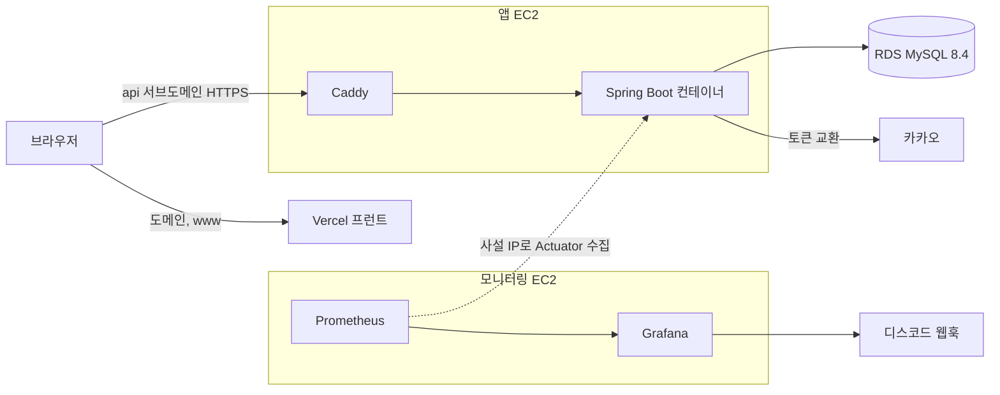
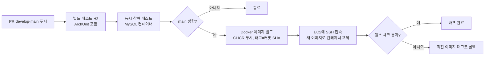

# AuDDum 테스트·배포 설계서

| 항목 | 내용 |
| --- | --- |
| 버전 | v1 |
| 작성일 | 2026-10-12 |
| 작성자 | 태풍 |
| 관련 문서 | [AuDDum 아키텍처 설계서](아키텍처.md), [AuDDum 인증·중복 참여 설계서](인증-중복-참여.md) |

## 요약

이 설계서는 테스트 전략과 배포 환경을 정한다. 확정: H2 테스트, MockMvcTester, EC2 한 대와 RDS, Vercel 프런트, 가비아 도메인, Flyway, 별도 모니터링 서버(Prometheus·Grafana), Caddy, GHCR, SSH 배포, `api` 서브도메인.

## 목차

1. [테스트 전략](#1-테스트-전략)
2. [배포 구성](#2-배포-구성)
3. [도메인·HTTPS·쿠키·CORS](#3-도메인https쿠키cors)
4. [CI/CD](#4-cicd)
5. [환경 설정과 비밀 값](#5-환경-설정과-비밀-값)
6. [운영](#6-운영)
7. [미정 항목](#7-미정-항목)

## 1. 테스트 전략

테스트는 설계에서 정한 책임 분리를 그대로 따라간다. 규칙은 도메인 객체에, 흐름과 트랜잭션은 서비스에, 응답은 controller에 둔다고 정했으므로 각 자리에서 따로 검증한다.

| 계층 | 대상 | 도구와 DB | 확인하는 것 |
| --- | --- | --- | --- |
| 도메인 단위 | `Poll`, `Member`, `Vote`, `Report` | JUnit, 스프링 없이 순수 자바 | 마감 판단, 상태 전이, 선택지 소속, 논리 삭제 규칙 |
| 서비스 통합 | Command·Query 서비스 | `@SpringBootTest` 또는 `@DataJpaTest`, H2 | 트랜잭션 경계, 유니크 제약, 동시 참여 처리, 재조회로 200·409 분기 |
| API | controller, 인증·인가 필터, 오류 응답 | `MockMvcTester`, H2 | 상태 코드, ProblemDetail 형식, 쿠키 발급, 회원 상태별 접근 범위 |
| 구조 | 패키지 의존 방향 | ArchUnit | 순환 의존 없음, 아키텍처 §2 다이어그램에 없는 도메인 의존 금지(support는 도메인에 의존하지 않음), 다른 도메인 repository(`infrastructure`) 직접 사용 금지(admin도 예외 없음), `@WebApi`는 `infrastructure`에 의존하지 않음, 역할 어노테이션은 맞는 패키지(`api`, `application`)에만 둠, 계층 의존은 한 방향(`api → application → domain`, `infrastructure → domain`)이고 역방향(`domain`·`application`·`infrastructure`가 바깥 계층에 의존)은 금지, `common` 패키지 금지 |

- 도메인 단위 테스트는 규칙을 도메인에 둔 이점이 가장 크게 드러나는 곳이다. 시각은 인자로 넘기므로 마감 경계를 시계 없이 확인할 수 있다.
- 우선순위는 참여(동시성·중복), 회원 상태·인가, 마감, 생성 검증 순이다. 관리자 기능은 정상 흐름과 권한 거절 위주로 확인한다.
- 테스트 커버리지 수치 목표는 정하지 않는다. 위 우선순위의 규칙이 빠짐없이 테스트되는지를 기준으로 한다.

**DB: H2를 쓰되 한계를 알고 간다**

테스트 DB는 H2(MySQL 모드)로 확정했다. 실제 운영 DB는 MySQL 8.4라 동작이 어긋날 수 있는 지점이 있어 미리 적는다.

| 차이 | 영향 | 대응 |
| --- | --- | --- |
| 격리 수준과 락 방식이 다르다(InnoDB는 기본 REPEATABLE READ) | 동시 참여 테스트가 H2에서 통과해도 MySQL에서 다르게 동작할 수 있다 | 아래 "실제 MySQL로 한 번 더 확인" |
| 유니크와 NULL, CHECK 제약의 세부 동작 | 회원·익명 신원 모델이 이 제약에 의존한다 | H2에서 동일한 제약을 걸고 위반 시나리오를 테스트한다 |
| 날짜 타입·정렬·문자열 비교 규칙 | 커서 페이징이나 정렬에서 차이가 날 수 있다 | 정렬과 커서는 내부 id(숫자) 기준이라 영향이 작다 |
| H2에 없는 MySQL 전용 문법 | 네이티브 쿼리를 쓰면 H2에서 실패 | 네이티브 쿼리를 피하고 JPQL과 생성 쿼리를 쓴다 |

**실제 MySQL로 한 번 더 확인 (제안)**

- 동시 참여 테스트 한 묶음만 GitHub Actions의 MySQL 서비스 컨테이너에서 돌린다. Testcontainers 없이 CI 설정만으로 되고 로컬에서는 제외할 수 있다.
- 처음에 이를 두지 않는 경우에도 첫 배포 뒤 실제 서버에서 같은 신원의 동시 요청을 한 번 보내 한 건만 저장되는지 확인한다.

**동시성 테스트 항목**

인증·중복 참여 설계서의 검증 항목을 그대로 쓴다. 같은 신원의 동시 요청이 1건만 저장되는지, 서로 다른 신원의 동시 참여가 득표 합계와 맞는지, 마감 경계, 저장 중 오류 롤백, 정지·탈퇴 회원 거절, 위조 쿠키, 리프레시 토큰 재사용을 확인한다.

## 2. 배포 구성

서버는 EC2 한 대이고 DB는 RDS로 분리한다. 프런트는 Vercel에 올린다. 확정된 선택이다. 인스턴스는 앱 EC2 t4g.small, 모니터링 EC2 t4g.small, RDS db.t4g.micro이고, 월 비용은 구현 단계에서 견적으로 확인한다.

| 구성 요소 | 역할 | 비고 |
| --- | --- | --- |
| Vercel | 프런트엔드 배포 | 도메인 연결, 프리뷰 배포는 로그인 쿠키가 붙지 않는다 |
| EC2 | Caddy와 Spring Boot 컨테이너 실행 | 서버 1대이므로 배포 중 짧은 중단이 생길 수 있다 |
| Caddy | HTTPS 종단, 인증서 자동 발급·갱신 | Secure 쿠키에 HTTPS가 필요하다 |
| Spring Boot | API 서버 | Docker 컨테이너로 실행 |
| RDS MySQL 8.4 | 모든 데이터 저장 | 단일 AZ, 자동 백업 사용 |
| 카카오 인증 서버 | 소셜 로그인 | 서버가 토큰 교환을 직접 한다 |

- RDS의 보안 그룹은 EC2에서 오는 연결만 허용하고 외부에서 직접 접속할 수 없게 한다.
- EC2는 80·443과 관리용 SSH만 열고, SSH는 허용한 IP로 제한한다.
- 모니터링은 앱 서버와 분리한 소형 EC2에서 하고(6장), 앱의 Actuator 포트는 그 서버에서만 접근하게 한다. Redis, 메시지 큐, 검색 엔진은 아키텍처 설계서대로 두지 않는다.

## 3. 도메인·HTTPS·쿠키·CORS

프런트와 API를 같은 사이트의 서브도메인으로 둔다. 도메인은 가비아에서 구매하고, 서브도메인 이름은 api로 정했다.

| 이름 | 가리키는 곳 | 비고 |
| --- | --- | --- |
| `example.com`, `www` | Vercel | 가비아 DNS에 Vercel이 안내하는 레코드를 등록 |
| `api` | EC2 고정 IP(A 레코드) | EC2에 Elastic IP를 붙인다 |

- HTTPS는 Caddy가 인증서를 자동 발급·갱신한다. 발급에는 80·443이 열려 있고 `api` 레코드가 EC2를 가리켜야 한다.
- 두 서브도메인이 같은 사이트라서 `SameSite=Lax` 쿠키가 프런트에서 보낸 API 요청에 붙는다. 쿠키는 `api` 호스트에만 발급하므로 Domain 속성은 두지 않는다.
- CORS는 프런트 origin(`https://도메인`, `https://www.도메인`)만 허용하고 자격 증명(쿠키)을 허용한다. 와일드카드는 쓰지 않는다. 쓰기 요청의 Origin 검사도 같은 목록을 쓴다.
- 카카오 개발자 콘솔의 리다이렉트 URI는 `https://api.도메인/login/oauth2/code/kakao`로 등록한다. 로컬 개발용 URI는 따로 등록한다.
- 로그인 후 이동할 주소는 프런트 도메인 허용 목록에 있는 것만 받는다.
- Vercel 프리뷰 배포(`*.vercel.app`)는 다른 사이트라서 로그인 쿠키가 붙지 않는다. 로그인이 필요한 확인은 운영 도메인이나 로컬에서 한다.

## 4. CI/CD

GitHub Actions로 구성한다. 도구는 GitHub Actions, GHCR, SSH 배포로 정했다.

1. PR과 develop·main 푸시: 빌드와 테스트(H2)를 실행한다. 브랜치 전략은 [개발 가이드](개발-가이드.md)의 git flow를 따른다. ArchUnit 구조 테스트도 여기에 포함된다.
2. 동시 참여 테스트 묶음은 MySQL 서비스 컨테이너에서 따로 돌린다.
3. main에 병합되면(`develop` 배포 PR 또는 hotfix) Docker 이미지를 만들어 레지스트리(GHCR)에 올린다.
4. EC2에 SSH로 접속해 새 이미지를 받아 컨테이너를 교체한다.
5. 헬스 체크가 통과하는지 확인하고, 실패하면 직전 이미지 태그로 되돌린다.

- 이미지 태그는 커밋 SHA로 붙여 되돌릴 대상을 분명히 한다.
- 배포용 SSH 키와 레지스트리 토큰은 GitHub Secrets에 둔다.
- 서버가 1대라서 교체 중 수 초의 중단이 생기며, 지금 규모에서는 감수한다.

## 5. 환경 설정과 비밀 값

- 프로파일은 `local`(compose의 로컬 MySQL)과 `prod`(RDS)로 나눈다. 테스트는 H2를 쓰고 `src/test/resources/application.yaml`로 설정한다. 파일 구성은 [개발 가이드](개발-가이드.md) 4장에 있다.
- `prod`에서는 Swagger UI와 `/v3/api-docs`를 끈다.
- 비밀 값은 코드와 git에 두지 않고 서버의 환경 변수 파일로 주입한다. 대상은 카카오 클라이언트 id·secret, JWT 서명 키, 익명 쿠키 HMAC 키, DB 비밀번호다.
- 서명 키 두 개는 서로 다른 값을 쓰고, 노출되면 교체한다. MVP는 키 하나로 운영하고 노출되면 교체한다(전원 재로그인). 무중단 교체는 이후에 본다.
- 운영 DB 스키마는 `ddl-auto`에 맡기지 않고 Flyway로 관리한다(확정). 마이그레이션은 앱 기동 시 자동 실행하고, 운영은 ddl-auto=validate로 두어 엔티티와 스키마가 어긋나면 기동을 실패시킨다. 이미 병합된 마이그레이션 파일은 고치지 않고 새 번호의 파일을 추가한다(협업 중인 로컬 DB의 체크섬 오류를 막는다). 되돌릴 때는 롤백 스크립트 없이 새 마이그레이션을 추가한다. 테스트 H2도 같은 마이그레이션 SQL로 스키마를 만들어 유니크·CHECK 제약 누락을 잡는다. H2에서 안 도는 MySQL 전용 문법은 쓰지 않고, 막히면 그 부분만 자동 생성으로 내린다.
- 시각은 KST로 저장하고, API는 KST 오프셋(+09:00)을 포함해 내려준다.

## 6. 운영

- 백업: RDS 자동 백업을 켜고 보관 기간은 7일이다.
- 로그: 토큰, 쿠키, 카카오 응답 원문은 남기지 않는다. 위조 익명 쿠키 시도와 리프레시 토큰 재사용 감지는 기록한다.
- 모니터링: 앱 서버와 분리한 소형 EC2에 Prometheus와 Grafana를 두고(로그가 필요하면 Loki 추가), 앱은 Actuator·Micrometer 지표만 노출한다. 수집은 같은 VPC의 사설 IP로 하고 Actuator 포트는 외부에 열지 않는다. 모니터링 서버가 죽으면 알림이 안 오므로 외부 업타임 체크를 알림용으로 따로 둔다. CloudWatch 기본 지표(RDS 연결 수 등)는 보조로 쓴다. 알림은 Grafana 알림을 디스코드 웹훅으로 받는다.
- 장애: 앱 컨테이너는 재시작 정책으로 복구하고, 문제가 있는 배포는 직전 이미지로 되돌린다. DB 복구는 RDS 백업 시점으로 한다.
- 단일 서버라 EC2 장애 시 서비스가 중단된다. 포트폴리오 규모에서 감수한다.

## 7. 미정 항목

- 약관·개인정보 동의 저장과 탈퇴 시 삭제 범위(개인정보 처리방침 단계에서 정한다).
